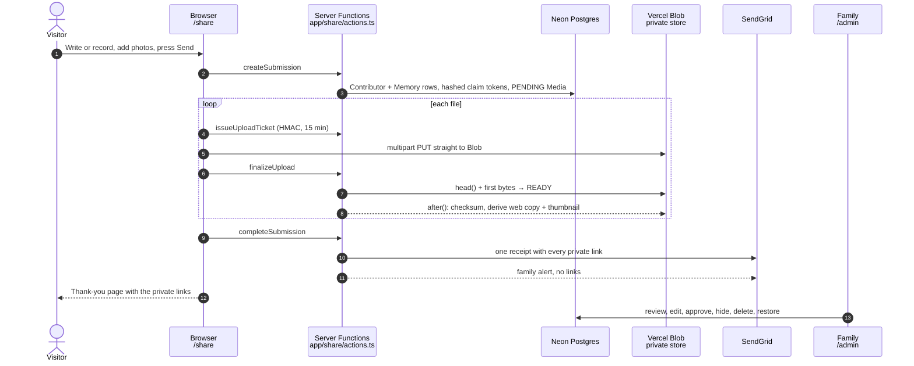
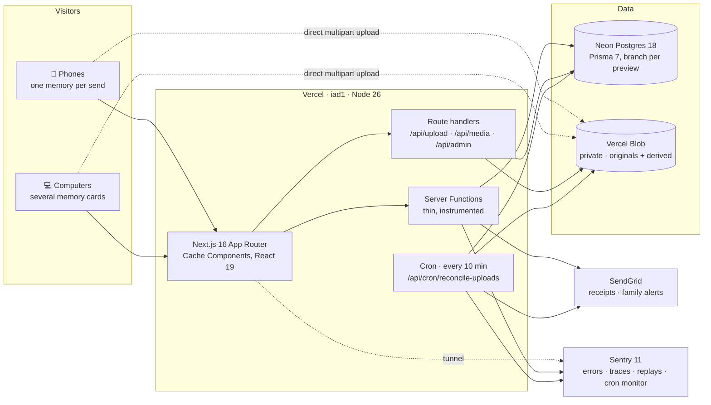
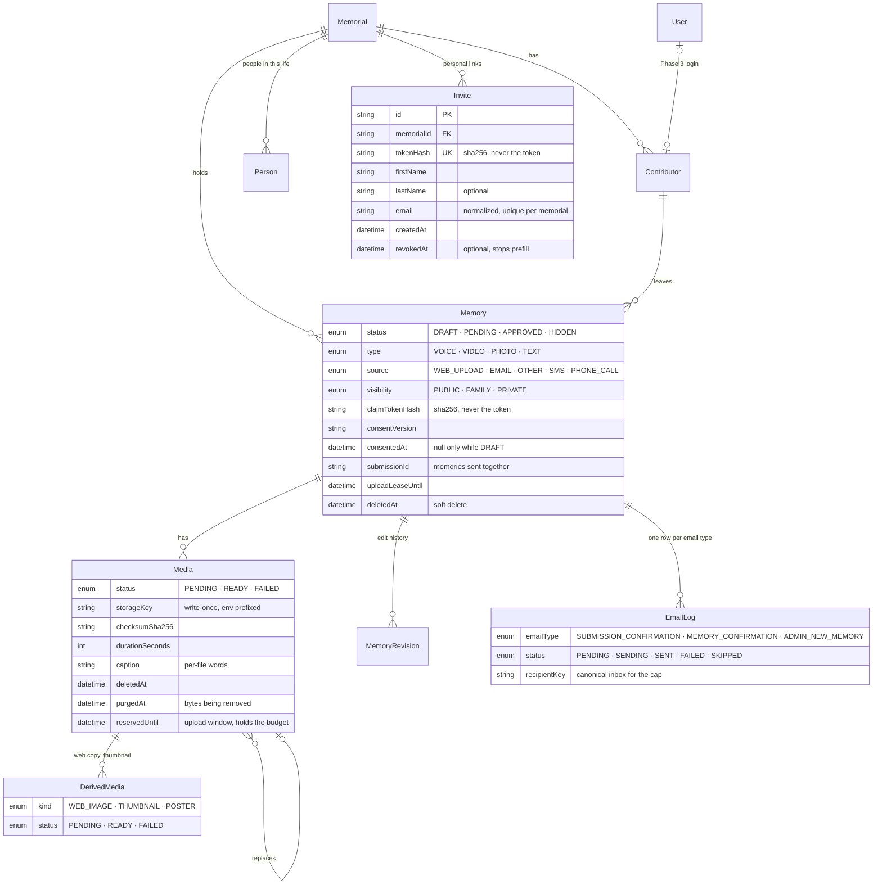

<div align="center">

# ❤️ jowray.com

**A place for family and friends to leave a memory of Jo: a voice, a photo, a video, or a few words.**

[](https://github.com/RobertdWray/jowray_com/actions/workflows/ci.yml)


**Live:** [www.jowray.com](https://www.jowray.com) · **Share a memory:** [/share](https://www.jowray.com/share) · **Obituary:** [/obituary](https://www.jowray.com/obituary) · **How it was built:** [/how-it-was-built](https://www.jowray.com/how-it-was-built)

</div>

---

## ✨ What this is, and why

Velma Josephine "Jo" Wray, née Hart: in the home page's own words, "teacher, quilter, bargain hunter, grandmother, and owner of a very cheeky giggle." When she died, her family wanted one place where everyone who knew her could leave a memory **while those memories were still fresh**, without creating an account, installing anything, or being good with computers. Most of the people sharing are over 70 and on an iPhone.

So Phase 1 of this site does one thing well: **it collects.** A visitor opens the share page, types or records a memory, adds photos or a video, and presses Send. They get a private link to come back and edit. The family gets an email. The See memories gallery, timeline and tag cloud are built and wait for the family to turn them on (`PUBLIC_MEMORIES_ENABLED`) after Rob's inventory sign-off; the rest of [Phase 2](#-roadmap) is still ahead.

The design brief is one line: *"A celebration of Jo, not a memorial of her."* Warm, bright, handmade, a little cheeky. Jo's maiden name was Hart, so **the heart is the mark**, always red and always hand-stitched. Body text is Atkinson Hyperlegible with a 17 px floor, touch targets are 56 px or larger, there are no modals (except the footer's Privacy note and the full-screen diagram view) and nothing hides behind hover. See [`design/DESIGN.md`](design/DESIGN.md).

The repository is also a record of **how it was built**: in three days, by Rob and a team of AI agents (mostly Claude), through 37 merged pull requests, each with a written plan, a premortem, a ledger of decisions and a review. See [How this was built](#-how-this-was-built).

---

## 🧭 How a memory travels

<!-- The three Mermaid diagrams in this file are also shown on /how-it-was-built. After editing one, run `npx tsx scripts/make-readme-diagrams.ts` and commit the result; __tests__/lib/readme-diagrams.test.ts fails until you do. -->



Every ten minutes a cron sweeps up whatever a closed tab left behind: stale uploads, missing checksums, unsent emails, derived copies, and files of memories deleted more than 30 days ago.

---

## 🏗️ Architecture



**Layering rule** (enforced by ESLint, see [`docs/code-layout.md`](docs/code-layout.md)):

```
app/  →  features/  →  services/  →  integrations/
          ▲ use cases     ▲ interfaces     ▲ vendor clients (Blob, SendGrid, sharp + libheif)
lib/ and server/ are leaves any layer may import. Nothing imports app/.
```

Pages and Server Functions call `features/`; route handlers may also call `services/`; nothing in `app/` touches a vendor SDK. Everything that reads a secret starts with `import "server-only"`.

---

## 📚 Features

Each feature has a one-to-two page document: what we built, why, the decisions Rob made and where they are recorded, the key files, the tests, and what is still open. Start at [`docs/features/README.md`](docs/features/README.md).

| | Feature | In one sentence |
|---|---|---|
| 🧵 | [See memories](docs/features/see-memories.md) | Explore approved memories shared with Everyone by place, time or tag, with one page per memory; built behind `PUBLIC_MEMORIES_ENABLED`, waiting for the family to turn the pages on. |
| 📝 | [Share form](docs/features/share-form.md) | One page, no account: name and email, one memory card on phones or several on a computer, place names offered from the photos' GPS, visibility asked once, a private link on the thank-you screen. |
| 🔗 | [Invite links](docs/features/invite-links.md) | Personal links prefill a greeting, name and email on the shared form, with read-only lookup, revocation and a private import ledger. |
| 📮 | [Correspondent harvest](docs/features/correspondent-harvest.md) | A local, read-only Python tool ranks the people the household's two Hotmail accounts corresponded with for the family to review, then builds the paced per-account Thunderbird mail-merge files that use each person's invite link. |
| 🎙️ | [Audio recording](docs/features/audio-recording.md) | Record in the browser with a live level meter, a "we're not hearing anything" warning with help for your device, and a silent-clip check before you send. |
| 🖼️ | [Media uploads](docs/features/media-uploads.md) | Files go straight to private storage on a signed ticket and are checked by their first bytes before they count as received; every photo (HEIC included) gets a web copy and a thumbnail with location data stripped, while the original's GPS is saved privately on the photo for Rob's tools; serving is metered per viewer and day; the claim page lets you add, replace or remove files. |
| 👨‍👩‍👧 | [Admin panel](docs/features/admin-panel.md) | The family's view of every memory: search, edit the words, approve or hide, delete with a 30-day undo, draft on someone's behalf. Entered once through a link; the secret never leaves the browser. |
| ✉️ | [Draft on behalf](docs/features/draft-on-behalf.md) | Turn a condolence email or card into a draft memory in the sender's own words (verbatim, or lightly reworded with their exact words kept in the history); it stays a private draft until the sender presses Share on their claim page or Rob records their agreed consent through the connector. |
| 🔌 | [MCP connector](docs/features/mcp.md) | Rob's Claude reads, drafts and edits memories, shares a draft on the sender's behalf, attaches original files from disk, and gets place names for a memory's photos, through twelve tools at `/api/mcp`, behind one bearer secret. Drafting works from any Claude surface; attaching files needs Cowork with the folder mounted or Claude Code on the Mac. A memory can also carry map coordinates for a named place, never a home. |
| 📬 | [Email and cron](docs/features/email-and-cron.md) | One fixed-content receipt per send with every private link and a card per file (never the visitor's words or pictures); a family alert with no links; per-inbox, hourly and daily caps; an idempotent delivery log; the ten-minute reconcile cron and the three-phase purge. |
| ↩️ | [Email replies and forwarding](docs/features/email-forwarding.md) | Reply to a site email and Cloudflare forwards it to the family inbox; the footer and receipts show the same family contact address. |
| 🔭 | [Sentry telemetry](docs/features/sentry-telemetry.md) | 100 % traces and unmasked replays for the alpha, with claim/invite tokens and upload tickets scrubbed from covered event fields by a linear-time scanner, proven by a test that runs the real SDK. |
| 📊 | [Vercel Web Analytics](docs/features/analytics.md) | Page-view analytics for Rob in Vercel, with claim/invite URLs scrubbed and unsafe routes dropped; live intake still needs checking. |
| 🔒 | [Privacy note](docs/features/privacy.md) | The footer's Privacy button opens Rob's note about what the family alpha records and links to how the site was built. |

---

## 🗃️ Data model

Twenty-one migrations, additive only. Raw claim and invite tokens are never stored in the database, only their SHA-256 hashes. No memory is hard-deleted; every edit that changes something is a `MemoryRevision`, and each memory keeps its first revision (which records consent) and the latest 199.



Full schema: [`prisma/schema.prisma`](prisma/schema.prisma). `WebhookEvent` (Blob upload callbacks, replayed by the cron), `EgressCounter` (bytes served per file and site-wide, and requests per viewer, each per UTC day) and `Person` (seeded with Jo; grows in Phase 2) are omitted from the picture.

---

## 🔐 Security and privacy, in one screen

| Concern | What we do |
|---|---|
| Who can edit a memory | Only someone holding its private link. The 32-byte token is hashed before storage; the cron rotates it when it has to email a link it never held. |
| Who can upload | Only a browser holding an HMAC upload ticket (15 min) for one pathname, one MIME type, one size. Bytes never pass through our servers. |
| Serving files | Only `READY` files are served. Originals are never served inline. Photos are shown from a derived copy with EXIF and GPS stripped; the original is a download. Inline views are 60-second presigned URLs. Each viewer's first request for a file each UTC day is charged against that file's daily allowance and a 50 GiB site-wide one, and each viewer has a daily request cap per file; past any of them a claim link gets `429` until the next UTC day. The family's admin views are counted, never refused. |
| Untrusted files | A file becomes `READY` only once its first bytes match an allowed type: a mislabel of the same kind is relabelled, anything unrecognised stays `FAILED` (`unrecognized_bytes`), is never served, and is kept rather than deleted on a 128-byte verdict. HEIC is decoded by libheif compiled to WebAssembly, in a worker thread with a heap cap, a deadline and a 30-megapixel ceiling; one decode runs at a time behind a short waiting line, and a long animated GIF becomes a still. |
| The family's admin page | Entered through a link whose secret sits in the URL fragment, which browsers never send to a server. The 30-day cookie carries an HMAC, never the secret. `Referrer-Policy: no-referrer`, `noindex`, Server Function argument logging off. |
| Email | Receipts are **fixed content**: the private links, a count of what was sent and a card per file by kind and length, never the visitor's words, filenames or pictures, so a receipt carries nothing a visitor wrote or uploaded. The family alert carries **no links at all**, so being told about a memory never hands anyone the power to edit it. Caps, decided under one advisory lock: 15 receipts a day per inbox (`+tag` and Gmail dots count as one), 60 an hour and 300 a day across all contributor email (held for the cron, not dropped), 20 alerts an hour, then one "arriving quickly" notice. |
| Logs | Pino redacts structured bearer values (including claim/invite tokens, share links and upload credentials) and protected headers. Contributor fields are allowed under R13 (2026-11-07); never put bearer values in free-text log messages. Logs carry ids, never Prisma rows or people. |
| Telemetry | **An honest caveat.** For the alpha, Rob authorized 100 % traces, unmasked session replays and contributor email as user context: *"The family has approved these aggressive tracking measures since it is an alpha, vibe-coded website and only family will be using it."* Claim tokens, invite tokens and share URLs, upload tickets and protected headers are still scrubbed from every event, span, log, breadcrumb and replay (open gaps: exception and event message text (`event.exception.values[].value`, `event.message`, `logentry`; [MCP plan follow-up 8.8](docs/plans/2026-11-06-mcp-endpoint.md)) and upper-case or short `/M/<token>` claim paths ([analytics follow-up F1](docs/features/analytics.md#known-gaps-and-follow-ups))), and [`__tests__/lib/sentry-envelope.test.ts`](__tests__/lib/sentry-envelope.test.ts) proves the covered paths against the real SDK. Accepted residuals include claim/invite page URLs inside replay DOM recordings and Vercel request logs, plus user-taken feedback screenshots ([Sentry telemetry](docs/features/sentry-telemetry.md)). Replay also records placeholders and `title`/`aria-label`; password inputs stay masked. Since 2026-11-08 the project's server-side Data Scrubber and Default Scrubbers are off (S1), so ordinary story text is no longer blanked; the SDK scrubber is the token control. The scrubber is a linear-time scanner, held byte-for-byte equal to its regex predecessor by a seeded differential test, and replaces any string over 256 KiB whole. Rob, 2026-11-05: sampling and replay stay at 100 % for the alpha. One commit ends the alpha settings ([plan §13](docs/plans/2026-11-04-sentry-full-telemetry.md)). Page views also go to [Vercel Web Analytics](docs/features/analytics.md) with claim/invite tokens and admin keys scrubbed from the URL and token-bearing unmatched paths dropped; visitors are told about the alpha's recording and logging in the footer [Privacy note](docs/features/privacy.md). |
| Abuse | Daily budgets on memories and ticketed bytes (allocated under one advisory lock, so concurrent sends cannot overshoot), a 4 GiB per-send declared-bytes cap, a 50 GiB total storage ceiling, and reservations that stop counting once their upload window closes. The cron retires an abandoned reservation only after its last token has expired and the store has no object for it. A save that changes nothing writes nothing, and a memory keeps at most 200 revisions. Add the email caps and egress allowance above and a Vercel WAF rate-limit rule on the public paths; the remaining dashboard limits are Rob's ([issue #43](https://github.com/RobertdWray/jowray_com/issues/43)). |
| Secrets | Never in git. Names and purposes are in [`docs/environment.md`](docs/environment.md); values live in `.env` (mode 600) and Vercel. Existing keys and their scopes are kept as they are (Rob, 2026-11-05). |

---

## 🚀 Getting started

**Prerequisites:** Node 26, npm. No database or `.env` is needed to run the checks; all three pass with `DATABASE_URL` unset.

```bash
npm ci
```

```bash
npm run validate      # next typegen + tsc --noEmit, then eslint
```

```bash
npm run test:run      # Vitest, ~1200 tests, Node environment
```

The Postgres integration suite (`__tests__/integration/`) runs in CI; locally it is skipped unless `TEST_DATABASE_URL` points at a throwaway Postgres.

```bash
npm run build:offline # the production build behind scripts/no-network.mjs (refuses any non-loopback socket)
```

To run the site locally you need the keys listed in [`docs/environment.md`](docs/environment.md) (names only there; ask Rob for values), then:

```bash
npm run dev
```

Database scripts: `db:migrate` (dev), `db:migrate:prod` (deploy), `db:seed`, `db:studio`. Fonts are self-hosted from Fontsource, so the build downloads nothing.

---

## 🛠️ Operations

- **Hosting:** Vercel, production branch `main`, Node 26, region `iad1`. Build command (`vercel.json`) is `prisma migrate deploy && prisma db seed && next build`, so migrations run at build time and must be additive.
- **Database:** Neon Postgres 18 through the Vercel integration. Every preview deployment gets its own `preview/<branch>` database branch; [`neon-cleanup.yml`](.github/workflows/neon-cleanup.yml) deletes it when the PR closes.
- **Cron:** `/api/cron/reconcile-uploads` every 10 minutes behind `CRON_SECRET`, with a Sentry monitor in production. Steps: (a0) repeat deletes of recently retired uploads for two hours, (a) stale uploads (given up only once the upload window has closed and `head()` finds no blob), (c) webhook replay, (d) email retries, including receipts held by the global caps, (e/e2/e3) missing receipts and alerts, (b) checksums, (f) purge after the 30-day grace, (f2) cancelled reservations, (g) derived images, (h) photo GPS (retries, and the backfill for photos stored before the feature). Details in [email-and-cron.md](docs/features/email-and-cron.md).
- **CI:** [`ci.yml`](.github/workflows/ci.yml) runs lint, type-check, the migrations and tests against a Postgres 18 service container (including the budget-concurrency suite), and the build, on every PR and push to `main`.
- **Domain:** `www.jowray.com` is primary; the apex redirects with a 308. Cloudflare DNS, DNS-only records, certificates from Vercel. [`docs/domain.md`](docs/domain.md).
- **Rollback floor:** once any memory has been deleted from the admin page, never roll production back below the admin-page merge; disable cron jobs first if you must. [`docs/admin.md`](docs/admin.md).
- **Launch checklist:** the sorted list of everything still open before the family launch is [issue #38](https://github.com/RobertdWray/jowray_com/issues/38); its evidence is [`docs/2026-11-04-debt-catalog.md`](docs/2026-11-04-debt-catalog.md).

---

## 🤝 How this was built

The site went from `create-next-app` to collecting real memories in three days ([PR #1](https://github.com/RobertdWray/jowray_com/pull/1) on 2026-11-02 to [PR #40](https://github.com/RobertdWray/jowray_com/pull/40) on 2026-11-04). Rob set direction and made every product call; AI agents, mostly Claude with OpenAI's Codex on some features, planned, built, reviewed and documented. The visitor-facing version of this story, with diagrams, is the site's own [/how-it-was-built](https://www.jowray.com/how-it-was-built) page. The rules of the road are in [`AGENTS.md`](AGENTS.md):

- 🌿 **Every change on a branch with a PR**, critical fixes included.
- 📋 **A plan before code.** Each feature has a plan in [`docs/plans/`](docs/plans/) with Rob's rulings quoted verbatim, a *"do not re-ask"* table, a premortem, a ledger of what shipped, and *"cost if wrong"* notes. The plans are frozen once executed; the feature docs summarise them.
- 🧪 **TDD on the critical paths:** upload tickets, finalize, confirmation email, cron.
- 🔍 **Review before merge:** a fresh-context whole-stack review plus a "Team Code Review" by two independent models, triaged into four buckets.
- 🚫 **No band-aids.** No `eslint-disable` without an all-caps YES from Rob. No submodules. No committed secrets. Fix the root cause.
- 📸 **Evidence.** Screenshots and accessibility trees for every visual change live in [`docs/plans/evidence/`](docs/plans/evidence/).

---

## 🗺️ Roadmap

### ✅ Phase 1 · Collect (shipped)

Share form with memory cards · in-browser recorder with silence detection · direct-to-Blob uploads with HEIC conversion and thumbnails · private claim pages with add, replace and remove · one receipt per send and a family alert · family admin page with approve, hide, delete and restore · drafting a memory on someone's behalf · full Sentry telemetry · reconcile cron with a three-phase purge.

### 🚦 Before the 100-person launch

Tracked in [issue #38](https://github.com/RobertdWray/jowray_com/issues/38): the remaining production environment values, a real iPhone and Android pass, the Vercel spend pause, and the wording of the thank-you screen's promise.

### 🔓 Before the repo goes public

The 2026-11-05 public-repo audit opened four issues: [#46](https://github.com/RobertdWray/jowray_com/issues/46) email, [#44](https://github.com/RobertdWray/jowray_com/issues/44) budgets and retention, [#45](https://github.com/RobertdWray/jowray_com/issues/45) media serving and processing, [#43](https://github.com/RobertdWray/jowray_com/issues/43) telemetry and platform. Their code fixes merged the same day ([#47](https://github.com/RobertdWray/jowray_com/pull/47) to [#50](https://github.com/RobertdWray/jowray_com/pull/50)); the issues stay open for Rob's follow-ups. #43 holds Rob's dashboard checklist (Vercel firewall rules, Sentry spike protection, a spend circuit breaker, the VoIP.ms sub-account) and the pre-flip steps, and closes last.

### 🔭 Phase 2 · Analyze and show

The gallery, timeline and tag cloud below are built behind `PUBLIC_MEMORIES_ENABLED` (off by default); launch waits for Rob's inventory sign-off. The remaining analysis work is future Phase 2. Source: [issue #37](https://github.com/RobertdWray/jowray_com/issues/37) and the original design notes in [`docs/Memorial Memories Site initial thinking.md`](docs/Memorial%20Memories%20Site%20initial%20thinking.md).

- 🏷️ **Tags for memories.** The tag cloud is built behind `PUBLIC_MEMORIES_ENABLED`, using family-edited `Memory.tags` on APPROVED + PUBLIC memories that are not deleted. Still planned: AI tagging, a `Tag` table per memorial with an origin (AI or family) and a merge pointer for cleanup; `MemoryTag` rows with a weight and a source (transcript, image, contributor, admin); tools for family admins to rename and merge tags.
- 🖼️ **A world-class gallery of every contributor's memories.** The gallery and single-memory pages are built behind `PUBLIC_MEMORIES_ENABLED`: media, words, who left them and roughly when. They read only APPROVED + PUBLIC memories that are not deleted, show derived photos and play eligible audio/video. A claim-link content edit sends an approved memory back to PENDING for review. A "by person" view is still planned.
- 📅 **A timeline.** Built behind `PUBLIC_MEMORIES_ENABLED`: memories ordered by their approximate date (`approxYear`, `approxMonth`, and the text as given, "Summer 1985"). Era clues from future analysis may fill gaps later.
- 🎙️ **Transcribe voice and video.** Not built yet. Speech-to-text for every recording and video audio track, stored with timestamps so a transcript can be quoted and searched. The design notes name ElevenLabs; [`docs/environment.md`](docs/environment.md) records the later decision to use Gemini for transcription and retire the ElevenLabs key.
- 👁️ **Describe photos and video frames.** Gemini vision: people, places, objects, mood and era clues, written to an `Analysis` row per media file per model run, so a better model later keeps both results.
- 👥 **People.** Grow the seeded `Person` table from mentions and faces; `MemoryPerson` with how (mentioned, pictured, contributor), a confidence, and a family confirmation flag.
- 🔍 **Search.** Keyword search over a `tsvector` of note, transcript, descriptions, tags and people, plus semantic search over `pgvector` embeddings for questions like "memories about fishing".
- ⏰ **The analysis job.** A Vercel Cron that picks up `analysisStatus = NOT_STARTED`, runs transcription, vision, tag extraction, embeddings and indexing, and reports to Sentry.
- 🎬 **Video posters.** The reserved `POSTER` derived kind: a browser-captured frame so video cards in the family alert and the gallery show a picture instead of a badge (receipts stay fixed content).
- 📣 **Close the loop with contributors.** The "your story is posted" email (`notifyWhenPosted` is already collected) and the weekly mailing list (`mailingListOptIn` is already collected). Fix the thank-you screen's date promise once these exist.
- 🧹 **Groundwork.** A Playwright browser harness against preview deployments, `build:offline` in CI, a one-page release and rollback sheet, and the Gemini billing and terms decision before any contributor media is sent to a model.

### 🔒 Phase 3 · Manage

Auth.js magic-link sign-in matched to contributors by verified email or phone; contributors edit or add to their own memories without a claim link; family admins approve, hide, tag and merge people with per-person attribution; and, if wanted, the deferred phone line and SMS intake (the VoIP.ms number is kept).

---

## 📖 Docs map

| Where | What |
|---|---|
| [`docs/features/`](docs/features/README.md) | One document per feature (start here) |
| [`docs/code-layout.md`](docs/code-layout.md) | Layers, import rules, Cache Components rule, Sentry policy, the three checks |
| [`docs/environment.md`](docs/environment.md) | Every environment variable name and purpose (never values) |
| [`docs/admin.md`](docs/admin.md) | Operator runbook for the family admin page: getting in, rotating the secret, what "deleted" means, rollback floor |
| [`docs/domain.md`](docs/domain.md) | DNS, redirects, certificates, SendGrid domain authentication, inbound email (Cloudflare Email Routing for memories@) |
| [`docs/consent/`](docs/consent/) | The consent sentence in force, by version |
| [`docs/skills/jowray-draft-memory/`](docs/skills/jowray-draft-memory/SKILL.md) | The Claude skill that drafts a memory from a condolence email |
| [`docs/plans/`](docs/plans/) | Frozen plans, ledgers and decisions for every feature; [`phase1-ledger.md`](docs/plans/phase1-ledger.md) is the Phase 1 record |
| [`docs/plans/evidence/`](docs/plans/evidence/) | Screenshots and checks from preview deployments |
| [`docs/plans/2026-11-02-bootstrap-report.md`](docs/plans/2026-11-02-bootstrap-report.md) | Resources, ids and decisions from day one (authoritative); [the runbook](docs/plans/2026-11-02-bootstrap.md) is the frozen snapshot |
| [`docs/2026-11-04-debt-catalog.md`](docs/2026-11-04-debt-catalog.md) | Every piece of leftover work, verified against `main`, rated for launch impact |
| [`docs/Memorial Memories Site initial thinking.md`](docs/Memorial%20Memories%20Site%20initial%20thinking.md) | The original three-phase system design |
| [`design/DESIGN.md`](design/DESIGN.md) | Look and feel: direction, colour, type, components, copy, accessibility |
| [`prisma/`](prisma/schema.prisma) | Schema, migrations, seed |
| [`scripts/`](scripts/) | Offline build guard, DNS setup, email previews, draft-memory CLI, recorder smoke test |
| [`AGENTS.md`](AGENTS.md) | The rules every agent (and person) follows in this repo |

<div align="center">

Made with ❤️ for Jo.

</div>
