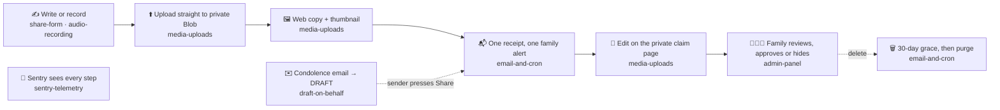

# Feature documentation

One document per feature of jowray.com: what we built, why, the decisions Rob made and where they are recorded, the key files, the tests and evidence, and what is still open. Each is one to two pages. The repository [README](../../README.md) is the overview; the plan docs under [`docs/plans/`](../plans/) are the frozen, detailed record each of these summarises. A new feature document starts from [`template.md`](./template.md), which holds the sections and the house rules.

| | Document | What it covers | Delivered by |
|---|---|---|---|
| 📝 | [Share form](./share-form.md) | The `/share` page: contributor fields, memory cards (one on phones, several on computers), place-name buttons from photo GPS (OpenStreetMap), visibility, consent sentence and preferences, drafts that survive a closed tab, the thank-you screen with private links. | [#7](https://github.com/RobertdWray/jowray_com/pull/7), [#11](https://github.com/RobertdWray/jowray_com/pull/11), [#16](https://github.com/RobertdWray/jowray_com/pull/16), [#28](https://github.com/RobertdWray/jowray_com/pull/28), [#29](https://github.com/RobertdWray/jowray_com/pull/29), [#35](https://github.com/RobertdWray/jowray_com/pull/35), [#36](https://github.com/RobertdWray/jowray_com/pull/36), [#49](https://github.com/RobertdWray/jowray_com/pull/49), [#50](https://github.com/RobertdWray/jowray_com/pull/50) |
| 🎙️ | [Audio recording](./audio-recording.md) | The in-browser recorder: live level meter, silence warning with per-device help, microphone picker, real durations, the silent-clip check before Send. | [#7](https://github.com/RobertdWray/jowray_com/pull/7), [#21](https://github.com/RobertdWray/jowray_com/pull/21), [#23](https://github.com/RobertdWray/jowray_com/pull/23), [#24](https://github.com/RobertdWray/jowray_com/pull/24), [#29](https://github.com/RobertdWray/jowray_com/pull/29) |
| 🖼️ | [Media uploads](./media-uploads.md) | Signed upload tickets, direct-to-Blob uploads, finalize with the byte check before `READY` and the cron backstop, upload budgets and reservations, derived web copies and thumbnails (HEIC via a WASM worker, one decode slot), each photo's GPS read from its original and kept private, the per-viewer egress allowance, the private claim page with add, replace and remove. | [#7](https://github.com/RobertdWray/jowray_com/pull/7), [#22](https://github.com/RobertdWray/jowray_com/pull/22), [#25](https://github.com/RobertdWray/jowray_com/pull/25), [#27](https://github.com/RobertdWray/jowray_com/pull/27), [#28](https://github.com/RobertdWray/jowray_com/pull/28), [#48](https://github.com/RobertdWray/jowray_com/pull/48), [#50](https://github.com/RobertdWray/jowray_com/pull/50) |
| 👨‍👩‍👧 | [Admin panel](./admin-panel.md) | The family's `/admin` page: entry link with the secret in the URL fragment, 30-day cookie, list and search, edit, approve or hide, delete with a 30-day undo, view-only media (counted for egress, never refused), revision history. | [#31](https://github.com/RobertdWray/jowray_com/pull/31), [#40](https://github.com/RobertdWray/jowray_com/pull/40), [#48](https://github.com/RobertdWray/jowray_com/pull/48) |
| ✉️ | [Draft on behalf](./draft-on-behalf.md) | Turning a condolence email, text or card into a DRAFT memory in the sender's own words (verbatim, or a light rewrite Rob approves, with the exact words kept in the revision history) through the admin API, the `jowray-draft-memory` skill and the admin form; the sender's Share is the consent. | [#30](https://github.com/RobertdWray/jowray_com/pull/30), [#31](https://github.com/RobertdWray/jowray_com/pull/31), [#51](https://github.com/RobertdWray/jowray_com/pull/51) |
| 🔌 | [MCP connector](./mcp.md) | The bearer-protected `/api/mcp` endpoint behind `MCP_API_SECRET`: nine admin tools (list, read, draft, set coordinates, edit, status, delete or restore, reissue a draft's link, suggest places from a memory's photos) so the `jowray-draft-memory` skill works from any Claude surface; optional WGS 84 coordinates on a memory, never shown on the site's pages. | [#60](https://github.com/RobertdWray/jowray_com/pull/60) |
| 📬 | [Email and cron](./email-and-cron.md) | The fixed-content receipt with every private link, the family alert with no links, the idempotent `deliver()` log with per-inbox, global and admin-alert caps, the SendGrid transport, the 10-minute reconcile cron and the three-phase purge. | [#7](https://github.com/RobertdWray/jowray_com/pull/7), [#20](https://github.com/RobertdWray/jowray_com/pull/20), [#26](https://github.com/RobertdWray/jowray_com/pull/26), [#28](https://github.com/RobertdWray/jowray_com/pull/28), [#31](https://github.com/RobertdWray/jowray_com/pull/31), [#49](https://github.com/RobertdWray/jowray_com/pull/49), [#50](https://github.com/RobertdWray/jowray_com/pull/50) |
| 🔭 | [Sentry telemetry](./sentry-telemetry.md) | Error tracking and full telemetry for the alpha: both inits, the handler-mode tunnel, the data policy and the linear-time scrubber that removes secrets regardless, identity, instrumented Server Functions, replays, feedback widget, cron check-ins, and how to end the alpha settings. | [#5](https://github.com/RobertdWray/jowray_com/pull/5), [#8](https://github.com/RobertdWray/jowray_com/pull/8), [#13](https://github.com/RobertdWray/jowray_com/pull/13), [#32](https://github.com/RobertdWray/jowray_com/pull/32), [#33](https://github.com/RobertdWray/jowray_com/pull/33), [#34](https://github.com/RobertdWray/jowray_com/pull/34), [#47](https://github.com/RobertdWray/jowray_com/pull/47) |

## One memory's life

The features meet in the life of a single memory. Each box names the document that owns that step.

## How to read the decision tables

Rob's product calls are recorded in the plan docs as he made them, often verbatim ("Rob, 2026-11-03: …", rulings R1–R10, amendments D1–D18, "do not re-ask" tables). Each feature document's **Key decisions (Rob)** table quotes those briefly and links to the plan section or PR. Where a decision was an agent's and Rob accepted it at approval or merge, the table says so. The transcripts of the planning sessions themselves are not in the repository; the plan docs are the record.

## Where the rest lives

- [`docs/code-layout.md`](../code-layout.md): layers, import rules, Cache Components rule, Sentry policy, the three checks.
- [`docs/environment.md`](../environment.md): every environment variable name and purpose, never values.
- [`docs/admin.md`](../admin.md): the operator runbook for the admin page.
- [`docs/2026-11-04-debt-catalog.md`](../2026-11-04-debt-catalog.md) and [issue #38](https://github.com/RobertdWray/jowray_com/issues/38): everything still open, rated for the family launch.
- [`design/DESIGN.md`](../../design/DESIGN.md): look and feel.
