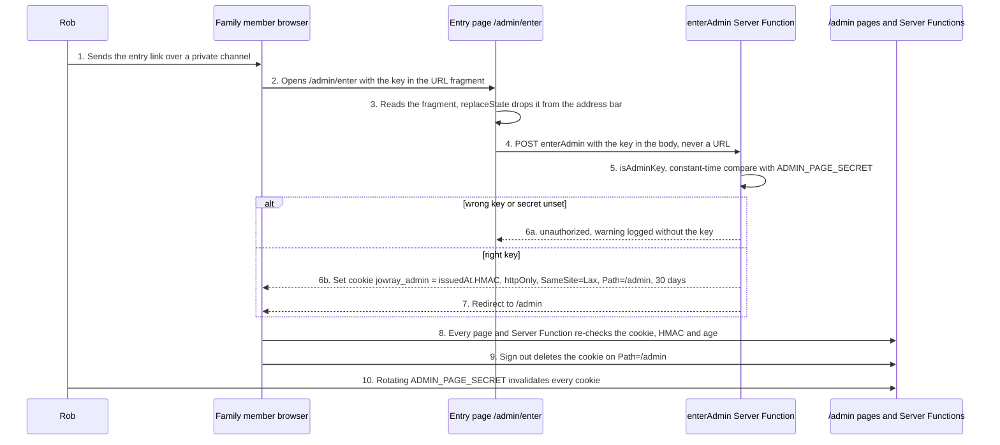

# Admin panel

The family's private page at `/admin` on jowray.com: every memory listed, editable, approvable, deletable and restorable, behind one shared entry link and a 30-day cookie.

**Status:** [PR #31](https://github.com/RobertdWray/jowray_com/pull/31) merged 2026-11-04 (merge commit `9ffdb8e`). On `main`, but not yet in use: the plan ledger records `ADMIN_PAGE_SECRET` in Production (L15), Standard Deployment Protection (L16), the production smoke (L17) and sending the link (L18) as todo, and [PR #40](https://github.com/RobertdWray/jowray_com/pull/40) (ledger, 2026-11-04) records `ADMIN_API_SECRET` and the alert emails only. With the secret unset every check fails closed and `/admin` shows the signed-out page.

## What we built

1. Rob sends each family member one link over a private channel: `/admin/enter` with the key in the URL fragment, which never reaches a server.
2. The entry page reads the key, drops it from the address bar with `history.replaceState` and posts it to the `enterAdmin` Server Function. A paste box covers a link whose fragment a messaging app stripped.
3. The server compares the key in constant time and sets the cookie `jowray_admin` (httpOnly, SameSite=Lax, Path=/admin, 30 days): a timestamp plus an HMAC of the secret, never the secret. The browser lands on `/admin`.
4. The list shows every memory newest first, 200 at a time, with status chips, a search over words, place, name and email, a Deleted toggle and "Showing 200 of N".
5. One memory shows its facts, a view-only gallery (through `/admin/media/[id]`), the revision history (newest 25) and the email log.
6. The edit form saves name, relationship, when, where, the words and visibility. Only changed fields are sent, with two version stamps; if someone saved first, a stale banner names what moved and the typed words survive. The email and the person's preferences cannot be edited.
7. Approve, Hide and Back to pending each write one ADMIN revision. Never from DRAFT: only the sender's Share leaves it. Approving publishes nothing yet.
8. Delete and Restore are a two-step inline confirm. A deleted memory leaves the family's view and its claim link stops working; it stays under the Deleted toggle.
9. "Draft for someone" makes a DRAFT from pasted words and an email and shows the private link the family sends by hand; "New link" rotates it. See [Draft on behalf](./draft-on-behalf.md).
10. Sign out deletes the cookie. Every page and Server Function re-checks the cookie itself; a replayed POST without it answers `unauthorized`.

## Why we built it

Before this page the family saw new memories only through the alert email and the database. PR #30 declared "no admin UI" a non-goal and left F2 ("Admin view of DRAFT rows: who was drafted, who pressed Share, nudge the rest") open. The plan ([§1](../plans/2026-11-04-admin-page.md)) is Rob's answer: an "MVP alpha for family" with no user tables, roles or Auth.js. The operator runbook is [admin.md](../admin.md); this page explains, that one instructs.

## Key decisions (Rob)

| Decision | Source |
|---|---|
| D1: "Entry link sets a cookie." httpOnly, 30 days; "Rotating the secret logs everyone out." Moving the key from `?key=` to the fragment is the agent's call, which Rob can veto. | [plan §1](../plans/2026-11-04-admin-page.md) |
| D2: separate `ADMIN_PAGE_SECRET`, so "a family leak does not expose the script/skill bearer". | [plan §1](../plans/2026-11-04-admin-page.md) |
| D3: scope is edit, status ("never from DRAFT"), soft-delete and restore, draft on behalf. | [plan §1](../plans/2026-11-04-admin-page.md) |
| D4: "Media is view-only in this alpha." | [plan §1](../plans/2026-11-04-admin-page.md) |
| D5: "No user tables, roles or Auth.js. Rob accepts the shared-secret risk." | [plan §1](../plans/2026-11-04-admin-page.md) |
| Email not editable: the cron emails a fresh claim link to whatever address a memory has, so "a typo would hand the edit capability to a stranger and kill the sender's link." Preferences are the person's own (PR #30 R6). Agent's reasoning, accepted at merge. | [plan §3.5](../plans/2026-11-04-admin-page.md) |
| 30-day grace and a durable `Media.purgedAt` mark before the first byte goes (review round 3: "a DB rollback cannot undo a storage delete"). Rollback floor: never below `9ffdb8e` once a memory has been deleted here. | [plan §3.6, §4.5, §7](../plans/2026-11-04-admin-page.md) |
| `sameSite: "lax"`, not strict (review G2): Strict "would land every emailed admin link on the signed-out page." Agent's call. | [plan §9](../plans/2026-11-04-admin-page.md) |
| Non-goals: no `?key=` fallback, no `proxy.ts`, no paging past 200, no approving a DRAFT, no hard delete, no reversal of a purge, no blocking Restore after 30 days. | [plan §10](../plans/2026-11-04-admin-page.md) |

## How it works

The secret reaches no request log, Referer or Sentry event: the fragment is not sent, `/admin/:path*` carries `Referrer-Policy: no-referrer` and `X-Robots-Tag`, `logging.serverFunctions` is off so the dev logger never prints the `enterAdmin` argument, and the Sentry scrub removes `key=` from queries and fragments. Two accepted residuals ([admin.md](../admin.md)): the browser history entry on the family member's device and Vercel's log line for `POST /admin/enter` (method and path only). Writes take the memory lock, then the contributor lock, re-read, compare versions and write one ADMIN revision.

**What Delete means for the family.** Delete sets `deletedAt`: the memory leaves the list, its claim page answers 404 and uploads stop, but nothing is removed. Restore within 30 days brings everything back. After 30 days the reconcile cron marks each file with `purgedAt`, flips it to FAILED and then deletes the bytes; a later Restore brings back the words, the page names the files that are gone, and the person can re-add them on their claim page. Nothing is ever hard-deleted. Mechanics: [Email and cron](./email-and-cron.md).

## Key files

| Path | Role |
|---|---|
| **app** | |
| `app/admin/layout.tsx` | noindex metadata, prefetch disabled, admin bar with Sign out |
| `app/admin/page.tsx`, `app/admin/memories/[id]/page.tsx`, `app/admin/new/page.tsx` | list, detail (read-only when deleted), draft form page |
| `app/admin/enter/page.tsx`, `app/admin/enter-form.tsx` | entry page; reads the fragment, offers the paste box |
| `app/admin/_session.ts`, `app/admin/actions.ts` | `hasAdminSession()`, the only cookie reader; the seven Server Functions (`enterAdmin`, `leaveAdmin`, `saveMemory`, `setStatus`, `setDeleted`, `createDraft`, `reissueLink`) |
| `app/admin/media/[id]/route.ts` | serves a file to a valid cookie; anything else gets the same 404 as a wrong token |
| `app/admin/memory-edit-form.tsx`, `app/admin/status-actions-client.tsx`, `app/admin/draft-form.tsx` | client forms: edit with stale banner; status and Delete/Restore buttons; draft on behalf |
| `app/admin/memory-detail.tsx`, `app/admin/media-gallery.tsx`, `app/admin/history.tsx`, `app/admin/admin-shell.tsx` and the other display components under `app/admin/` | detail, view-only gallery, revisions then the email log, 1 to 3 columns |
| `app/api/admin/` | the bearer-protected admin API used by the draft script, not by the page |
| **features** | |
| `features/admin/session.ts` | pure `mintAdminCookie`, `isAdminKey`, `isAdminCookie`, `adminCookieOptions` |
| `features/admin/list-memories.ts`, `features/admin/get-memory.ts` | page DTOs; never `claimTokenHash`, `blobUrl`, `storageKey` or `exif` |
| `features/admin/update-memory.ts`, `features/admin/set-status.ts`, `features/admin/set-deleted.ts`, `features/admin/create-draft.ts` | the four writes |
| `features/memories/lock.ts`, `features/media/serve-media.ts` | `lockMemory` then `lockContributor`; shared `serveMedia`, never a `purgedAt` row |
| **lib + server** | |
| `lib/validations/admin.ts` | input schemas; the edit schema is `.strict()`, so email and preferences are unknown keys |
| `server/config/env.ts`, `next.config.ts`, `lib/sentry/scrub.ts` | `adminPageSchema` (32+ characters, empty means unset); admin headers and `logging.serverFunctions: false`; `key=` scrubbing |
| **Prisma** | |
| `prisma/schema.prisma`, `prisma/migrations/20261104160000_media_purged_at` | `Media.purgedAt`, `Memory.deletedAt` |

## Tests and evidence

- `__tests__/features/admin-session.test.ts`, `__tests__/features/admin-memories.test.ts`, `__tests__/app/admin-actions.test.ts` (every Server Function refuses without the cookie), `__tests__/api/admin-media.test.ts`, `__tests__/lib/validations-admin.test.ts`, `__tests__/lib/sentry-scrub.test.ts`, `__tests__/lib/env.test.ts`, `__tests__/api/reconcile.test.ts` (purge cases C1–C6).
- Local walk: [evidence README](../plans/evidence/2026-11-admin-page/README.md), checks B1–B17 all passing on the Neon `dev` branch with throwaway secrets, 11 screenshots at 390, 1440 and 2560 px. Four review rounds in [plan §9](../plans/2026-11-04-admin-page.md). PR #31: `validate`, `test:run` (967 tests) and `build:offline` green.
- NOT RUN or not recorded: production smoke (L17), real device pass, secret rotation, the family's first use. Ledger L15–L18 unticked.

## Known gaps and follow-ups

Catalog ids from the [debt catalog](../2026-11-04-debt-catalog.md); section numbers from [issue #38](https://github.com/RobertdWray/jowray_com/issues/38).

- §1.1: M-A-05 (`ADMIN_PAGE_SECRET` in Production, "the one true blocker"), M-A-08 (production smoke), M-A-10 (send the link). §2.7: M-A-07 (Standard Protection), M-F-13 (request-log retention, A9).
- §2.10: M-C-18, the silent test recording is deleted on `/admin`, which means deleting its whole memory, since files are view-only here.
- §3.3: M-E-01 public header on admin pages (A1); M-E-02 no paging past 200 (A2); M-E-03 revisions say ADMIN, never who (A3, blocked by D5); M-E-04 media changes from admin (A4); M-E-05 deferred minors (no clock-skew tolerance on the cookie, whole view passed to the client form, rail filter resets, stale banner copy); M-E-06 withdraw a draft; M-F-02 Server Functions not wrapped with `instrumentedAction`; A5 nudge email; M-E-12 draft expiry (Rob's call).
- M-E-09: neither secret rotation has been run. M-E-14: every future lister must decide what to do with DRAFT. A8 (§3.1): the claim form can still overwrite an admin correction.
- The revision history shows the newest 25 revisions (`REVISION_TAKE` in `features/admin/get-memory.ts`). A skill draft saved as a light rewrite keeps the sender's exact words in its first revision's `before`, so after more than 24 later edits those words leave the page; they stay in the database, because the 200-revision cap (`MAX_REVISIONS_PER_MEMORY` in `features/memories/media-state.ts`) always keeps a memory's first revision. Low; [draft-skill plan §10 bucket 4](../plans/2026-11-05-draft-skill-rewrite-prompts.md).

## Related

- [Draft on behalf](./draft-on-behalf.md), [Email and cron](./email-and-cron.md), [Share form](./share-form.md), [Media uploads](./media-uploads.md), [Audio recording](./audio-recording.md), [Sentry telemetry](./sentry-telemetry.md)
- [admin page plan](../plans/2026-11-04-admin-page.md), [draft memory plan](../plans/2026-11-03-draft-memory-on-behalf.md), [Phase 1 ledger](../plans/phase1-ledger.md)
- [admin.md](../admin.md) (runbook: getting in, rotation, replay check), [code-layout.md](../code-layout.md), [environment.md](../environment.md)
