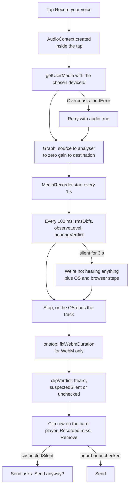

# Audio recording

The in-browser voice recorder on `/share`: a visitor taps once, talks, taps again, and the take becomes a playable clip on their memory card, with a live meter and a silence warning so nobody sends an empty file by accident.

**Status:** merged to `main` in [PR #7](https://github.com/RobertdWray/jowray_com/pull/7) (first recorder, 2026-11-03), [PR #21](https://github.com/RobertdWray/jowray_com/pull/21) (meter, silence warning, mic picker, help, durations, draft autosave, 2026-11-03), [PR #23](https://github.com/RobertdWray/jowray_com/pull/23) and [PR #24](https://github.com/RobertdWray/jowray_com/pull/24) (mic picker hotfixes, 2026-11-03) and [PR #29](https://github.com/RobertdWray/jowray_com/pull/29) (one recorder per form, take becomes a card row, 2026-11-04). Vercel deploys `main` on merge, so the code is on production; no production smoke or real-device check is recorded, and the ledger keeps `/share` unshared until the WAF gate is on.

## What we built

1. On a memory card the visitor taps **Record your voice**. The browser asks for the microphone.
2. While they talk, a canvas meter scrolls, a red dot pulses and a timer runs. A status line reads "Listening…", then "Hearing you" or "We're not hearing anything". Under Reduce Motion the meter is a static bar.
3. After about 3 seconds with nothing above −60 dBFS, a help box shows steps for their OS and browser. Recording never stops on its own; a phone call or screen lock shows "Recording paused by your phone".
4. On a computer with two or more inputs, a "Microphone settings" gear opens a picker with plain-language device names and a "Using: …" line. Phones never see the picker.
5. **Stop recording** turns the take into a row on that card: a player, "Recorded m:ss" and a two-step "Remove this recording".
6. Every clip carries a verdict. `heard` shows nothing extra. `suspectedSilent` adds "This recording sounds silent. Play it back before you send it." and Send becomes a second press, "Send anyway". `unchecked` says the clip could not be checked. A clip cut short by an error is kept and marked partial.
7. WebM clips get a duration header patched in, so the player has a real timeline. `durationSeconds` is stored on the `Media` row and shown on the claim page.
8. The typed words are autosaved to `localStorage`, so following "quit and reopen your browser" help does not lose the story.

## Why we built it

From the plan's Context: Rob recorded a test memory from his Mac and the row "landed as READY … **24 s of pure digital silence** (mean and peak −91 dBFS)". The old recorder "calls `getUserMedia({ audio: true })` with no device choice, no level feedback and no silence check … A contributor can talk for a minute and send the family a silent file without knowing." Two smaller defects sat on the same rows: Chrome's WebM had no duration header, so the player timeline was broken, and `durationSeconds` was never written.

Premortem P11 corrected the Context: the cause is **unconfirmed**. The likeliest causes on current Chrome are the macOS input volume at zero or an idle or virtual default input, so the silence help leads with input volume and "pick another microphone" before any permission setting.

## Key decisions (Rob)

| Decision | Source |
|---|---|
| Native `MediaRecorder`, canvas meter, device picker, per-platform help, `fix-webm-duration`; no wavesurfer. "Rob, 2026-11-03: 'let's do all these things'". | [plan, Decisions](../plans/2026-11-03-recorder-feedback.md) |
| Warn, never delete: "Nothing is ever discarded automatically; missing analysis is never evidence of silence." (Decision 3, revised after premortem P1.) | [plan, Decision 3](../plans/2026-11-03-recorder-feedback.md) |
| Autosave the typed fields so the "quit and reopen the browser" help cannot erase a story. (Decision 10, premortem P4.) | [plan, Decision 10](../plans/2026-11-03-recorder-feedback.md) |
| Injectable browser factories so lifecycle tests run in Node. (Decision 11, premortem P14.) | [plan, Decision 11](../plans/2026-11-03-recorder-feedback.md) |
| Premortem first, before any code. (Decision 9.) | [plan, Decision 9](../plans/2026-11-03-recorder-feedback.md) |
| Review round 1: "Rob chose buckets 1 + 2 in full." | [plan, Review round 1](../plans/2026-11-03-recorder-feedback.md) |
| No server-side silence check ("Rob chose warn-not-delete"); no IndexedDB autosave of the clip. | [plan, Parking lot](../plans/2026-11-03-recorder-feedback.md) |
| "recorder has no time cap and gains playback plus 'Remove recording'" (Rob, 2026-11-03). | [ledger, Task 11](../plans/phase1-ledger.md) |
| One form-level recorder; the take becomes a row on the card that started it. Agent decision (B4), accepted with the PR. | [share redesign](../plans/2026-11-03-share-redesign.md) |
| Picker hidden on iOS and Android ("the OS, not the page, chooses"), behind a gear on desktop; OS noise stripped from device names. Agent hotfixes, merged by Rob. | [PR #23](https://github.com/RobertdWray/jowray_com/pull/23), [PR #24](https://github.com/RobertdWray/jowray_com/pull/24) |

## How it works

Hot level data never enters React. `AudioRecorder` owns the stream, the recorder and the Web Audio graph, samples on `setInterval` (not `requestAnimationFrame`, which pauses in background tabs) and publishes an immutable snapshot through `useSyncExternalStore`. Phase changes go through the pure reducer in `lib/recorder-state.ts`, so double taps and OS-interrupted stops are unit-tested, and a session counter makes every late async continuation a no-op. `app/share/share-form.tsx` calls `useRecorder({ onClip })` once; a card's Record button starts the engine in the same click, `onClip` appends the row to that card, and every other capture control is disabled while a card records.

## Key files

| Path | Role |
|---|---|
| **app** | |
| `app/share/recorder.ts` | `AudioRecorder` engine and `pickRecordingType` (webm/opus, mp4, webm). |
| `app/share/use-recorder.ts` | `useRecorder({ onClip })`: device list, object URLs, help text, `showPicker`. |
| `app/share/recorder-panel-client.tsx` | Start/Stop button, gear and picker, silence box, verdict and error help. |
| `app/share/level-meter-client.tsx` | Canvas meter, static bar under reduced motion, `aria-live` status. |
| `app/share/share-form.tsx` | One recorder per form; the "Send anyway" confirmation; `durationSeconds` on file metadata. |
| `app/share/card-media-client.tsx` | The clip row: player, "Recorded m:ss", two-step remove. |
| `app/m/[claimToken]/media-list-client.tsx` | Shows the stored duration under the player. |
| **features** | |
| `features/memories/create-memory.ts` | `resolveFile` keeps `durationSeconds` for non-photos; `createPendingMediaRow` writes it. |
| `features/memories/create-submission.ts` | Calls those helpers for each file in a send. |
| `features/memories/claim.ts` | Selects `durationSeconds` for the claim page. |
| **lib** | |
| `lib/audio-level.ts` | `rmsDbfs`, `observeLevel`, `hearingVerdict`, `clipVerdict`, the thresholds. |
| `lib/recorder-state.ts` | Pure reducer: idle, requesting, recording, finishing, clip, error. |
| `lib/recorder-help.ts` | `problemFromError`, `detectPlatform`, `helpFor`; steps quoted from vendor support pages. |
| `lib/recording-devices.ts` | `audioInputsFor`, `shouldShowPicker`, `friendlyInputLabel`, `audioConstraintsFor`. |
| `lib/format-duration.ts`, `lib/share-draft.ts`, `lib/validations/memory.ts` | `durationSecondsFor`; draft v1 to v2 with 30-day TTL; `durationSeconds` 0 to 86 400. |
| **tests and scripts** | |
| `__tests__/app/recorder.test.ts`, `__tests__/stubs/browser-audio.ts` | Engine lifecycle tests with fakes. |
| `__tests__/lib/audio-level.test.ts`, `__tests__/lib/recorder-state.test.ts`, `__tests__/lib/recorder-help.test.ts`, `__tests__/lib/recording-devices.test.ts`, `__tests__/lib/format-duration.test.ts`, `__tests__/lib/share-draft.test.ts`, `__tests__/lib/validations-memory.test.ts` | Unit tests for the pure modules. |
| `scripts/recorder-smoke.mjs`, `scripts/fixtures/silence-1s.wav` | Headless Chromium smoke, hearing and silent cases. |
| **Prisma** | |
| `prisma/schema.prisma` | `Media.durationSeconds Int?`; the column already existed, no migration. |

## Tests and evidence

- Unit tests (Vitest, Node, no DOM): the seven `__tests__/lib/` files above and `__tests__/app/recorder.test.ts` (28 engine cases: cancel before grant, error then data then stop, double stop, OS stop, mute and unmute, review-round fixes).
- Plan Verification record (commit `a6839f2`): `validate`, `test:run` and `build:offline` PASS; headless smoke PASS for `--expect hearing` and `--expect silent` with the silence fixture.
- `docs/plans/evidence/2026-11-share-redesign/` ([README](../plans/evidence/2026-11-share-redesign/README.md)): the smoke re-run on card 1 after PR #29, `hearing-clip.png`, and a phone send with a fake-mic clip and two photos.
- **NOT RUN:** the physical device matrix (Mac Chrome with mic denied, headset picker, Mac Safari, iPhone Safari incl. screen lock, Android, Firefox, Windows) is marked "NOT RUN, needs Rob's devices" in the plan. No production smoke of the recorder is recorded. The hook and the canvas meter have no automated tests.

## Known gaps and follow-ups

- M-H-04 (issue #38 §1.2): recorder device matrix, folded into the phone pass M-H-03 (§1.2).
- M-C-16: silent-clip root cause unconfirmed; −60 dBFS is one tunable constant; no hook or canvas tests.
- M-C-17: `durationSeconds` is client-reported and display-only; picked files carry no duration.
- M-C-18 (§2.10): the silent test recording is still in production; delete it on `/admin` (deletes the whole memory).
- M-F-03 (§2.9): expected-path catches in `app/share/recorder.ts` teardown and the draft storage probe send noise to Sentry.
- M-C-11: in-page webcam recording (release 2) not started. M-C-12: no recorder on the claim page.

## Related

- [Media uploads](./media-uploads.md), [Share form](./share-form.md), [Sentry telemetry](./sentry-telemetry.md), [Admin panel](./admin-panel.md), [Draft on behalf](./draft-on-behalf.md), [Email and cron](./email-and-cron.md)
- [Recorder feedback plan](../plans/2026-11-03-recorder-feedback.md), [Share redesign plan](../plans/2026-11-03-share-redesign.md), [Phase 1 ledger](../plans/phase1-ledger.md), [Brand implementation plan](../plans/2026-11-03-brand-implementation.md)
- [Code layout](../code-layout.md), [Environment](../environment.md), [Admin](../admin.md)
