# Correspondent harvest and send list

A local Python tool that turns the household's downloaded Thunderbird mail into a ranked, family-reviewed list of the people Jo corresponded with. It then builds the paced, per-account send files for a Thunderbird mail merge. It runs only on Rob's Mac (`scripts/notify/rank_correspondents.py`), reads mail headers read-only, and writes everything to a private folder outside the repo.

**Status:** [PR #92](https://github.com/RobertdWray/jowray_com/pull/92) delivered the hardened harvester, its tests and the operator runbook [`docs/notify-friends.md`](../notify-friends.md); merged 2026-11-08 (`eba20e5`). Rob's original script went in unchanged first (`0039db4`) and was then hardened test-first. The invite links it joins come from [PR #91](https://github.com/RobertdWray/jowray_com/pull/91), merged and deployed 2026-11-08 ([Invite links](./invite-links.md)). Plan: [`docs/plans/2026-11-07-notify-correspondents.md`](../plans/2026-11-07-notify-correspondents.md) §7 and §10. A real harvest of both accounts ran on 2026-11-08; its outputs stay private. The family review (D4), the real `send-list`, the production import (D6), the Thunderbird setup (D7) and the dress rehearsal (D8) are still Rob's. Nothing has been scheduled or sent to any correspondent.

## What we built

1. **Harvest.** Rob quits Thunderbird and runs the harvester (no subcommand) over both accounts' `ImapMail/<server>` folders, with `--self` listing the two household addresses, primary first. It writes `correspondents.csv` (one row per person, best first, with a blank `notify` column), `mail.sqlite` (every header, for private SQL), and `evidence/household-names.txt` into `--out` (default `~/jo-mail-review`).
2. **Family review.** Rob and the family open `correspondents.csv` in Excel or Numbers, mark `notify`, fix first and last names and the sending account, and save a copy as `correspondents_reviewed.csv` in "CSV UTF-8".
3. **Send list.** `send-list` validates the marked rows and writes one plain `send_list.csv`: `email, first_name, last_name, name, account`.
4. **Invite links.** `scripts/import-invites.ts` creates a personal `/s/<token>` link for each row in production and records it in a private ledger, `invites.csv`. See [Invite links](./invite-links.md).
5. **Schedule (go-day only).** `schedule` joins the send list to the ledger and writes one merge file per account, `send_list_primary.csv` and `send_list_second.csv`, each row with its `share_url` and a `send_at` time.
6. **Send.** In Thunderbird, Mail Merge (Deliver Mode **Save As Draft**, At = `{{send_at}}`) creates scheduled drafts that the Send Later add-on holds until the operator releases them. The [runbook](../notify-friends.md) owns these steps, and the D8 rehearsal comes first.

## Why we built it

Jo Wray died on 2026-11-02. [Issue #59](https://github.com/RobertdWray/jowray_com/issues/59): "Rob wants to tell the people the household corresponded with, by email, with a link to the obituary and a personal link that opens the memory form already filled in with their name and email." The household used two Hotmail accounts for decades, so nobody could list from memory who Jo wrote to. The harvest gives the family a ranked list to review instead of a blank page, and the send files let each person hear from the address they knew, slowly enough to look like personal mail.

## Key decisions (Rob)

| Decision | Source |
|---|---|
| Stop line: everything but scheduling. "I don't want to start sending, but I'd like to get everything ready." (Rob, 2026-11-07). Later: "I would like to hit the final button before we send any emails to people." (Rob, 2026-11-08) | [plan §2 R1](../plans/2026-11-07-notify-correspondents.md) |
| R7: harden Rob's script, don't rewrite it. The baseline went in byte for byte, characterization tests came first, and reviewers read the whole file | plan §2 R7, R14 |
| R4: pace per account, about 10 a day each, random 30–90 minute gaps between 09:00 and 19:00 local, each account on its own clock | plan §2 R4 |
| Agent's call D8, accepted with the plan: console output is counts only; per-person lines need `--verbose`, and household display names go to a private evidence file | plan §2 D8 |
| Agent's call D24, accepted: the deterministic account attribution below, with an `account_basis` column so Rob can review the weak cases | plan §2 D24 |
| Agent's calls D10 and D19, accepted: Mail Merge **Save As Draft** with At = `{{send_at}}` (its "Send Later" Deliver Mode queues unscheduled mail in the Outbox), and Send Later "Check every # minutes" = 0 as the hold until a post-merge gate passes | plan §2 D10, D19; [runbook §4–§5](../notify-friends.md) |
| Declined in review round 1: skipping Trash/Deleted folders (deleted mail is still evidence of correspondence, and the family review is the filter) and a strict-parser capability probe | [PR #92 comment](https://github.com/RobertdWray/jowray_com/pull/92) |
| Declined in the plan: a TypeScript port, SendGrid or Gmail API sending, the Python suite in CI (CI is a required Node-only check; follow-up F1) | plan §16 |

## How it works

```mermaid
flowchart LR
    TB["Thunderbird mbox<br/>both accounts (read-only)"] --> R["rank<br/>headers only"]
    R --> C["correspondents.csv<br/>+ mail.sqlite"]
    C --> F["family review<br/>correspondents_reviewed.csv"]
    F --> S["send-list<br/>send_list.csv"]
    S --> I["import-invites.ts<br/>invites.csv ledger"]
    I --> SC["schedule (go-day)<br/>send_list_primary/second.csv"]
    SC --> MM["Mail Merge: Save As Draft<br/>Send Later hold"]
```

### Ranking

Every message adds weight to the people on it. Mail the household sent weighs 4 (just them), 3 (2–3 people), 1.5 (4–8), 0.75 (9–20) or 0.25 (more). Mail they sent weighs 1.5, 1, 0.5 or 0.15 by the number of To/Cc addresses, or 0.3 when the household was only Bcc'd. Weight halves every 10 years (`--half-life`), and two-way correspondence gets a 25% bonus. Several kinds of mail add nothing:
- bulk, list and automated mail (`List-*`, `Precedence`, `Auto-Submitted`, bulk-sender headers, `noreply@`-style addresses);
- Junk, Drafts, Outbox and Templates folders, which are skipped;
- a message stored in both accounts, which is counted once.

Addresses sharing a full display name are grouped as one person. The household's own addresses and display names are excluded automatically: every name used on household-sent mail becomes a household name. Someone the household never wrote to needs at least 2 personal messages (`--min-received`).

### Account attribution (D24)

Each message gets one of the `--self` accounts, with its basis, from the first rule that applies:
1. `from`: the household sent it from that account.
2. `to`: the account's address is in To. Ties go to the `--self` order.
3. `cc`: the account's address is in Cc.
4. `delivered`: the account appears in `Delivered-To` or `X-Original-To`.
5. `folder`: none of the above, so the account is inferred from the source folder.

A person's `account` is the one with the higher weighted score, ties going to the primary. Their `account_basis` is the strongest basis behind it, or `none` for address-book-only people.

### Contracts

| Command | Reads | Writes (all 0600, folders 0700) | Refuses |
|---|---|---|---|
| (default) rank | mail folders, optional `--exclude` and `--contacts` | `correspondents.csv` (UTF-8 with BOM, formula-guarded cells), `mail.sqlite`, `evidence/household-names.txt` | output inside a git work tree; a missing or unreadable mail source; symlinked outputs |
| `send-list` | the reviewed CSV, `--self` | `send_list.csv` (UTF-8, no BOM, LF line endings) | an unknown `notify` mark; a blank first name; an invalid email; an account not in `--self`; a household recipient; control characters in a field (all reported by rank only); `--gap`, `--hours` or `--start` ("use `schedule`") |
| `schedule` | `send_list.csv`, the ledger, `--self`, `--start` | `send_list_primary.csv`, `send_list_second.csv` (plus `share_url`, `send_at`), and an appended `schedule.log` | a start in the past; a missing or mismatched ledger header (`# target=<origin> memorial=<slug>`); a `share_url` outside `<target>/s/`; a row with no ledger entry |

Gmail spellings of one inbox collapse to the first-ranked row. Times stay inside the hours window and carry over to the next morning. Each account's clock uses its own seeded random number generator, and `schedule.log` records the seed and the local timezone.

### Invariants

- **Read-only, headers only:** mail files are opened `rb`; message bodies are never read.
- **Private outputs:** every write uses `O_NOFOLLOW`, goes to a temp file in the same folder, and is renamed into place. Nothing is written outside `--out`, including SQLite temp data, which is kept in memory.
- **Never exposed:** the console never prints a name, address, subject or absolute path without `--verbose`. Errors refer to ranks or row numbers. The outputs never enter the repo, because the git guard refuses an `--out` inside a work tree.
- **Standard library only;** runs on Python 3.9 (macOS's `/usr/bin/python3`) and 3.11.

## Operations and rollback

None on the site: the tool has no secrets, switches or deployed parts. The importer it hands over to uses `ADMIN_API_SECRET` and `MEMORIAL_SLUG` ([`docs/environment.md`](../environment.md)), and its operation is in [Invite links](./invite-links.md#operations-and-rollback). All operator steps, commands, the Thunderbird settings, the emergency stop (Send Later "Check every" back to 0) and the go-day order are in the runbook [`docs/notify-friends.md`](../notify-friends.md). Private values live in `~/jo-mail-review/notify.env` (0600), never in the repo. Rollback is reverting the scripts by PR. The outputs are private files Rob can delete.

## Key files

| Path | Role |
|---|---|
| **scripts and docs** | |
| `scripts/notify/rank_correspondents.py` | The harvester: rank (default), `send-list`, `schedule` |
| `docs/notify-friends.md` | Operator runbook: D1–D9, Thunderbird setup, rehearsal, go-day, emergency stop |
| `scripts/import-invites.ts` | The importer between `send-list` and `schedule` ([Invite links](./invite-links.md)) |
| **tests** | |
| `scripts/notify/test_rank_correspondents.py` | `unittest` suite: characterization of the baseline, then the hardened behaviour |
| **Prisma** | none (the `Invite` model belongs to [Invite links](./invite-links.md)) |

## Tests and evidence

- **Characterization first:** 62 tests pinned the unchanged baseline on Python 3.9 and 3.11 before any change. Six baseline quirks were pinned, for example ", Jr." becoming a first name.
- **At merge (`20ab232`), 126 tests** cover name parsing, every attribution branch and its tie rule, scoring, `send-list` refusals and Excel "CSV UTF-8" quirks, and `schedule` windows, gaps, carry-over and ledger refusals. They also cover symlink and atomic-write safety, refusal of unreadable sources, and counts-only console output on success and error paths. They run with `python3 -m unittest discover -s scripts/notify -p "test_*.py"` and the same under `/usr/bin/python3`; both passed, and so did `npm run validate`.
- **Reviews:** a fresh Opus review of the whole file before acceptance (3 rounds); one Team Code Review round (George + Oscar) with its fixes; an Opus regression review that compared the old and new head on the same synthetic fixtures: "no serious regressions".
- **CI:** `ci` passed on PR #92, but it runs the Node checks only; the Python suite is not in CI (F1).
- **Real data (2026-11-08):** two harvests of both accounts, plus the merged candidate into a separate private folder, gave identical counts, finished in under a minute, and printed counts only. The counts and outputs are private.
- **NOT RUN:** the family review, `send-list` and `schedule` on the real reviewed list, the production import (D6), the Thunderbird add-ons and settings (D7) and the D8 dress rehearsal.

## Known gaps and follow-ups

- F1 (low): the Python suite is not in CI.
- F9 (medium): a go-day campaign journal (merged, scheduled, sent, failed, unknown per row) before any re-merge.
- F10 (medium): an overdue-message reconciliation procedure for when Send Later's late-limit warning fires.
- F15 (low): SIGTERM or SIGHUP during a harvest leaves hidden 0600 temp files in `--out`.
- F16 (low): a dangling symlink or unreadable dot-folder under a mail source aborts the harvest with a generic message. Rob's Thunderbird folders had none on 2026-11-08.
- F17 (low): refusing a symlinked `--out` is untested and not in the runbook.
- F18 (low): plan §7.1 says Python 3.9 lacks `getaddresses(strict=)`, but macOS's 3.9.6 has the backport. Code and tests cover both paths.
- The harvester's own `--help` epilog still suggests `send-list correspondents.csv`. The runbook's command, with the reviewed copy and `--self`, is the one to use.

## Related

[Invite links](./invite-links.md) · [`docs/notify-friends.md`](../notify-friends.md) (runbook) · [notify plan](../plans/2026-11-07-notify-correspondents.md) and its [public-safe evidence](../plans/evidence/2026-11-notify/post-merge.md) · [issue #59](https://github.com/RobertdWray/jowray_com/issues/59) · [Privacy note](./privacy.md) · [`docs/environment.md`](../environment.md) · [`docs/code-layout.md`](../code-layout.md)
