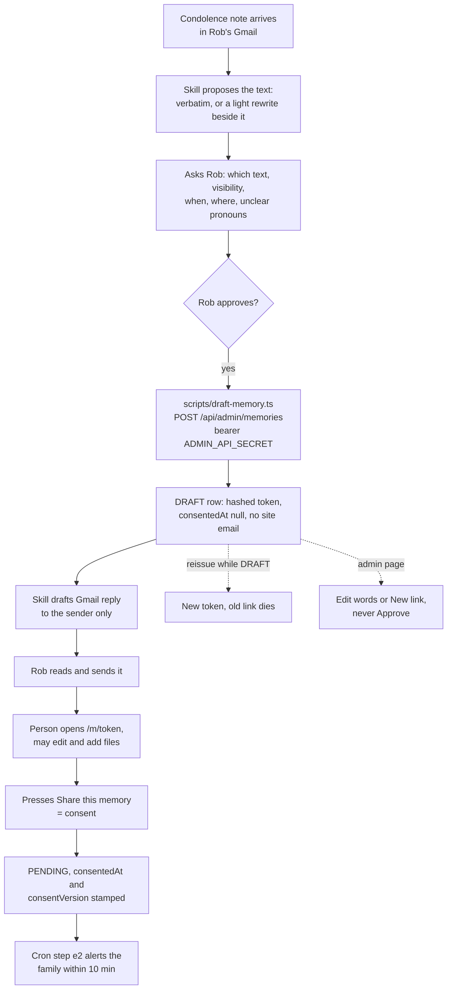

# Draft on behalf

When a condolence email, text or card holds a memory of Jo, the family can save the sender's own words as a DRAFT memory and send them a private link. It leaves DRAFT only when that person presses **Share this memory** or, on Rob's explicit word that the sender agreed, the [MCP connector's `share_draft`](./mcp.md) records consent on their behalf.

**Status:** [PR #30](https://github.com/RobertdWray/jowray_com/pull/30) (DRAFT status, admin API, script, skill; merged 2026-11-04), [PR #31](https://github.com/RobertdWray/jowray_com/pull/31) (admin-page draft form and New link; merged 2026-11-04), [PR #40](https://github.com/RobertdWray/jowray_com/pull/40) (ledger: `ADMIN_API_SECRET` set; merged 2026-11-04), [PR #51](https://github.com/RobertdWray/jowray_com/pull/51) (verbatim-or-light-rewrite choice, prompts for when/where/relationship/visibility, `originalNote` in the revision and the `originalNoteRecorded` echo; 2026-11-05), [PR #60](https://github.com/RobertdWray/jowray_com/pull/60) (the `jowray` MCP connector at `/api/mcp` behind `MCP_API_SECRET`, so the skill saves from any Claude surface; optional memory coordinates; plan `docs/plans/2026-11-06-mcp-endpoint.md`). Deployed: the ledger records `ADMIN_API_SECRET` set in Production on 2026-11-04 and the admin API probed on the live site (401 / 401 / 400). `CONSENT_VERSION=2026-11-v2` is not set yet, and the first two real drafts have not been run.

## What we built

1. A condolence note sits in Rob's Gmail. Rob runs the `jowray-draft-memory` skill (in the repo, symlinked into `~/.claude/skills`, `disable-model-invocation: true` so a chat that mentions Jo can never write to production by accident).
2. The skill's preflight stops unless the checkout's script and skill match `origin/main`. It finds the sender's message and proposes the **verbatim** cut: whole paragraphs about Jo, with only non-memory lines dropped (greetings, sign-offs, signatures, standalone condolence lines) and hard-wrapped lines joined. When the cut still reads as a letter to the family, it shows a **light rewrite** beside it with a change list ("dropped 'I was so sorry to hear about your mom.'; your mom → Jo"). Removing a condolence sentence that sits inside a memory paragraph is the rewrite's job, never the cut's. It then asks Rob, in one prompt, which text to save, who may see it (PUBLIC / FAMILY / PRIVATE), roughly when and where (or leave blank, or ask the sender in the reply), and resolves any unclear pronoun; names come from the obituary, never from a fixed substitution. Nothing is saved without an answered question (since 2026-11-05).
3. With the `jowray` connector (since PR #60; see [MCP connector](./mcp.md)), the skill calls the MCP tool `draft_memory` with the same object (plus optional `coordinates` for the named place) and the server derives `source` and `sourceRef` through `lib/source-input.ts`; `get_memory`, `reissue_claim_link` and `update_memory` serve the 409 branch. Without the connector, on Rob's Mac, the skill writes a JSON input with a `sourceInput` (gmail, sms or other) to the scratchpad and runs `scripts/draft-memory.ts --prod`. The script derives `source` and `sourceRef` through `lib/source-ref.ts` and posts to `POST /api/admin/memories` with the `ADMIN_API_SECRET` bearer. No default target (`--prod` or `ADMIN_API_URL`, never both), http only to loopback, redirects refused, the secret redacted from every output line.
4. `draftMemory` runs one transaction: duplicate check on the unique `sourceRef`, then the daily budget, then a Contributor (`contactOptIn: false`), a Memory with `status: DRAFT`, `consentedAt: null` and a hashed claim token, and an ADMIN revision. For a rewrite the revision's `before` is `{ note: <verbatim excerpt> }`, so History shows the sender's exact words → the saved text. Answers: 200 with the link and `originalNoteRecorded` (the script prints `originalNote: recorded`, which the skill checks so a rewrite can never lose its original against an older build; an `originalNote` equal to `note` is a 400, because that is a verbatim save), 409 `duplicate` with the existing id and status, 400, 429.
5. The skill drafts Rob's Gmail reply to the sender only (no cc or bcc; it reads the draft back to check) with the claim link. Its saved line follows what the row holds: "in your own words" for a verbatim save, "I trimmed your note lightly…" for a rewrite. After a 409 (`duplicate`), the skill first reads the existing draft with `get_memory` (without the connector, Rob reads it on `/admin`), before anything else, and a rewrite whose original was not recorded blocks the reply. Rob sends the reply himself. The site never emails the link.
6. The person opens `/m/<token>`. A DRAFT shows "A memory of Jo, in your words", the file control above the form, both preference boxes ticked, and one button: **Share this memory**.
7. The sender's Share, under the memory lock, moves DRAFT to PENDING, stamps `consentedAt` and `consentVersion`, and records the two preferences. A second press never re-stamps. An edit without Share leaves a DRAFT and cannot set preferences. On Rob's explicit instruction that the sender agreed, `share_draft` moves a DRAFT to PENDING or APPROVED, as Rob chooses per call, in one transaction under the memory lock. It writes the same consent stamp and appends one ADMIN revision: `before { status: DRAFT, consentedAt: null }` → `after { status, consentedAt }`. No consent note, no new column. It leaves `contactOptIn`, `mailingListOptIn` and `notifyWhenPosted` unchanged and the claim link working. This is MCP connector only; the admin page has no button for it (follow-up F5). APPROVED publishes nothing public yet (follow-up F1).
8. The admin page can also draft (`/admin/new`): browser drafts are always `source: OTHER` with `otherSourceRef(email, note)`, since a form has no Gmail message id. **New link** on a DRAFT, or `--reissue`, rotates the token; any link already sent stops working. Admins may edit a DRAFT's words but not approve it on the admin page; recording the sender's agreed consent is the connector's `share_draft` (item 7).
9. Drafted memories never get the site's confirmation, before or after either share path, and no admin alert fires while DRAFT. After the sender's own Share, cron step (e2) alerts the family within one ten-minute run, dated by `consentedAt`. In the same transaction as `share_draft`, a terminal `EmailLog` row (`ADMIN_NEW_MEMORY`, `SKIPPED`, reason `admin_shared`) prevents the family-admin alert for that memory forever, including after later activity by the sender.

## Why we built it

The plan's context: "Condolence notes are arriving in Rob's Gmail with real memories of Jo inside them. jowray.com already has a `Memory` row with a hashed claim token, a `/m/[claimToken]` page where a person edits their words and adds files, and an upload pipeline. Missing: a way for the family admin to create a memory **on a sender's behalf**, and a skill that drives it end to end" ([plan §3](../plans/2026-11-03-draft-memory-on-behalf.md)).

The sender's Share is the consent because "the person never performed an act of sharing before that"; `share_draft` records the sender's agreed consent on Rob's explicit instruction. Drafts get no site email because the confirmation's "stored exactly as you sent it" is false for an excerpt, and the cron's token rotation "would kill the link Rob sent" (plan §1, §3.5).

## Key decisions (Rob)

| Decision | Source |
|---|---|
| "Rob sends the link himself from Gmail... The site never emails the link." (Rob, 2026-11-03) | [plan §1](../plans/2026-11-03-draft-memory-on-behalf.md) |
| "The memory text is a verbatim excerpt... Claude proposes the cut, Rob approves before anything is saved." (Rob, 2026-11-03) | [plan §1](../plans/2026-11-03-draft-memory-on-behalf.md) |
| Amended: verbatim *or* a light rewrite, Rob's choice per memory; "as light and as surgical as possible to have the memory make sense on a shared family website"; the verbatim excerpt is kept in the ADMIN revision (`originalNote`); the skill prompts for when, where, relationship and visibility (Rob, 2026-11-05) | [plan 2026-11-05 §1](../plans/2026-11-05-draft-skill-rewrite-prompts.md) |
| "An admin API on the site (bearer secret)... No production DB credentials in the skill." "An email address is required to draft." Quality over speed. (Rob, 2026-11-03) | [plan §1](../plans/2026-11-03-draft-memory-on-behalf.md) |
| Agent's calls, accepted at approval ("go build this plan", 2026-11-04): the DRAFT status; the sender's Share = consent; drafts never get site email; reissue is deliberate revocation; one button on the page; roll forward only once a DRAFT exists | [plan §1, §2](../plans/2026-11-03-draft-memory-on-behalf.md) |
| Review buckets 1 and 2 in scope, including the CHECK constraint (Rob, 2026-11-04); merge "if no serious regressions" | [plan §8.1, §2](../plans/2026-11-03-draft-memory-on-behalf.md) |
| PR #30 build rulings (agent): R1 no request-path alert on the sender's Share, the cron covers it; R2 predicates in `site-email.ts`; R3 builders in `lib/source-ref.ts`; R5 one shared `_auth.ts`; R6 the sender's Share stores both preferences | [plan §8.2](../plans/2026-11-03-draft-memory-on-behalf.md) |
| Admin-page status changes "never from DRAFT"; the page's draft form reuses `draftMemory` (Rob, D3, 2026-11-04). Browser drafts are `OTHER` with no source select (agent's call) | [admin plan §1, §3.5](../plans/2026-11-04-admin-page.md) |
| Amended (Rob, 2026-11-06, R4–R7, including R4a; calls D8 and D11): on Rob's explicit word that the sender agreed, connector-only `share_draft` records the same consent stamp and an ADMIN revision, with no note or new column, and moves DRAFT to PENDING or APPROVED per call. APPROVED publishes nothing public yet. Preferences and the claim link stay unchanged; a terminal `admin_shared` email-log row permanently prevents the admin alert. | [plan §2, §7](../plans/2026-11-06-mcp-attach-media.md), [issue #71](https://github.com/RobertdWray/jowray_com/issues/71) |

## How it works

The raw token lives only in the link; the row holds its hash, so the site cannot tell whether a link Rob sent is still live (F15). Reissue is a conditional write on `status = DRAFT`, so a Share that wins the race cannot be undone, and the claim transactions re-read the token hash under the lock so a revoked link cannot share. The CHECK constraint `status = 'DRAFT' OR consentedAt IS NOT NULL` makes a non-DRAFT row without consent impossible, which is why `set-status.ts` refuses a DRAFT with code `draft`.

## Key files

| Path | Role |
|---|---|
| **app** | |
| `app/api/admin/_auth.ts` | Bearer check, fail-closed, constant time |
| `app/api/admin/memories/route.ts`, `app/api/admin/memories/[id]/claim-link/route.ts` | Draft; reissue a DRAFT's link |
| `app/m/[claimToken]/page.tsx`, `app/m/[claimToken]/claim-form.tsx` | DRAFT heading, prefilled boxes, the single Share button |
| `app/admin/new/page.tsx`, `app/admin/draft-form.tsx`, `app/admin/actions.ts` | Admin draft form, New link, cookie-checked Server Functions |
| **features** | |
| `features/memories/draft-memory.ts` | `draftMemory`, `reissueDraftClaimLink` |
| `features/memories/claim.ts` | The Share transition and the preference rule |
| `features/memories/site-email.ts` | Email and alert predicates with their Prisma `where` fragments |
| `features/admin/create-draft.ts`, `features/admin/set-status.ts` | Browser drafts as `OTHER`; refuses status changes from DRAFT |
| `features/admin/share-draft.ts` | `shareDraftAsAdmin`: consent stamp, ADMIN revision and the terminal `admin_shared` alert row in one transaction |
| `app/api/cron/reconcile-uploads/route.ts` | Step (e2) alerts shared drafts without the 30-minute wait |
| **services** | |
| `services/email/index.ts` | `suppressAdminAlertForDraftShare`, `TERMINAL_SKIP_REASONS` |
| **lib + scripts** | |
| `lib/source-ref.ts`, `lib/validations/memory.ts` | `sourceRef` builders; draft schema and the source to prefix refine |
| `lib/source-input.ts`, `app/api/mcp/route.ts`, `app/api/mcp/tools.ts` | The shared `sourceInput` derivation; the MCP connector's route and its tools (eight from PR #60, plus `suggest_places`) |
| `scripts/draft-memory.ts`, `docs/skills/jowray-draft-memory/SKILL.md` | The script and the skill |
| **tests** | |
| `__tests__/features/draft-memory.test.ts`, `__tests__/api/admin-memories.test.ts` | Draft, duplicate, P2002 race, budget, reissue, a rewrite's `before.note` and `originalNoteRecorded`; route codes and the echo |
| `__tests__/lib/source-ref.test.ts`, `__tests__/scripts/draft-memory.test.ts` | Builders and canonicalisation; target, redirects, redaction, the `originalNote:` output line |
| `__tests__/features/claim.test.ts`, `__tests__/features/confirm.test.ts`, `__tests__/features/site-email.test.ts`, `__tests__/features/notify-admins.test.ts`, `__tests__/features/admin-memories.test.ts` | Share stamps consent once; drafts skipped by email and alert; admin refuses DRAFT |
| `__tests__/features/share-draft.test.ts`, `__tests__/integration/share-draft.test.ts` | On-behalf share to PENDING or APPROVED; consent stamp, ADMIN revision, terminal alert row and unchanged preferences; consent constraint and unique alert row in Postgres |
| **Prisma** | |
| `prisma/schema.prisma` | `MemoryStatus.DRAFT`, `MemorySource.EMAIL` / `OTHER`, nullable `consentedAt`, unique `sourceRef` |
| `prisma/migrations/20261104070000_draft_memories/migration.sql`, `prisma/migrations/20261104070100_consent_check/migration.sql` | Enum values, nullable consent, unique index; the CHECK constraint |

## Tests and evidence

- PR #30 records `npm run validate`, `npm run test:run` (898 tests) and `npm run build:offline` green with no `.env*` present.
- Plan §2 records the migrations applied to a Neon verification branch and a local walk: 401, 200, 409, DRAFT page rendered, photo added with no `EmailLog` row, Share to PENDING, reissue refused on a shared row, old link dead after reissue, cron leaving both tokens unchanged.
- Admin-page evidence ([README](../plans/evidence/2026-11-admin-page/README.md)): B7, B10 and B17 pass (no Approve on a DRAFT, New link kills the old link, Share moves it to PENDING, "Already drafted"), with `b7-new-link-1440.jpg`. PR #30 has no evidence directory of its own.
- Rewrite evidence ([README](../plans/evidence/2026-11-05-draft-skill/README.md)): a synthetic rewrite posted through the script to a local `next dev` on the Neon dev branch printed `originalNote: recorded`; the revision row and the admin History page show the sender's letter → the saved rewrite under `note`; fifteen role-played skill scenarios: ten first-round cases (verbatim, rewrite, replacement text, instruction, already-about-Jo, ask-the-sender, unclear pronoun, timed-out question, 409 with new choices, missing echo) and five re-tests after two tightening rounds.
- PR #51 records `npm run validate`, `npm run test:run` (1092 tests on the branch, 1191 once merged with #47–#49) and `npm run build:offline` green with no `.env*`, and one Team Code Review round (George and Oscar, seven findings, all applied; [plan 2026-11-05 §10.1](../plans/2026-11-05-draft-skill-rewrite-prompts.md)).
- NOT RUN: the first two real drafts (ledger unticked); `CONSENT_VERSION=2026-11-v2` in Production and `.env` (unticked); a real Gmail reply carrying a production link; `ADMIN_API_SECRET` rotation.

## Known gaps and follow-ups

- M-E-06 (F12): no withdraw route; a deleted DRAFT's `sourceRef` blocks a redraft with 409. Mitigation: edit the words on `/admin`.
- M-E-07 (F14): no `sameEmail` hint when a follow-up message makes a second draft.
- M-E-08 (F15): no way to verify a claim link without using it.
- M-E-09 (F16): `ADMIN_API_SECRET` rotation runbook; short version in `docs/environment.md`.
- M-E-10 (F11): the skill runs from a shared, often-stale checkout; the preflight guard is the interim.
- M-E-11 (F5): attachments are not ingested; the reply asks the sender to add the photo. Related: F13 `--attach`, F4 in-browser recorder on the claim page.
- M-E-12 (F10): expiry policy for drafts nobody shares; needs Rob.
- M-E-13: the first two real drafts and the connector-mailbox check; needs Rob's "run it for real".
- M-E-14: every future lister of memories must decide explicitly what to do with DRAFT.
- History on the admin page shows the newest 25 revisions (`features/admin/get-memory.ts`); a memory edited more than 24 times no longer shows its creation revision, and with it a rewritten draft's verbatim original, on the page (still in the database). Low; see plan 2026-11-05 §10 bucket 4.
- No admin control to copy a draft's original words apart from reading them in History. Low; same bucket.
- M-D-07 (F2 second half): no nudge email for unshared drafts.
- Accepted minors (plan §8.2): drafts count against the daily memory budget; no request-path alert on Share (R1).
- Launch tracking: [issue #38](https://github.com/RobertdWray/jowray_com/issues/38).

## Related

- [MCP connector](./mcp.md), [Admin panel](./admin-panel.md), [Email and cron](./email-and-cron.md), [Share form](./share-form.md), [Media uploads](./media-uploads.md), [Audio recording](./audio-recording.md), [Sentry telemetry](./sentry-telemetry.md)
- [Plan: draft a memory on someone's behalf](../plans/2026-11-03-draft-memory-on-behalf.md), [Plan: verbatim-or-rewrite choice and prompts](../plans/2026-11-05-draft-skill-rewrite-prompts.md) (with its [evidence](../plans/evidence/2026-11-05-draft-skill/README.md)), [Plan: family admin page](../plans/2026-11-04-admin-page.md), [the skill](../skills/jowray-draft-memory/SKILL.md), [debt catalog](../2026-11-04-debt-catalog.md)
- [Code layout](../code-layout.md), [Environment](../environment.md) (`ADMIN_API_SECRET`, `ADMIN_API_URL`, `CONSENT_VERSION`), [Admin runbook](../admin.md) ("Drafts")
