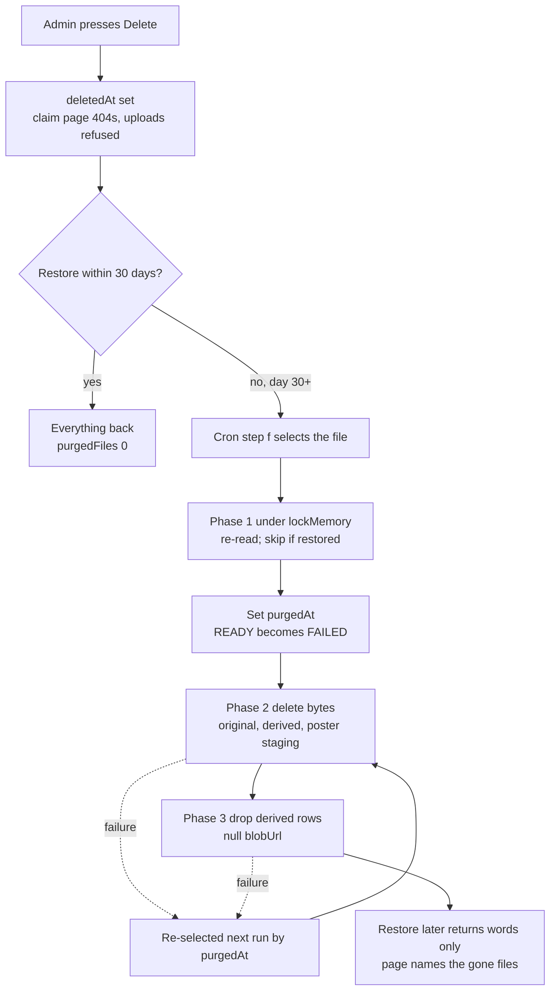

# Email and the reconcile cron

The site's two transactional emails (the contributor's receipt and the family-admin "new memory" alert), the `deliver()` machinery they share, and the 10-minute reconcile cron that retries, backfills and purges.

**Status:** merged in [PR #7](https://github.com/RobertdWray/jowray_com/pull/7) (first confirmation email and cron, 2026-11-03), [PR #20](https://github.com/RobertdWray/jowray_com/pull/20) (on-brand confirmation, Cut point A, 2026-11-03), [PR #26](https://github.com/RobertdWray/jowray_com/pull/26) (admin alert and the SendGrid `content_id` fix, 2026-11-03), [PR #28](https://github.com/RobertdWray/jowray_com/pull/28) (one receipt per send, cron step e3, 2026-11-04), [PR #31](https://github.com/RobertdWray/jowray_com/pull/31) (30-day grace, three-phase purge, 2026-11-04), [PR #49](https://github.com/RobertdWray/jowray_com/pull/49) (fixed-content receipts, canonical and global caps, admin alert cap, 2026-11-05; issue #46) and [PR #50](https://github.com/RobertdWray/jowray_com/pull/50) (cron step (a0), claim before delete, 2026-11-05; issue #44). Live in production. `ADMIN_ALERT_EMAILS` was set in Production on 2026-11-04 (admin-alert plan §9, row 11). A real-inbox check of the current receipt and Hotmail delivery of the alert are not recorded.

## What we built

1. A person sends one or more memories from `/share`. On completion, `completeSubmission` emails one receipt (`SUBMISSION_CONFIRMATION`) with every memory's private link, a "what you sent" line from counts, a badge card per file (kind and length) and a count of files that never arrived. Fixed content since issue #46 (2026-11-05): no name, note, date, place, filename or uploaded picture; the words and pictures are on the private page. Subject: "Thank you for sharing a memory" or "… N memories". The receipt goes out straight away: with no pictures in it, nothing waits for thumbnails or reads storage.
2. A legacy single memory gets `MEMORY_CONFIRMATION` through `confirmMemory`. Admin-drafted memories never get a site email.
3. After the response, `notifyAdminsOfMemory` sends one `ADMIN_NEW_MEMORY` alert per memory to every address in `ADMIN_ALERT_EMAILS`, one message they all see. Order: Who, Date, Memory, Media, other details. No links of any kind.
4. Every email goes through `deliver()`: render, then under one advisory lock (bounded wait) create or load the `EmailLog` row per `(memoryId, emailType)`, apply the outbound guard and the caps, claim the row; send through SendGrid outside the lock; record SENT or FAILED. Every message is From `SENDGRID_FROM_EMAIL` with Reply-To `FAMILY_CONTACT_EMAIL` (`lib/contact.ts`): the From address has no inbox, so a reader's Reply goes to the family. Caps (issue #46): 15 receipts a day per inbox (`recipientKey` folds `+tag`, Gmail dots and googlemail), `OUTBOUND_HOURLY_CAP`/`OUTBOUND_DAILY_CAP` across all contributor email (held as retryable FAILED rows), and `ADMIN_ALERT_HOURLY_CAP` for alerts (one "arriving quickly" notice per hour, then skips).
5. Every 10 minutes Vercel Cron calls `GET /api/cron/reconcile-uploads` with the `CRON_SECRET` bearer: late-arrival deletes, stuck uploads, webhook replay, email retries (including receipts held by the global caps) and backfill, checksums, the 30-day purge, derived copies.
6. On the admin page, Delete hides a memory at once; Restore within 30 days brings everything back. After 30 days the cron removes the files, never the words.

## Why we built it

Phase 1 needed a receipt carrying the only copy of the private link, and a sweeper because "cron delivery can duplicate or skip runs and Vercel does not retry" (Phase 1 plan Task 9). Then the alert: "Rob and the family inbox learn about new memories only by looking at the database" (admin-alert plan §1). The purge was reworked for the admin page because the original step (f) deleted files of soft-deleted memories on the next run, and "with a Restore button that would be a trap" (admin-page plan §3.6).

## Key decisions (Rob)

| Decision | Source |
|---|---|
| R1 echo the full note and details (reverses Phase 1 S2; **superseded 2026-11-05 by issue #46 D1: receipts are fixed content**); R2 inline CID images (in receipts only the brand marks since #46), no tokenized URLs, tracking off; R5 originals never degraded; R6 compatibility over style. Rob, 2026-11-03: stop at Cut point A. | [confirmation plan §1, §2](../plans/2026-11-03-confirmation-email-preview.md) |
| Alert "approved for implementation (Rob, 2026-11-03 ~21:10 ET)". Order Who, Date, Memory, Media, other details. R2 no links: "the edit links are for users only." | [admin-alert plan §1, §2](../plans/2026-11-03-admin-new-memory-alert.md) |
| R3 one message both admins see; R4 no cap (**superseded 2026-11-05 by issue #46 D4: 20 alerts an hour, then one notice**); R5 a duplicate after a crash is accepted; R6 backfill only since `ADMIN_ALERT_SINCE`; R7 an empty list writes no row. Premortem findings, folded in under Rob's approval. | [admin-alert plan §2](../plans/2026-11-03-admin-new-memory-alert.md) |
| Agent rulings, accepted: the transport sends `content_id` (SendGrid had refused every inline image); `ADMIN_ALERT_SINCE` is `2026-11-03T22:00:00Z`, the PR #26 body's 00:00Z is superseded. | [admin-alert plan §9](../plans/2026-11-03-admin-new-memory-alert.md) |
| `EmailLog` idempotency keyed by `(memoryId, emailType)`, outbound guard, per-recipient cap. | [Phase 1 plan Task 5](../plans/2026-11-02-phase1-database-infrastructure-memory-collection.md) |
| Agent ruling, accepted: the raw token is never stored, so the cron path rotates it. Final review: rotate only after a successful send; SKIPPED is terminal; step (e) waits 30 minutes. | [ledger Task 8, Final review](../plans/phase1-ledger.md) |
| D3 one receipt per send; D14 links first; D15 cap 3 to 15; D18 one alert per memory at completion, one per send parked. D14, D15, D18 are amendments recorded for Rob. | [share-redesign plan](../plans/2026-11-03-share-redesign.md), [ledger Task 15](../plans/phase1-ledger.md) |
| 30-day grace, durable `Media.purgedAt`, three phases under `lockMemory`, after the review point "a DB rollback cannot undo a storage delete". No reversal once set; Restore never blocked. | [admin-page plan §3.6, §4.5, §9, §10](../plans/2026-11-04-admin-page.md) |
| Rollback floor: never below PR #31 once anything is deleted; use the project-level Disable Cron Jobs switch, not `vercel.json`. | [admin-page plan §7](../plans/2026-11-04-admin-page.md), [admin.md](../admin.md) |
| Issue #46, Rob, 2026-11-05: each open decision takes the issue's default. D1 fixed-content receipts; D2 60 an hour and 300 a day across contributor email, held for the cron rather than refused; D3 `+tag`, Gmail dots and googlemail folded, 15 a day per inbox kept; D4 20 alerts an hour with one notice; a 3 s lock wait. D5 (Turnstile) not built; D6 the SendGrid key is kept as it is. | [PR #49](https://github.com/RobertdWray/jowray_com/pull/49) decisions table, [environment.md](../environment.md) |

## How it works

The lock covers only the database write. Because `purgedAt` is committed before the first byte goes, a crash or a Restore in the middle can never leave a READY row pointing at missing bytes; `serveMedia` refuses any file with `purgedAt` set. The email lane has the same shape: `deliver()` renders, then in one short transaction under `pg_advisory_xact_lock` (3 s `lock_timeout`; a timeout answers `busy` with no row, and the cron's catch-up finds the memory) drops recipients the outbound guard forbids (`OUTBOUND_ENABLED` or `OUTBOUND_ALLOWLIST`), applies the per-inbox, global and admin caps, and claims `PENDING|FAILED|SKIPPED` (or a SENDING claim older than 15 minutes) to `SENDING`; it then sends with three SendGrid attempts (10 s each; of the 4xx family only 408 and 429 retry), then writes SENT with any rotated claim hashes in one transaction. Failures leave FAILED with `nextAttemptAt` = 15 min × attempts (a global-cap hold is FAILED `global_capped`, due a minute after the oldest counted row leaves the window, attempts untouched); a SENDING row older than 15 minutes is reclaimed. Cron order: (a0) late-arrival sweep, (a) stale PENDING files, (c) webhook replay, (d) email retries by type, (e) legacy confirmations, (e2) admin alerts, (e3) send receipts, (b) checksums, (f) purge, (f2) cancelled reservations, (g) derived copies, all inside a 50 s deadline. Since issue #44, (a) gives up on a day-old PENDING row only once its `reservedUntil` has passed (no Blob token for it can still land bytes) and the store's own `head()` finds no blob (`recordMedia` also answers PENDING for a blob whose first bytes it could not read), and it claims before it deletes: a conditional `updateMany` (`status: PENDING`, `deletedAt` null, the same window) sets FAILED + `purgedAt`, and only when that matched one row is the pathname deleted (this environment's blobs only). A finalize that landed after the head() check, or a re-ticket that moved the window, makes the claim match nothing and nothing is deleted. (f2) claims the same way; (f) and (f2) judge cancelled rows by `reservedUntil` rather than by age. Step (a0), first in the run, deletes again, for two hours, the pathname of every row this environment retired recently: a Blob request that began before its token expired may finish after it.

## Key files

| Path | Role |
|---|---|
| **app** | |
| `app/api/cron/reconcile-uploads/route.ts` | The cron: bearer check, steps a0 to g, Sentry monitor in production |
| `vercel.json` | `*/10 * * * *` schedule |
| **features** | |
| `features/memories/confirm.ts` | Legacy receipt; token rotation on the cron path |
| `features/memories/complete-submission.ts` | One receipt per send, `confirmSubmission` |
| `features/memories/notify-admins.ts` | Admin alert, `ADMIN_ALERT_SINCE` |
| `features/memories/site-email.ts`, `features/memories/media-summary.ts` | Which memories get email; the READY file list |
| `features/memories/lock.ts` | `lockMemory` used by the purge claim |
| `features/admin/set-deleted.ts` | Soft delete and Restore; returns `purgedFiles` |
| `features/media/serve-media.ts` | Never serves a file with `purgedAt` set |
| **services + integrations** | |
| `services/email/index.ts`, `services/email/types.ts`, `services/email/recipient-key.ts` | `deliver()` with the lock and caps, the three senders, types; the canonical cap key |
| `services/email/templates/shared.ts` | Chrome, cards, escaping shared by every template |
| `services/email/templates/memory-confirmation.ts`, `services/email/templates/submission-confirmation.ts`, `services/email/templates/admin-new-memory.ts`, `services/email/templates/admin-alerts-paused.ts` | The two fixed-content receipts, the alert (no `href` anywhere) and the "arriving quickly" notice |
| `integrations/sendgrid/client.ts`, `integrations/sendgrid/index.ts` | Key and 10 s timeout; retries, `content_id` attachments, tracking off, sanitised errors |
| **lib + server** | |
| `lib/email-assets/index.ts` | Base64 PNG heart and badges (generated) |
| `lib/claim-token.ts`, `lib/site-url.ts`, `lib/sentry/metrics.ts` | Token mint and hash; claim link base and storage prefix; `reconcile.run` metric |
| `server/config/env.ts` | `SENDGRID_*`, `OUTBOUND_*` (including the hourly and daily caps), `ADMIN_ALERT_EMAILS`, `ADMIN_ALERT_HOURLY_CAP`, `CRON_SECRET` schemas |
| `scripts/sample-confirmation.ts`, `scripts/sample-admin-alert.ts`, `scripts/render-email-preview.ts`, `scripts/send-test-email.ts`, `scripts/make-email-assets.ts` | Samples, HTML preview, real test send (no `EmailLog` row), asset generator |
| **tests** | |
| `__tests__/services/email.test.ts` | Claim, guard, caps (per inbox, hourly, daily, admin with staggered times), the lock and `busy`, a race at the last slot, retries, rotation, both types on one memory |
| `__tests__/services/email-template.test.ts`, `__tests__/services/admin-template.test.ts`, `__tests__/services/submission-template.test.ts`, `__tests__/services/admin-paused-template.test.ts`, `__tests__/services/recipient-key.test.ts` | Template contracts (no contributor text or uploaded image in a receipt; the largest send under the size budget); key folding |
| `__tests__/features/confirm.test.ts`, `__tests__/features/notify-admins.test.ts`, `__tests__/features/complete-submission.test.ts`, `__tests__/features/site-email.test.ts` | Feature rules |
| `__tests__/api/reconcile.test.ts` | Every step, purge cases C1 to C7, monitor |
| `__tests__/lib/email-assets.test.ts` | Asset dimensions and size |
| **Prisma** | |
| `prisma/schema.prisma` | `EmailType`, `EmailStatus`, `EmailLog` (`recipientKey`), `Media.purgedAt`, `Media.reservedUntil` |
| `prisma/migrations/20261103031114_email_status_sending_skipped`, `prisma/migrations/20261103220303_email_type_admin_new_memory`, `prisma/migrations/20261104160000_media_purged_at`, `prisma/migrations/20261105120000_email_recipient_key`, `prisma/migrations/20261105130000_email_recipient_key_fold`, `prisma/migrations/20261105140000_media_reserved_until` | SENDING and SKIPPED; `ADMIN_NEW_MEMORY`; `purgedAt`; `recipientKey` and its folded backfill; `reservedUntil` |

## Tests and evidence

- Unit tests above; the ledgers record the suite green at each merge (712/712 at PR #26, 806/806 at PR #28 Slice A).
- `docs/plans/evidence/2026-11-confirmation-email/` ([README](../plans/evidence/2026-11-confirmation-email/README.md)): Chrome renders at 1280 px and 390 px. Delivered-message inspection "not yet recorded".
- `docs/plans/evidence/2026-11-admin-alert/` ([README](../plans/evidence/2026-11-admin-alert/README.md)): synthetic renders at 390 px and 1280 px. Inbox results are text only, in the admin-alert plan §9: both samples accepted (202) and received in Gmail with five inline attachments; a cron retry on a Neon branch went SENT.
- Ledger Task 9: first production cron run 2026-11-03 07:40:39 UTC, all counts 0.
- NOT RUN: a real inbox check of the multi-memory receipt (ledger Task 15 "Still open: real emails"); Hotmail delivery of the alert (the dev run's guard dropped that address, so Hotmail has never received a site email); the device pass; the admin-page production smoke.

## Known gaps and follow-ups

- M-H-09 Hotmail deliverability of the alert, M-H-08 the receipt in a real inbox, M-D-02 per-recipient delivery state via the SendGrid event webhook (issue #38 §2.1).
- M-D-01 the alert carries no thumbnails (receipts carry none by design since #46); no 30 MB transport guard. M-D-03 later edits send nothing; M-D-04 daily digest; M-D-05 one alert per send (Rob); M-D-06 no "posted" email (§1.4); M-D-07 nudge for unshared drafts; M-D-08 plus-tag variants bypass the cap (fixed by issue #46, `recipientKey`); M-D-09 a stale ledger checkbox.
- M-B-06 PENDING blobs on deleted memories are never purged, no per-row retry bound; M-B-07 (closed by issue #44: step (a) fails with a conditional `updateMany` on `status: PENDING` and the row's window); M-B-08 a finalize replay can resend a FAILED email without backoff.
- Issue #46 follow-ups (open for Rob): Turnstile on `/share` (D5); one alert per send or a cron digest (D4 i and iii); a real-Postgres test of the outbound lock and caps; gentler thank-you wording when a receipt is held (the cron sends it later with fresh links that supersede the on-screen ones); previews only after approval would need a second email.
- M-A-09 rollback floors; the SHA blank in admin-page plan §7 should be `9ffdb8e` (§2.6). M-A-06 cutoff settled (§1.1). M-F-10 alerting on one failed cron run (§2.3).

## Related

- [Share form](./share-form.md), [Media uploads](./media-uploads.md), [Audio recording](./audio-recording.md), [Admin panel](./admin-panel.md), [Draft on behalf](./draft-on-behalf.md), [Sentry telemetry](./sentry-telemetry.md)
- Plans: [confirmation email](../plans/2026-11-03-confirmation-email-preview.md), [admin alert](../plans/2026-11-03-admin-new-memory-alert.md), [Phase 1](../plans/2026-11-02-phase1-database-infrastructure-memory-collection.md), [Phase 1 ledger](../plans/phase1-ledger.md), [share redesign](../plans/2026-11-03-share-redesign.md), [admin page](../plans/2026-11-04-admin-page.md), [debt catalog](../2026-11-04-debt-catalog.md)
- [Code layout](../code-layout.md), [Environment](../environment.md), [Admin runbook](../admin.md)
