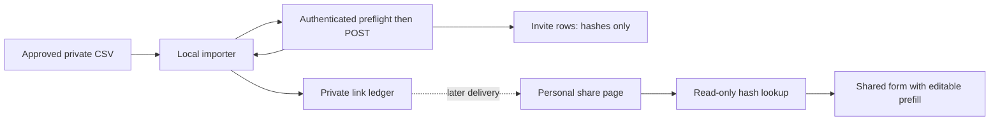

# Invite links

Personal `/s/<token>` links let family-approved correspondents open the share form with a greeting, name and email already filled in. The local importer creates the links and keeps them in a private ledger for the later mail merge.

**Status:** implemented on this branch for the PR-2 workstream of [issue #59](https://github.com/RobertdWray/jowray_com/issues/59), [notify plan §8](../plans/2026-11-07-notify-correspondents.md). Merge, production migration, deployment, live token checks and a real import are not established here. S1, the server-side Sentry scrubber switch, remains pending.

## What we built

1. An operator imports a family-approved CSV through `scripts/import-invites.ts`. The bearer-protected `/api/admin/invites` preflight checks the target before the script posts missing invitees and saves new links privately. It sends no messages.
2. The recipient opens `/s/[inviteToken]` and sees `Hi <firstName>,` above the shared `Intro` and `ShareForm`. A valid invite supplies the name and email. An unknown, malformed or revoked token opens the ordinary form without a greeting.
3. A remembered contributor with the same email keeps their name (unless blank) and relationship; a matching draft can supply the relationship. A different remembered email cannot supply either identity field or its relationship. With no invite, the ordinary draft/remembered defaults apply. The full four-row [decision table and shared-device example](./share-form.md#personal-links-and-prefill) cover the fallbacks.
4. The editable fields have this explanation before the first successful send: “This form was filled in from your personal link. Not you? Change the name and email above.” After success, `sentOnce` prevents “Share another” from restoring the invite identity and hides that line. The normal submission flow and receipt then apply.

## Why we built it

The [plan §1.1](../plans/2026-11-07-notify-correspondents.md) calls for “a personal `/s/<token>` link that opens the memory form already filled in.” It removes repeated typing for approved correspondents while preserving a usable form for someone who receives a forwarded link. A link is a prefill convenience, not proof of who is using the device or permission to edit a memory.

## Key decisions (Rob)

| Decision | Source |
|---|---|
| “12 characters, 72 bits”, “only the SHA-256 is stored” (Rob, 2026-11-07, R3). | [plan §2](../plans/2026-11-07-notify-correspondents.md) |
| “Invitee names and emails fall under the 100% Sentry policy”; “Invite tokens and share URLs stay forbidden” (Rob, 2026-11-07, R10). | same |
| Replay DOM URL and Vercel request-log residuals on `/s/<token>` are accepted (Rob, 2026-11-07, R5/R11). R13 removes contributor-field Pino redaction; bearer credentials remain redacted. | same |
| Agent calls D3/D4/D6, accepted with plan approval on 2026-11-07: resolve identity without mixing people; no identify on invite lookup; GET never writes. Link scanners and prefetch must not count as a person opening or using an invite. | [plan §2, §8.6](../plans/2026-11-07-notify-correspondents.md) |
| Agent calls D2/D17/D27, accepted with that approval: keep a private token ledger, acknowledge preview copies of Invite rows, and fix forward after the first real send. | [plan §2, §16–17](../plans/2026-11-07-notify-correspondents.md) |

## How it works



`newInviteToken()` encodes nine random bytes as 12 base64url characters (72 bits). `hashInviteToken()` uses the same SHA-256 helper as claim tokens. `Invite` has a unique `tokenHash` and a unique `(memorialId, email)` pair; email is trimmed and lower-cased, first name is required, and a blank last name becomes absent. It has no foreign key to a contributor or memory and no opened/used column.

`createInvites` takes 1–200 validated rows per request and rejects duplicate normalized emails. Within a transaction it uses `createManyAndReturn({ skipDuplicates: true })` and maps returned rows by hash to input index, never by return position. Rotation changes only the stored hash and cannot revive a revoked invite.

| API result | Meaning |
|---|---|
| `GET /api/admin/invites`, 200 | Read-only, bearer-authenticated `{ success: true, data: { memorialSlug, siteUrl } }` preflight. |
| `POST /api/admin/invites`, 200 | `{ success: true, data: { results, memorialSlug, siteUrl } }`; each result has its input `index` and `status`, never an email. |
| `created` / `rotated` | Includes `token` and `shareUrl` for the private ledger. |
| `exists` / `revoked` | No token or URL; stored hashes cannot recover a lost link. |
| 400 / 401 | Invalid JSON/input / missing or invalid admin bearer authentication. |

`getInvitePrefill` rejects a malformed token before touching the database; otherwise it performs only `findUnique` by hash and returns first name, joined name and email if active. **GET never writes or identifies**, including scanner and prefetch visits. The page calls `connection()` before params or the lookup; its `Suspense` fallback never mounts a form. Both entry points allow 120 seconds for their shared Server Functions.

`/s/:path*` responses carry `Referrer-Policy: no-referrer` and `X-Robots-Tag: noindex, nofollow`; the page also supplies the no-referrer meta tag. Tokens and share URLs are forbidden in application logs, Sentry and analytics. Structured Pino bearer fields remain redacted; never interpolate a URL into a log message. Sentry filters invite fields, full `/s/` URLs, router tuples and RSC response segments; analytics keeps the matched route and scrubs its `url` to `/s/[inviteToken]`, dropping unsafe unmatched paths. Invitee names/emails are allowed under R10. The accepted exceptions are the replay DOM page URL (R5) and Vercel request logs (R11); [Sentry telemetry](./sentry-telemetry.md) records these and remaining scrubber gaps. The feature itself logs batch counts only.

## Operations and rollback

The migration is `20261107120000_invites`. Use the configured `ADMIN_API_SECRET` and `MEMORIAL_SLUG`; [Environment](../environment.md) owns their setup. Replace the placeholders below with private local paths, quoting paths containing spaces:

```sh
npx tsx --env-file=<main checkout .env> scripts/import-invites.ts --prod --in <send_list.csv> --ledger <invites.csv> [--rotate-missing]
```

`--prod` selects the production target and cannot be combined with `ADMIN_API_URL`. For local testing omit `--prod` and set `ADMIN_API_URL=http://localhost:3000`; the server's link origin must match exactly. Redirects are refused. Before its first POST the importer verifies the server's memorial and site origin, and validates both again in every batch response.

The UTF-8 input requires `email,first_name` and optionally `last_name`; BOM, CRLF, quoted commas, doubled quotes and embedded newlines are supported. All rows are validated before posting. Input and ledger must be outside git work trees, including through symlinks. The ledger's format is:

```csv
# target=<target-origin> memorial=<MEMORIAL_SLUG>
email,share_url
<email>,<target-origin>/s/<token>
```

The ledger is logically append-only: existing bytes and entries remain, and each batch saves additions by an atomic same-directory replacement with file/directory fsync and mode `0600`. Existing ledgers must be regular files with exactly that mode. The importer refuses a wrong target/memorial header, malformed columns/rows, wrong URL prefix or token format, duplicate normalized emails or share URLs, and leftover private temporary ledger files. API result validation rejects missing, duplicate or out-of-range indices, wrong origins, inconsistent token/URL pairs, duplicate issued tokens and contradictory statuses. It posts only emails absent from the ledger, at most 200 per batch, and success requires every input email to have an entry. Successful console output is counts only; refusals use value-free messages and row numbers, never addresses, names or links.

An `exists` result without a ledger entry stops with recovery advice; `revoked` stops with the 1-based input row number. Valid new credentials from a mixed batch are saved before that stop. After a lost response, rerun without rotation first. **`--rotate-missing` is only for recovery before any message is sent**: it invalidates old links for missing ledger entries. This is an operator constraint; the script has no send-history database to enforce it.

Revocation is SQL-only until F3 adds a button. An authorized database operator sets `revokedAt` on the intended row, for example with this placeholder-only statement, then verifies the link opens the plain form:

```sql
UPDATE "Invite" SET "revokedAt" = CURRENT_TIMESTAMP WHERE "id" = '<inviteId>';
```

Neon preview branches copy production `Invite` rows (D17); creating a preview does not anonymize them. After deployment, prove prefill, the shared-device case, “Share another,” headers and token removal using synthetic data before a real import or S1. The plan's `/s/` WAF readiness check is operational work, not established by these unit tests.

**After the first real send, fix forward only (D27).** Reverting PR-2 would make delivered links 404. Before any real send, the additive table can remain while code is reverted. Do not rotate delivered links as a recovery shortcut.

## Key files

| Path | Role |
|---|---|
| **app** | |
| `app/api/admin/invites/route.ts` | Authenticated preflight and batch API |
| `app/s/[inviteToken]/page.tsx`, `app/share/intro.tsx`, `app/share/share-form.tsx` | Request-time lookup, shared greeting and form |
| `app/_components/analytics-client.tsx`, `next.config.ts` | Analytics route guard and headers |
| **features** | |
| `features/invites/create-invites.ts`, `features/invites/resolve-invite.ts` | Transactional issuance and read-only lookup |
| **lib + server** | |
| `lib/invite-token.ts`, `lib/validations/invite.ts`, `lib/share-prefill.ts` | Token, input and identity contracts |
| `lib/sentry/scrub.ts`, `lib/sentry/secrets.ts`, `lib/sentry/replay-options.ts`, `lib/logger/logger.ts` | Token privacy and alpha collection |
| **scripts** | |
| `scripts/import-invites.ts`, `scripts/draft-memory.ts` | Private CSV/ledger workflow; shared target and HTTP helpers |
| **tests** | |
| `__tests__/features/invites.test.ts`, `__tests__/api/admin-invites.test.ts`, `__tests__/scripts/import-invites.test.ts` | Feature, API and importer contracts |
| `__tests__/lib/invite-token.test.ts`, `__tests__/lib/validations-invite.test.ts`, `__tests__/lib/share-prefill.test.ts`, `__tests__/integration/invites.test.ts` | Tokens, validation, prefill and real-Postgres constraints |
| **Prisma** | `prisma/schema.prisma`, `prisma/migrations/20261107120000_invites/migration.sql` |

## Tests and evidence

Token tests cover length/alphabet, uniqueness across 10,000 values and SHA-256 parity. Validation tests pin normalization, blank last names, duplicate rejection and batch bounds. Feature tests cover every result status, shuffled insertion mapping with an existing middle row, rotation/revocation races and zero writes or identification on lookup. API tests pin authentication, input errors and server binding. Importer tests cover private atomic writes, refusals, counts-only output, repeated runs and per-batch recovery. Prefill tests cover the four rows and shared devices.

`__tests__/lib/sentry-envelope.test.ts` uses real SDK transport with positive controls: action inputs/results, incoming invite bodies, both route-token tuples, RSC response segments through the Replay hook, and Pino-to-Sentry logs retain synthetic names/emails while removing tokens. Scrub unit/differential/timing tests, `replay-options.test.ts`, `logger.test.ts`, `__tests__/app/analytics-client.test.ts` and `__tests__/next-config.test.ts` pin the related policies.

Local checks on 2026-11-07, base `1d8b50d` plus this documentation working tree, using Node v26.13.0 (`PATH=/opt/homebrew/bin:$PATH`) and no `.env*` file:

- `npm run test:run -- __tests__/lib/readme-diagrams.test.ts` ran first after the README edit: 45 passed, 1 failed, specifically the Data model source-hash drift, before attempting regeneration. No tests were added or changed for this docs-only task.
- `npx tsx scripts/make-readme-diagrams.ts` failed before rendering with `listen EPERM` on tsx's IPC pipe. A separate local `playwright-core` Chromium launch probe also failed (browser exited with `SIGABRT`). `public/diagrams/` is unchanged. The orchestrator must regenerate outside this sandbox, including the generated `app/how-it-was-built/readme-diagrams.ts` manifest, which is outside this worker's ownership.
- `npm run validate`: passed (route type generation, TypeScript and ESLint).
- `npm run test:run`: 2,565 passed, 55 skipped, 4 failed; 100 files passed, 8 skipped, 2 failed. Failures: the same Data model drift test and three `__tests__/scripts/no-network.test.ts` loopback cases (`net.connect(port, callback)`, `net.connect(options, callback)`, `Socket.connect(port, callback)`), all refused by sandbox `listen EPERM` on `127.0.0.1`. No checks were suppressed or weakened.

**NOT RUN:** integration not run here (no `TEST_DATABASE_URL`); offline build, CI, browser/real-device prefill and replay checks, live analytics intake, production migration/import and token checks, WAF readiness and S1. Tests present in source do not establish deployment or real-data use.

## Known gaps and follow-ups

- F2, Medium: link a submitted memory to its invite; no such relation exists now.
- F3, Low: an admin revoke button; SQL is the current operation.
- F5/F7, Low: final thank-you copy and separating other people's unsent draft cards on shared devices. The undated R6 copy and identity prefill do not close these.
- F8, Low: consider scrubbing Invite rows copied into Neon previews (D17).
- S1, operator-owned: server-side Data Scrubber and Default Scrubbers stay on until deployment and token proof, then require Rob's re-confirmation of amended R12. SDK scrubbing remains enabled.
- Plan/code differences: §8.5 described POST only; code also has the authenticated GET preflight and includes `memorialSlug`/`siteUrl` in both responses. Despite §16 declining per-batch checkpoints, the importer persists each batch's issued links, including valid links before an `exists`/`revoked` stop. The prefill code compares draft names with the chosen fallback name and ignores a blank draft relationship when emails match. D21 also covers Next's RSC `{"n":…,"k":…}` response segments, beyond the original tuple-only plan. This document follows the code.

## Related

- [Share form](./share-form.md), [Privacy note](./privacy.md), [Sentry telemetry](./sentry-telemetry.md), [Analytics](./analytics.md), [Email and cron](./email-and-cron.md).
- [Notify plan §2, §8, §16–17](../plans/2026-11-07-notify-correspondents.md), [Environment](../environment.md), [Admin operations](../admin.md), [Code layout](../code-layout.md).
