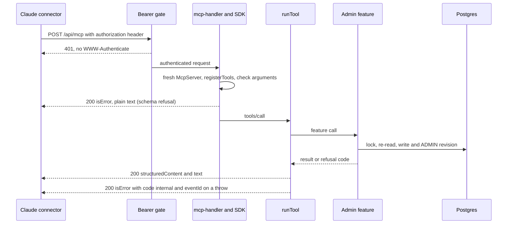

# MCP connector

The `jowray` MCP server at `https://www.jowray.com/api/mcp`: nine admin tools that let Rob's Claude list, read, draft and edit memories, and suggest place names from the GPS saved with their photos, from any Claude surface (claude.ai, the phone, Desktop, cloud sessions, Claude Code), so the `jowray-draft-memory` skill no longer needs the laptop checkout. It also gives each memory optional map coordinates.

**Status:** [PR #60](https://github.com/RobertdWray/jowray_com/pull/60) (route, every tool below except `suggest_places`, `MCP_API_SECRET`, memory coordinates, the shared `sourceInput` derivation, the skill rewritten to prefer the connector; merged 2026-11-06 as `d583308` and deployed to Production). Plan and ledger: [`docs/plans/2026-11-06-mcp-endpoint.md`](../plans/2026-11-06-mcp-endpoint.md). The ninth tool, `suggest_places`, and per-photo coordinates in `get_memory` come from [PR #66](https://github.com/RobertdWray/jowray_com/pull/66) (plan [`docs/plans/2026-11-06-photo-gps-places.md`](../plans/2026-11-06-photo-gps-places.md), step B7, Refs #58; merged 2026-11-06 as `fa68582`). `MCP_API_SECRET` was set in Vercel Production on 2026-11-06 and production redeployed ([PR #68](https://github.com/RobertdWray/jowray_com/pull/68); ledger §3, done by the agent on Rob's choice, with the same value in the main checkout's `.env`): no header and a wrong bearer answer 401 with no `WWW-Authenticate`, the right bearer answers 200 with nine tools. Both OAuth well-known paths answered 404 after PR #60's deploy. Ledger §3 leaves the rest of setup and real use open: the connector added, approval set on six tools, the production smoke draft, the skill delivered to every surface, the first real run.

## What we built

1. Rob adds a custom connector in Claude: the URL above, **No sign-in**, and the request header `authorization: Bearer <MCP_API_SECRET>`. Anthropic's servers call the site directly, so one connector serves every Claude surface; Claude Code adds the same URL and header itself.
2. Every `GET` or `POST` to `/api/mcp` first passes the bearer gate, `unauthorized(request, "mcp")` in `app/api/admin/_auth.ts`. It reads the `authorization` header before any env or Prisma access and compares it in constant time with `Bearer <MCP_API_SECRET>`. No secret configured, an empty one, or a missing or wrong header: a plain `401` (`{ error: { code: "unauthorized", message: "Unauthorized" } }`) with **no `WWW-Authenticate` challenge**, logged as `mcp_unauthorized`. The admin API's `ADMIN_API_SECRET` does not open it.
3. An authenticated request goes to `mcp-handler`, which builds a fresh `McpServer` for every request and runs `registerTools` on it: stateless, `maxDuration` 30 s, both protocol eras.
4. The model sees nine tools, each a thin adapter over a feature: `list_memories`, `get_memory` and `suggest_places` read; `draft_memory`, `set_coordinates`, `update_memory`, `set_status`, `set_deleted` and `reissue_claim_link` write. `suggest_places` (photo GPS, plan `docs/plans/2026-11-06-photo-gps-places.md`, B7) changes no memory: it asks OpenStreetMap for place names near each photo's saved point through the site's cached, throttled lookup.
5. `draft_memory` takes a `sourceInput` (a `gmail` message id; an `sms` number, time and text; or `other` with the original text) and never a `source` or `sourceRef`. The server derives both with `prepareInput` from `lib/source-input.ts`, the same code the laptop script runs, so no model computes the dedup key.
6. Every answer our tools return carries the same JSON twice, as `structuredContent` and as a text block. A refusal is an `isError` result with a `code` the skill acts on; an unexpected exception becomes `{ code: "internal", eventId }`.
7. A memory may hold one WGS 84 `coordinates` pair for a future map, set by `draft_memory` or `set_coordinates` and read through MCP, including stale `set_coordinates` replies. Each photo may also hold the GPS read from its original (`Media.latitude`, `longitude`), read only through `get_memory`'s file rows and `suggest_places`. The admin page and the claim page never show either.
8. In Claude, Rob sets **requires approval** on the six tools that write, so Claude asks before each call: the five annotated `destructiveHint: true` and `draft_memory`. `suggest_places` is read-only (`readOnlyHint`, `openWorldHint`; it writes cache, quota and throttle rows) and is not among them. `draft_memory` keeps its non-destructive annotations, which are accurate (it only adds, and a repeat answers `duplicate`), but it writes a row and returns a live claim link, and the read tools bring text any visitor can submit (`suggest_places` also brings OpenStreetMap's place names and the files' original names) into the same session (Team Code Review, G1).

## Why we built it

Plan §1.1: the skill's save step "runs only on Rob's Mac: it needs the local checkout, `.env` with `ADMIN_API_SECRET`, and the cloud container's egress proxy refuses `jowray.com`." On 2026-11-05 a reply to a condolence note sat unsent with a placeholder because a claude.ai session could not save the memory. "A Claude custom connector at `https://www.jowray.com/api/mcp` fixes all three failures because Anthropic's infrastructure calls the site directly." Rob also wanted each memory to carry optional WGS 84 coordinates "for a future map, captured while the place is fresh".

## Key decisions (Rob)

| Decision | Source |
|---|---|
| `place` edits leave coordinates alone (Rob, 2026-11-06); `features/memories/claim.ts` and `features/admin/update-memory.ts` are not touched | [plan, decision 1](../plans/2026-11-06-mcp-endpoint.md) |
| One PR with ordered commits (Rob, 2026-11-06) | decision 3 |
| Rate limiting is the 32+ character secret, logged refusals and the daily memory budget; a Vercel WAF rule is a follow-up, not code. Accepted at plan approval (Rob, 2026-11-06: "Execute this plan in a new worktree") | decision 2, §8.1 |
| A separate `MCP_API_SECRET`: Rob rejected reusing `ADMIN_API_SECRET`, since rotating one value would break the script and the connector at once, and a connector's header cannot be edited, only removed and re-added | [plan §9](../plans/2026-11-06-mcp-endpoint.md) |
| `MCP_API_SECRET` in Production only among Vercel environments, never Preview (Preview deploys read a copy of production rows). Rob, 2026-11-06: the same value is also kept in the main checkout's local `.env`, where the connector's header value comes from | plan §0.3 and ledger §3, [environment.md](../environment.md), [PR #68](https://github.com/RobertdWray/jowray_com/pull/68) |
| Agent's calls, flagged for Rob's veto: `draft_memory` accepts only `sourceInput`; no server-side rounding of coordinates; the privacy guard is the tool description plus the skill asking Rob before saving; a named community or facility campus is a place, a residence or unit inside it is not | decision 4 |
| From the review round: every tool runs inside one error boundary that reports to Sentry and returns `{ code: "internal", eventId }`; `wrapMcpServerWithSentry` is called explicitly; versions pinned exactly (`mcp-handler` 2.3.1, `@modelcontextprotocol/server` 2.4.0) | decision 5, [plan §10](../plans/2026-11-06-mcp-endpoint.md) |
| A place phrase that names a home (a street address, or an apartment inside a campus) gets no coordinates at all, not even its town's or campus's. Orchestrator's call from the skill micro-tests, **flagged for Rob's veto** | decision 6 |
| From the Team Code Review (George and Oscar, orchestrator's triage): approval in Claude on `draft_memory` too, with its annotations unchanged; every tool's input strict; `maxToolInputElements` 1000; on `stale`, ask Rob whenever any field moved; the reply wording after a duplicate follows the row's current words | [plan §3](../plans/2026-11-06-mcp-endpoint.md) |
| Photo GPS (2026-11-06, photo-GPS plan): R3 the connector gets the place lookup too; D13 `suggest_places` may return a landmark's own point and the skill proposes `set_coordinates` only with it, never a photo's (camera) point; D14 a photo's coordinates are read only through these tools. `suggest_places` is read-only, so the approval set stays at six. The code returns no partial `photos` on `disabled`, `daily_limit` or `provider_refused`; earlier successful lookups may be cached for a retry | [photo-GPS plan](../plans/2026-11-06-photo-gps-places.md), D13, D14, B7 |
| Not doing: `withMcpAuth` and OAuth metadata routes (the challenge would start a sign-in with no authorization server behind it); an `Origin` allow-list; an IP allow-list (it would block Claude Code on the Mac); rate limiting in code; turning off Sentry's MCP output recording (Rob's 2026-11-04 telemetry ruling; scrubbing is the guard); a hand-built `sourceRef` in `draft_memory` | plan §9 |

## How it works

### The nine tools

| Tool | Calls | Success payload | `isError` codes | Annotations | Approval in Claude |
|---|---|---|---|---|---|
| `list_memories` | `listMemoriesForAdmin` with `includeCoordinates: true`, and `adminStatusCounts()` | `{ query, rows, shown, total, counts }`; newest first, at most 200 rows, each with `coordinates` | `invalid` | `readOnlyHint` | no |
| `get_memory` | `getMemoryForAdmin(memoryId, { includeCoordinates: true })` | the admin view (contributor, files, newest 25 revisions, emails, `memoryVersion`) plus `coordinates`, deleted or not | `not_found` | `readOnlyHint` | no |
| `draft_memory` | `prepareInput(args)`, then `draftMemory` | `{ memoryId, claimLink, originalNoteRecorded }` | `invalid { message }` (also any `prepareInput` refusal), `duplicate { memoryId, status }`, `budget_exceeded` | `destructiveHint: false`, `idempotentHint: true` | yes; the skill's step 2b questions still come first |
| `set_coordinates` | `setMemoryCoordinatesAsAdmin` | `{ changed, memoryVersion }` | `invalid`, `not_found`, `stale { current: { memoryVersion, coordinates } }` | destructive, idempotent | yes |
| `update_memory` | `updateMemoryAsAdmin` | `{ written, current }` | `invalid`, `not_found`, `last_words`, `stale { current }` | destructive | yes |
| `set_status` | `setMemoryStatusAsAdmin` | `{}` | `invalid`, `not_found`, `draft` | destructive, idempotent | yes |
| `set_deleted` | `setMemoryDeletedAsAdmin` | `{ purgedFiles }` | `invalid`, `not_found` | destructive, idempotent | yes |
| `reissue_claim_link` | `reissueDraftClaimLink` | `{ memoryId, claimLink }` | `invalid`, `not_found`, `not_draft` | destructive, not idempotent | yes |
| `suggest_places` | `suggestPlacesForMemory(memoryId)`: `lookupPlace` per unique point of the memory's live READY photos that have GPS, no viewer key, one 20 s deadline | `{ photos: [{ mediaId, originalFilename, coordinates, labels }], pending, attribution }`; `coordinates` is where the camera was, a landmark label's `point` is the place's own | `not_found`, `disabled`, `daily_limit`, `provider_refused` (`pending` lists photos whose lookup came back `busy` or `failed`) | `readOnlyHint`, `openWorldHint` | no |

Every tool can also answer `internal { eventId }`. On `stale`, `update_memory`'s description tells the model to compare every editable field in `current` with the value it read before the edit and to show Rob and ask before retrying whenever any differs, even a field it is changing, because a retry sends Rob's value over the other person's; only a move of the versions alone is retried without asking (Team Code Review, O2). `not_found` means no such memory or, for `suggest_places` and every write except `set_deleted`, a soft-deleted one (`get_memory` answers a soft-deleted memory, marked by `deletedAt`); `last_words` refuses emptying the words of a memory with no ready file; `draft` means only the sender's Share leaves DRAFT; reissuing revokes the link already sent. The exact model-facing contract (titles, descriptions, annotations, input JSON Schemas) is the inline snapshot in `__tests__/api/mcp.test.ts`. Annotations are hints: approval is a per-tool setting Rob applies in Claude, and must be applied again after every re-add of the connector. Success payloads are mapped field by field, so no answer carries `claimToken`, `claimTokenHash`, `blobUrl` or `storageKey`; the claim link appears only in the two success payloads that exist to return it.

### Two kinds of refusal

- **Schema refusal.** The SDK checks the arguments against the tool's zod input schema before our code runs. A mismatch (a `source` or `sourceRef` on `draft_memory`, a mistyped `contributor` key, a half pair or an out-of-range coordinate, a non-uuid id, `DRAFT` as a status) is HTTP 200 with `isError: true` and the SDK's validation message as **plain text**: no `structuredContent`, no `code`, and the feature is never called. Every tool's input is strict at the top level (and `draft_memory`'s `contributor` too), so an unknown or misplaced key, such as a `note` beside `update_memory`'s `changes`, is refused rather than dropped (Team Code Review, G2). Before any schema runs, the SDK also refuses a call whose arguments hold more than 1000 elements (array items plus object members; `maxToolInputElements`, G3), the same way and with its own message; a full `draft_memory` has about 20.
- **Feature refusal.** The feature ran and said no. HTTP 200 with `isError: true` and JSON `{ code, ...extra }` (the feature's result without its `ok` flag) in both `structuredContent` and the text block. `prepareInput` refusals (a bad Gmail id, phone number or timestamp; an `other` email that differs from `contributor.email`) come back the same way as `invalid` with the message.
- **Transport answers** are not tool results: `401` from the gate; `400` for a malformed 2026-07-28 request (for example without `Mcp-Method`); `405` for an authenticated `GET` on the stateless 2025-era path; `500` when the handler itself fails.

### The error boundary and handler errors

The SDK turns any exception in a tool into an `isError` result carrying the raw message (a Prisma or Neon error, file paths included) and reports nothing (plan §1.4). So `runTool` in `app/api/mcp/tools.ts` wraps every tool: it tags the scope with `memory_id`, catches the exception, sends it to Sentry once (mechanism `mcp.tool`, tag `tool`), logs `mcp_tool_failed` with the tool, `memoryId` and `eventId`, and returns `{ code: "internal", eventId }`. The skill tells Rob the `eventId` and retries once; a draft that did commit answers `duplicate` on the retry.

Errors the SDK raises outside a tool (a `registerTools` throw, a transport failure, a protocol rejection of an authenticated caller) go to its `onerror`, which `mcp-handler` silently drops unless `onEvent` is set (review round 1, R1). The route's `reportHandlerEvent` sends each `ERROR` event to Sentry once (mechanism `mcp.handler`, level from its severity, tag `mcp_source`) and logs `mcp_handler_error` with the source, severity and `eventId`. It ignores the request events, which carry the request's parameters.

### Coordinates

- Two nullable `Float` columns on `Memory`, `latitude` and `longitude` (Postgres `double precision`): WGS 84 decimal degrees, named fields so they are never swapped. Migration `20261106120000_memory_coordinates` is expand-only, with no backfill, and adds three CHECKs: `Memory_coordinates_pair` (both or neither), `Memory_latitude_range` (-90 to 90) and `Memory_longitude_range` (-180 to 180). `coordinatesSchema` in `lib/validations/memory.ts` repeats the ranges as a strict object.
- Set by `draft_memory` (optional; the creation revision's `after.coordinates` records it, `null` when absent), by `set_coordinates`, and, because it parses the same draft schema, by the admin draft API `POST /api/admin/memories` that the laptop script calls. Read through MCP, including stale `set_coordinates` replies.
- `set_coordinates` locks the memory, re-reads it, answers `not_found` for a missing or deleted memory and `stale` with `current` when `memoryVersion` is not the row's `updatedAt`, answers `changed: false` without writing when the pair is already equal, and otherwise writes both columns with one ADMIN revision `{ coordinates: old }` → `{ coordinates: new }`. It returns the committed `memoryVersion` either way, so a following write needs no re-read. `null` clears both. It never touches `place`, and `place` edits never touch it (decision 1).
- The admin page never sees them: `getMemoryForAdmin` and `listMemoriesForAdmin` add them only with `includeCoordinates`, and without it strip the `coordinates` key from revision snapshots and drop a revision that held nothing else. The stripping runs after the newest-25 `take`, so History can show fewer rows (follow-up 8.3).
- **Privacy rule** (decisions 4 and 6): coordinates of the named place (a town, a facility or community campus, a church, a park, a lake), never a residence, a street address or a unit inside a place; a place phrase that names a home gets none at all. The server cannot tell a home from a place, so the guard is the rule in both tools' descriptions ("Ask Rob before saving them") and the skill's Coordinates question. No server-side rounding: 4 decimal places still find a house to about 11 m (plan §9).

- **Per-photo coordinates** (photo-GPS plan, D1, D14): `Media.latitude` and `longitude`, read by the server from each photo's original ([Media uploads](./media-uploads.md#photo-gps)), with their own CHECKs. `get_memory` adds `coordinates` to each file row only with `includeCoordinates` (`null` when none was found or the photo is not decided yet); the admin page's view has no such key. No tool writes them, and `get_memory`'s description says each file's `coordinates` is where the camera was (often a home) and is never to be proposed for `set_coordinates` (final review).

### Place suggestions from photos (`suggest_places`)

- **Input** `{ memoryId }` (strict, like `get_memory`). **Answer** `{ photos, pending, attribution }`: one `photos` row per photo whose lookup came back, with `mediaId`, `originalFilename`, `coordinates` (the photo's point, where the camera was) and `labels`, each `{ text, kind }` with `kind` `landmark` or `town`; a landmark may carry `point`, if the provider supplied a valid place point (D13). `labels: []` means the point was looked up and nothing was worth offering. `attribution` is "© OpenStreetMap contributors".
- **Which photos**: the memory's live `READY` image files that have a saved point, in display order. A missing or soft-deleted memory is `not_found`. Photos arrive only through the site (the claim page or `/share`): the connector has no upload, and a drafted reply asks the sender to add the photo (draft-on-behalf M-E-11). Rob's iPhone route: open the claim link in Safari, add photos from Photos with Location on, then ask Claude to suggest places for the memory.
- **Lookups** (`features/places/suggest-for-memory.ts`): one `lookupPlace` per unique point (degrees × 1e6), one at a time, all under one deadline 20 s from the call's start (the route allows 30 s; a started provider call may take 5 s more). There is no viewer key, so the per-viewer limit does not apply; a call that reaches OpenStreetMap still counts against the site's daily provider limit and waits its turn for the site-wide slot, like a lookup from `/share`. Cached points answer at once.
- **Outcomes**: a point whose lookup was `busy` or `failed` puts its photos in `pending`, not in `photos`; the description tells the model to call again at most twice, then tell Rob which photos are still pending. `disabled`, `daily_limit` and `provider_refused` (Nominatim answered 403, 429 or 509) end the call with that code (not retryable).
- **Annotations** `readOnlyHint`, `openWorldHint`: it changes no memory (cache, quota and throttle rows only) and talks to OpenStreetMap. Not in the approval set. What it suggests is saved only through `update_memory` (a label's text as `place`) or `set_coordinates` (a landmark label's own point), after Rob answers; the skill's "Place suggestions from photos" section has the questions. The description repeats the place rule and names the camera point as each photo's `coordinates`, so the rule's `coordinates` are not read as applying to it (B7 review).
- **Sentry and logs**: the tool's MCP span carries its arguments and result, coordinates included, as Rob's telemetry ruling allows; Pino logs ids only and redacts `latitude` and `longitude` anyway.

### Protocol eras

One stateless handler serves the 2025-era Streamable HTTP (JSON-RPC over `POST`, `Accept: application/json, text/event-stream`, answered as JSON or SSE) and the 2026-07-28 protocol (headers `MCP-Protocol-Version: 2026-07-28` and `Mcp-Method`, plus `Mcp-Name` on `tools/call`, and a `_meta` envelope with the protocol version and client capabilities; a missing header is a 400). The tool list is static, so the server advertises `tools: { listChanged: false }` in both the 2025 `initialize` and the 2026 `server/discover` results (the SDK defaults it to true; review round 2, R8). `maxSubscriptions: 0` refuses `subscriptions/listen` ("Subscription limit reached") instead of holding the function open until `maxDuration`. Which era claude.ai and Claude Code actually use is not recorded yet (plan §5.3).

### Sentry and logs

- `registerTools` calls `Sentry.wrapMcpServerWithSentry(server)` (idempotent), so each call is an MCP span named for the tool. Under Rob's 2026-11-04 alpha ruling (`genAI: { inputs: true, outputs: true }` in `lib/sentry/data-collection.ts`) the span also carries the arguments and the result text (`mcp.tool.result.content`): contributor email and words may reach Sentry, as the policy allows.
- Claim links in tool-result spans are scrubbed: `scrubSpan` in `lib/sentry/scrub.ts` covers span attributes, and `__tests__/lib/sentry-envelope.test.ts` proves with the real SDK that the token in a `draft_memory` or a `reissue_claim_link` result never leaves while each tool's MCP span does (the reissue case added by the Team Code Review, G4).
- An exception is reported once, by our boundary: the Sentry wrapper captures only when a handler throws, and ours never does.
- Pino logs ids only: `mcp_unauthorized` (path and whether a secret is configured, never the header), `mcp_tool_failed`, `mcp_handler_error`, and the features' own lines (`memory_drafted`, `draft_duplicate`, `admin_coordinates_set`, …). Never the header, arguments, words, emails or links; `verboseLogs` stays off.

## Operations and rollback

- **Connector setup:** follow [environment.md, "MCP connector"](../environment.md#mcp-connector-apimcp): the `www` URL (the apex answers 308, and a cross-origin redirect drops `Authorization`), **No sign-in**, header name `authorization` with the value `Bearer <MCP_API_SECRET>` typed with the scheme, then approval on the six tools that write (`draft_memory` and the five destructive ones). An Owner adds it for the organisation. Claude Code: `claude mcp add --transport http jowray https://www.jowray.com/api/mcp --header "Authorization: Bearer <MCP_API_SECRET>"` (plan §5.3).
- **The secret:** `MCP_API_SECRET`, 32+ characters, Production + the main checkout's local `.env` (same value, set 2026-11-06), never Preview. Generating, setting and rotating it (rotation ends with removing and re-adding the connector and re-applying the six approvals) are in the [`MCP_API_SECRET` row and the connector section](../environment.md#mcp-connector-apimcp). It is the organisation's credential: every request carries the same key, so revisions record `changedVia: ADMIN` with no person.
- **Expected symptoms:** a wrong or missing header should show in Claude as a connection error, never a sign-in prompt. `/.well-known/oauth-protected-resource` and `/.well-known/oauth-protected-resource/api/mcp` must stay 404; a future catch-all route there would break "No sign-in" (plan §5.1).
- **Local run:** a throwaway secret in the shell only (`MCP_API_SECRET=<throwaway> npm run dev`) against a Neon dev branch, never Preview (plan §6.2).
- **Turn it off:** remove `MCP_API_SECRET` from Production and redeploy; the route answers 401 to everything with no code change.
- **Rollback:** the migration is expand-only, so reverting the code leaves two unused nullable columns and three CHECKs every row satisfies (plan §7).
- **Fallback:** if the connector is down or Anthropic withdraws the request-headers beta, the skill falls back to `scripts/draft-memory.ts` on Rob's Mac with `ADMIN_API_SECRET` ([Draft on behalf](./draft-on-behalf.md)).
- **After the merge:** plan §6.3: the 401/401/200 `curl` checks against production, the connector from the phone, one smoke draft agreed with Rob then removed with `set_deleted`, and the wrong-header and well-known checks. Any Vercel env change, adding or removing the connector, `reissue_claim_link` and the production test draft are STOP points for Rob (plan §0.3).

## Key files

| Path | Role |
|---|---|
| **app** | |
| `app/api/mcp/route.ts` | `GET` and `POST`: the gate, then `createMcpHandler` (`serverInfo` `jowray`, `listChanged: false`, `maxSubscriptions: 0`, `maxToolInputElements: 1000`, `onEvent` → `reportHandlerEvent`); `maxDuration` 30 |
| `app/api/mcp/tools.ts` | The nine tool definitions (`TOOLS`), `registerTools`, `toolResult`, `refusal`, the `runTool` boundary, the place rule |
| `app/api/admin/_auth.ts` | `unauthorized(request, realm)`: one bearer gate for the `admin` and `mcp` realms; plain 401, no challenge |
| **features** | |
| `features/admin/set-coordinates.ts` | `setMemoryCoordinatesAsAdmin`: lock, re-read, `stale`, `changed: false`, one ADMIN revision |
| `features/admin/get-memory.ts`, `features/admin/list-memories.ts` | `includeCoordinates` opt-in (the memory's pair and, in `get_memory`, each file's); revision stripping for the admin page |
| `features/memories/draft-memory.ts` | Stores the pair on create and in the creation revision |
| `features/admin/update-memory.ts`, `features/admin/set-status.ts`, `features/admin/set-deleted.ts` | Existing admin writes behind three tools, unchanged |
| `features/places/suggest-for-memory.ts` | `suggestPlacesForMemory` behind `suggest_places` (photo GPS, B7); the lookup itself is `features/places/lookup-place.ts` |
| **lib + server** | |
| `lib/validations/mcp.ts` | `mcpListInputSchema`, `mcpDraftInputSchema` (strict, `sourceInput` instead of `source` + `sourceRef`); strict copies of the five admin schemas the other tools take (`mcpMemoryIdSchema`, `mcpCoordinatesSchema`, `mcpMemoryChangesSchema`, `mcpStatusSchema`, `mcpDeletedSchema`); the admin schemas stay as the REST routes use them |
| `lib/validations/memory.ts`, `lib/validations/admin.ts` | `coordinatesSchema`, `coordinatesOf`, `draftMemoryObjectSchema`; `adminCoordinatesSchema` and the `isoDate` description the model reads |
| `lib/source-input.ts` | `sourceInputSchema` and `prepareInput`, shared with `scripts/draft-memory.ts` |
| `server/config/env.ts` | `mcpSchema` and `getMcpEnv()` (`MCP_API_SECRET`, empty means unset) |
| **scripts and docs** | |
| `scripts/draft-memory.ts` | The laptop fallback; imports and re-exports `prepareInput` |
| `docs/environment.md` | `MCP_API_SECRET` row; "MCP connector (`/api/mcp`)" setup, rotation and fallback |
| `docs/skills/jowray-draft-memory/SKILL.md` | The skill: connector first, script as fallback; the coordinates question; `duplicate`, `stale` and `internal` handling |
| **tests** | |
| `__tests__/api/mcp.test.ts` | Gate; `tools/list` inline snapshot (the contract); every result row; boundary on all nine tools; schema and `prepareInput` refusals, including an unknown top-level key on every tool and arguments over 1000 elements; no `claimToken` in any body; the 2026-07-28 era; `listChanged: false` in both eras |
| `__tests__/api/mcp-handler-errors.test.ts` | A registration throw in either era reaches Sentry once and Pino with ids only; protocol rejections reported; request events ignored |
| `__tests__/lib/sentry-envelope.test.ts` | MCP span case with the real SDK: `draft_memory` and `reissue_claim_link` spans with `mcp.tool.result.content`, neither tool's `SENTRYTEST_` token in any envelope |
| `__tests__/api/admin-auth.test.ts`, `__tests__/lib/env.test.ts` | Realms independent, fail closed, no `WWW-Authenticate`, header read before env; `getMcpEnv` |
| `__tests__/features/set-coordinates.test.ts`, `__tests__/features/admin-memories.test.ts`, `__tests__/features/draft-memory.test.ts` | The coordinates feature; no coordinates anywhere in the admin page's view, a file's only with the opt-in; the pair on a draft |
| `__tests__/features/suggest-for-memory.test.ts` | One lookup per unique point, sequential, no viewer key, one 20 s deadline; `pending`; the ending codes; `not_found` for a deleted memory |
| `__tests__/lib/source-input.test.ts`, `__tests__/lib/validations-admin.test.ts`, `__tests__/lib/validations-memory.test.ts`, `__tests__/scripts/draft-memory.test.ts` | The shared derivation (the script re-exports it, its test unchanged); schemas |
| `__tests__/integration/memory-coordinates.test.ts` | Real Postgres (CI): each CHECK refuses by SQLSTATE 23514 and constraint name; valid pairs and extremes stored unchanged |
| **Prisma** | |
| `prisma/schema.prisma`, `prisma/migrations/20261106120000_memory_coordinates/migration.sql` | `Memory.latitude`, `Memory.longitude`; the columns and three CHECKs |
| **packages** | |
| `package.json` | `mcp-handler` 2.3.1 and `@modelcontextprotocol/server` 2.4.0, pinned exactly |

## Tests and evidence

- The tests above. `__tests__/api/mcp.test.ts` runs the real route, gate, env accessor, `mcp-handler` and SDK with the features mocked; its inline snapshot pins each tool's name, title, description, annotations and input schema, so any change to what the model sees shows in the diff.
- Recorded checks (plan §3): at `48d7621`, `npm run validate` green, `npm run test:run` 74 files / 1365 passed and `npm run build:offline` green with `/api/mcp` dynamic; at `e2f9a86`, with `TEST_DATABASE_URL` on a local Postgres 18.6, both integration suites passed (75 files / 1372); PR #60's `ci` green, including `prisma migrate deploy` on Postgres 18 and the integration suites. Three `/code-review` rounds: R1–R5 and R8 applied as fix-up commits, R6 and R7 declined with reasons, round 3 found nothing.
- Locally with a throwaway secret (`next dev`, plan §3 commit 5, and the end-to-end run on a Neon branch off `dev`, plan §6.2): 401 with no header or a wrong bearer, no `WWW-Authenticate`, both well-known paths 404, an authenticated `GET` 405; every tool PR #60 shipped, in both eras; every tool exercised, including `stale`, `changed: false`, clearing, a schema refusal for a half pair and latitude 91, `draft` on a DRAFT, `duplicate` with the same id, and the `prepareInput` email mismatch; the text block equal to `structuredContent` on every JSON result; the admin page and its History showing no coordinates. Photo-GPS [B9 and `ce32c7a`](../plans/evidence/2026-11-photo-gps/README.md) also exercised `suggest_places` and per-file coordinates with the stub.
- Sensitivity: with `beforeSendSpan` returning spans unscrubbed, the envelope case fails on the token; with `Memory_longitude_range` dropped, exactly the three longitude cases fail.
- Skill micro-tests (plan §6.4): round 3 with mocked tools passed at `c227994`; edges applied in `57e59aa`. Post-TCR e2e and selected skill scenarios passed at `166edde`; wording fixed in `7e89a92` (plan §3).
- Team Code Review (George and Oscar at `353121c`; plan §3): fix-ups `e27d97d` to `c4a3d7e`; at `c4a3d7e`, `npm run validate` green, `npm run test:run` 74 files / 1367 passed, `npm run build:offline` green. Declined suggestions are recorded in a [PR comment](https://github.com/RobertdWray/jowray_com/pull/60#issuecomment-6692691326).
- **NOT RUN:** authenticated production tool calls beyond the ledger's post-deploy check (200 with nine tools), and the smoke draft (plan §6.3); a real Claude connector, so the wrong-header prompt check (§5.1), the protocol era each client uses (§5.3) and the approval prompts (§5.4) are unrecorded; the skill on claude.ai; a real condolence note through the connector; `suggest_places` through a real connector and against production Nominatim (photo-GPS plan, steps B9 and B12).

## Known gaps and follow-ups

- Plan §8 (to be filed as issues after merge): 8.1 Vercel WAF rate-limit rule on `/api/mcp`, medium, Rob's; 8.2 OAuth per-person sign-in if the request-headers beta is withdrawn or more admins join, low; 8.3 History shows fewer than 25 rows when coordinate-only revisions are stripped, low; 8.5 retire `scripts/draft-memory.ts` after a few weeks of connector traffic, low; 8.6 the future map must emit GeoJSON `[longitude, latitude]`, note; 8.7 bound `get_memory`'s output (25 revisions of up to 10,000-character notes, sent twice, can exceed a client's tool-result limit), low-medium (Team Code Review, O1).
- Decisions 4 and 6 still await Rob's veto or acceptance.
- No person in the audit trail: the secret is shared, so MCP writes are `changedVia: ADMIN` like the admin page's (debt catalog M-E-03).
- Plan §8.8 (medium): Sentry exception messages, `event.message` and `logentry` remain unscrubbed (`lib/sentry/scrub.ts`).
- Code versus plan: the migration's header comment still says coordinates are "Set and read only through /api/mcp", but the admin draft API also writes them; the comment was left because the migration is already applied on the preview and verification branches (plan §3, review round 1, R5). `prisma/schema.prisma` and `lib/validations/memory.ts` state it correctly.

## Related

- [Draft on behalf](./draft-on-behalf.md) (the skill and the admin API this connector serves), [Admin panel](./admin-panel.md) (the same admin features; never shows coordinates), [Sentry telemetry](./sentry-telemetry.md) (the data policy and the scrubber)
- [Plan: bearer-protected MCP endpoint](../plans/2026-11-06-mcp-endpoint.md) (decisions, §1.4 package facts, §3 ledger, §7 rollback, §8 follow-ups, §9 not doing), [its source issue](../plans/2026-11-06-mcp-endpoint-issue.md), [the skill](../skills/jowray-draft-memory/SKILL.md)
- [Plan: photo GPS and place suggestions](../plans/2026-11-06-photo-gps-places.md), [Share form, place suggestions](./share-form.md#place-suggestions-from-photos), [Media uploads, photo GPS](./media-uploads.md#photo-gps)
- [Environment](../environment.md) (`MCP_API_SECRET`, the connector section, `ADMIN_API_SECRET` for the fallback), [Code layout](../code-layout.md)
