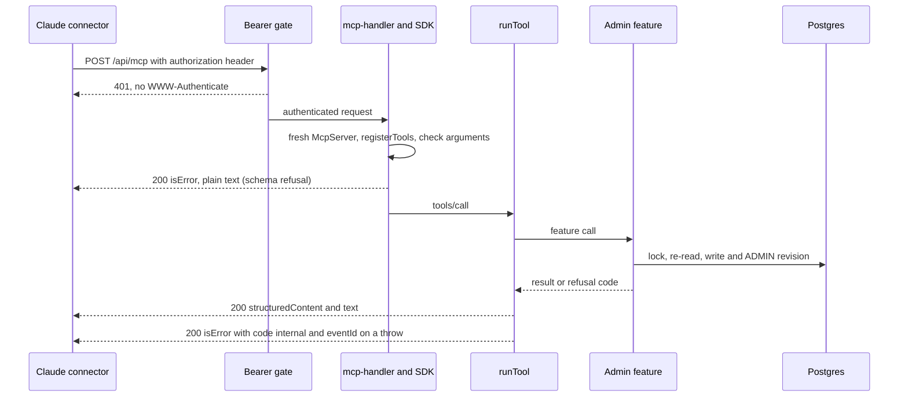

# MCP connector

The `jowray` MCP server at `https://www.jowray.com/api/mcp` gives Rob's Claude fifteen admin tools to list, read, draft and edit memories, share on the sender's behalf, attach original files, fix a memory's files (edit a file's words, remove or restore a file, reorder them) and suggest places from photo and video GPS. Drafting works from any Claude surface (claude.ai, the phone, Desktop, cloud sessions, Claude Code) without the laptop checkout. Attaching files needs the originals on disk: Cowork with the folder mounted or Claude Code on the Mac. Each memory can also hold optional map coordinates.

**Status:** [PR #60](https://github.com/RobertdWray/jowray_com/pull/60) (route, the original eight tools below, `MCP_API_SECRET`, memory coordinates, the shared `sourceInput` derivation, the skill rewritten to prefer the connector; merged 2026-11-06 as `d583308` and deployed to Production). Plan and ledger: [`docs/plans/2026-11-06-mcp-endpoint.md`](../plans/2026-11-06-mcp-endpoint.md). `suggest_places` and per-photo coordinates in `get_memory` come from [PR #66](https://github.com/RobertdWray/jowray_com/pull/66) (plan [`docs/plans/2026-11-06-photo-gps-places.md`](../plans/2026-11-06-photo-gps-places.md), step B7, Refs #58; merged 2026-11-06 as `fa68582`). `MCP_API_SECRET` was set in Vercel Production on 2026-11-06 and production redeployed ([PR #68](https://github.com/RobertdWray/jowray_com/pull/68); ledger §3, done by the agent on Rob's choice, with the same value in the main checkout's `.env`): no header and a wrong bearer answer 401 with no `WWW-Authenticate`, the right bearer answered 200 with the then-current tool set. Both OAuth well-known paths answered 404 after PR #60's deploy. Ledger §3 leaves the rest of setup and real use open: the connector added, approval setup (now seven tools), the production smoke draft, the skill delivered to every surface, the first real run. `share_draft` merged in [PR #72](https://github.com/RobertdWray/jowray_com/pull/72), PR 1 of the attach-media plan, on 2026-11-07 as `59942b2`; it added the seventh approval. **PR 2 of the attach-media plan, in progress** ([§8](../plans/2026-11-06-mcp-attach-media.md#8-pr-2-request_upload--finalize_upload)): `request_upload` and `finalize_upload` bring the tool count to twelve. The recorded production checks predate both attach-media PRs. The photo tools `update_media`, `set_media_deleted` and `reorder_media` (plan [`docs/plans/2026-11-08-mcp-media-tools.md`](../plans/2026-11-08-mcp-media-tools.md)) bring the tool count to fifteen and the approval set to ten: [PR #101](https://github.com/RobertdWray/jowray_com/pull/101), merged 2026-11-09 as `f7af4db` and deployed to Production. Their first production use, the Lake George cleanup, ran on 2026-11-09 (plan §5.1).

## What we built

1. Rob adds a custom connector in Claude: the URL above, **No sign-in**, and the request header `authorization: Bearer <MCP_API_SECRET>`. Anthropic's servers call the site directly, so one connector serves every Claude surface; Claude Code adds the same URL and header itself.
2. Every `GET` or `POST` to `/api/mcp` first passes the bearer gate, `unauthorized(request, "mcp")` in `app/api/admin/_auth.ts`. It reads the `authorization` header before any env or Prisma access and compares it in constant time with `Bearer <MCP_API_SECRET>`. No secret configured, an empty one, or a missing or wrong header: a plain `401` (`{ error: { code: "unauthorized", message: "Unauthorized" } }`) with **no `WWW-Authenticate` challenge**, logged as `mcp_unauthorized`. The admin API's `ADMIN_API_SECRET` does not open it.
3. An authenticated request goes to `mcp-handler`, which builds a fresh `McpServer` for every request and runs `registerTools` on it: stateless, `maxDuration` 30 s, both protocol eras.
4. The model sees fifteen tools, each a thin adapter over a feature: `list_memories`, `get_memory` and `suggest_places` read; `draft_memory`, `share_draft`, `request_upload`, `finalize_upload`, `set_coordinates`, `update_memory`, `update_media`, `set_media_deleted`, `reorder_media`, `set_status`, `set_deleted` and `reissue_claim_link` write. `suggest_places` changes no memory: it asks OpenStreetMap for place names near each photo's or MOV/MP4 video's saved point through the site's cached, throttled lookup (photo-GPS plan B7; attach-media plan §9).
5. `draft_memory` takes a `sourceInput` (a `gmail` message id; an `sms` number, time and text; or `other` with the original text) and never a `source` or `sourceRef`. The server derives both with `prepareInput` from `lib/source-input.ts`, the same code the laptop script runs, so no model computes the dedup key.
6. Every answer our tools return carries the same JSON twice, as `structuredContent` and as a text block. A refusal is an `isError` result with a `code` the skill acts on; an unexpected exception becomes `{ code: "internal", eventId }`.
7. A memory may hold one WGS 84 `coordinates` pair for a future map, set by `draft_memory` or `set_coordinates` and read through MCP, including stale `set_coordinates` replies. Each photo or MOV/MP4 video may also hold the GPS read from its original (`Media.latitude`, `longitude`), read only through `get_memory`'s file rows and `suggest_places`. The admin page and the claim page never show either.
8. In Claude, Rob sets **requires approval** on ten tools, so Claude asks before each call: the nine annotated `destructiveHint: true` (including `share_draft` and the three photo tools) and `draft_memory`. Approval for `request_upload` and `finalize_upload` is Rob's choice; both have `destructiveHint: false, idempotentHint: true`, so the approval set stays ten. `suggest_places` is read-only (`readOnlyHint`, `openWorldHint`; it writes cache, quota and throttle rows) and is not among them. `draft_memory` keeps its non-destructive annotations, which are accurate (it only adds, and a repeat answers `duplicate`), but it writes a row and returns a live claim link, and the read tools bring text any visitor can submit (`suggest_places` also brings OpenStreetMap's place names and the files' original names) into the same session (Team Code Review, G1).

## Why we built it

Plan §1.1: the skill's save step "runs only on Rob's Mac: it needs the local checkout, `.env` with `ADMIN_API_SECRET`, and the cloud container's egress proxy refuses `jowray.com`." On 2026-11-05 a reply to a condolence note sat unsent with a placeholder because a claude.ai session could not save the memory. "A Claude custom connector at `https://www.jowray.com/api/mcp` fixes all three failures because Anthropic's infrastructure calls the site directly." Rob also wanted each memory to carry optional WGS 84 coordinates "for a future map, captured while the place is fresh".

## Key decisions (Rob)

| Decision | Source |
|---|---|
| `place` edits leave coordinates alone (Rob, 2026-11-06); `features/memories/claim.ts` and `features/admin/update-memory.ts` are not touched | [plan, decision 1](../plans/2026-11-06-mcp-endpoint.md) |
| One PR with ordered commits (Rob, 2026-11-06) | decision 3 |
| Rate limiting is the 32+ character secret, logged refusals and the daily memory budget; a Vercel WAF rule is a follow-up, not code. Accepted at plan approval (Rob, 2026-11-06: "Execute this plan in a new worktree") | decision 2, §8.1 |
| A separate `MCP_API_SECRET`: Rob rejected reusing `ADMIN_API_SECRET`, since rotating one value would break the script and the connector at once, and a connector's header cannot be edited, only removed and re-added | [plan §9](../plans/2026-11-06-mcp-endpoint.md) |
| `MCP_API_SECRET` in Production only among Vercel environments, never Preview (Preview deploys read a copy of production rows). Rob, 2026-11-06: the same value is also kept in the main checkout's local `.env`, where the connector's header value comes from | plan §0.3 and ledger §3, [environment.md](../environment.md), [PR #68](https://github.com/RobertdWray/jowray_com/pull/68) |
| Agent's calls, flagged for Rob's veto: `draft_memory` accepts only `sourceInput`; no server-side rounding of coordinates; the privacy guard is the tool description plus the skill asking Rob before saving; a named community or facility campus is a place, a residence or unit inside it is not | decision 4 |
| From the review round: every tool runs inside one error boundary that reports to Sentry and returns `{ code: "internal", eventId }`; `wrapMcpServerWithSentry` is called explicitly; versions pinned exactly (`mcp-handler` 2.3.1, `@modelcontextprotocol/server` 2.4.0) | decision 5, [plan §10](../plans/2026-11-06-mcp-endpoint.md) |
| A place phrase that names a home (a street address, or an apartment inside a campus) gets no coordinates at all, not even its town's or campus's. Orchestrator's call from the skill micro-tests, **flagged for Rob's veto** | decision 6 |
| From the Team Code Review (George and Oscar, orchestrator's triage): approval in Claude on `draft_memory` too, with its annotations unchanged; every tool's input strict; `maxToolInputElements` 1000; on `stale`, ask Rob whenever any field moved; the reply wording after a duplicate follows the row's current words | [plan §3](../plans/2026-11-06-mcp-endpoint.md) |
| Photo GPS (2026-11-06, photo-GPS plan): R3 the connector gets the place lookup too; D13 `suggest_places` may return a landmark's own point and the skill proposes `set_coordinates` only with it, never a photo's (camera) point; D14 a photo's coordinates are read only through these tools. `suggest_places` is read-only, so it adds no approval requirement. The code returns no partial `photos` on `disabled`, `daily_limit` or `provider_refused`; earlier successful lookups may be cached for a retry | [photo-GPS plan](../plans/2026-11-06-photo-gps-places.md), D13, D14, B7 |
| Share on behalf (Rob, 2026-11-06): R4–R7 allow `share_draft` to move a DRAFT to PENDING or APPROVED with the sender's agreed consent recorded as the stamp plus one ADMIN revision, no note or new column, and no family-admin alert ever. R4a: APPROVED publishes nothing public yet. Superseded by the See memories plan (2026-11-08, D1, D15). D8 leaves contact and mailing preferences, confirmations and the claim link unchanged; D11 commits a terminal `admin_shared` alert row with the share | [attach-media plan §2 and §7](../plans/2026-11-06-mcp-attach-media.md#7-pr-1-share_draft) |
| R1: any memory not deleted accepts connector uploads: DRAFT, PENDING, APPROVED or HIDDEN, with D7's narrow `not_ready` exception | [attach-media plan §2](../plans/2026-11-06-mcp-attach-media.md#2-rulings-and-calls), Rob, 2026-11-06 |
| R3: no laptop upload script; use the same tool steps from Claude Code on the Mac when Cowork cannot reach the upload host | attach-media plan §2, Rob, 2026-11-06 |
| D1: a presigned PUT sends bytes straight to Blob with curl; `issueSignedToken` and `presignUrl` use the existing storage token, with no new secret | attach-media plan §2 and §8.6, planner's call |
| D2: `MCP_API_SECRET` authenticates the admin tools; no HMAC upload ticket. The upload URL allows one path, write-once, for 60 minutes | attach-media plan §2 and §8.6, planner's call |
| D3: reserve the exact declared size. The CDN enforces the maximum and `x-content-type`; completion checks size equality and bytes before READY | attach-media plan §2 and §8.3, planner's call; [S0.3 header correction](../plans/evidence/2026-11-mcp-attach/s03-spike.md) |
| D4: `declaredSha256` is the session's claim, `checksumSha256` is server-verified; the verified hash always wins in dedupe | [attach-media plan §8.4](../plans/2026-11-06-mcp-attach-media.md#84-identity-and-dedupe-d4), planner's call |
| D7: uploads never email or change memory status or consent. A non-DRAFT memory with no words and no READY file is `not_ready`, so an admin attachment cannot trigger its first confirmation and alert | attach-media plan §2 and §8.5, planner's call |
| D9: finalize gets 25 s within the route's 30 s limit; cron backfills missed work | attach-media plan §2 and §8.5, planner's call |
| D10: finalize and cron use one completion path for `Media.addedVia = ADMIN`; validation precedes READY, and READY plus its ADMIN revision commit together | attach-media plan §2 and §8.3, planner's call |
| D14: original files on disk only, in a mounted Cowork folder or Claude Code on the Mac. Pasted chat uploads may be re-encoded or capped and are not supported | attach-media plan §2, planner's call; Cowork reachability still open in S0.3 |
| Not doing: `withMcpAuth` and OAuth metadata routes (the challenge would start a sign-in with no authorization server behind it); an `Origin` allow-list; an IP allow-list (it would block Claude Code on the Mac); rate limiting in code; turning off Sentry's MCP output recording (Rob's 2026-11-04 telemetry ruling; scrubbing is the guard); a hand-built `sourceRef` in `draft_memory` | plan §9 |

## How it works



<a id="the-nine-tools"></a>

<a id="the-ten-tools"></a>

### The fifteen tools

| Tool | Calls | Success payload | `isError` codes | Annotations | Approval in Claude |
|---|---|---|---|---|---|
| `list_memories` | `listMemoriesForAdmin` with `includeCoordinates: true`, and `adminStatusCounts()` | `{ query, rows, shown, total, counts }`; newest first, at most 200 rows, each with `coordinates` | `invalid` | `readOnlyHint` | no |
| `get_memory` | `getMemoryForAdmin(memoryId, { includeCoordinates: true })` | the admin view (contributor, files, newest 25 revisions, emails, `memoryVersion`, `reviewVersion`) plus `coordinates`, deleted or not | `not_found` | `readOnlyHint` | no |
| `draft_memory` | `prepareInput(args)`, then `draftMemory` | `{ memoryId, claimLink, originalNoteRecorded }` | `invalid { message }` (also any `prepareInput` refusal), `duplicate { memoryId, status }`, `budget_exceeded` | `destructiveHint: false`, `idempotentHint: true` | yes; the skill's step 2b questions still come first |
| `share_draft` | `shareDraftAsAdmin` | `{ status, memoryVersion }` (the new version) | `invalid` (also APPROVED without `reviewVersion`), `not_found`, `not_draft`, `stale { current: { memoryVersion, status: "DRAFT" } }` (also when APPROVED and `reviewVersion` no longer matches) | `destructiveHint: true`, `idempotentHint: true` | yes; Rob must say the named sender agreed |
| `request_upload` | `requestUploadAsAdmin` | `{ mediaId, status: "PENDING", upload: { method: "PUT", presignedUrl, headers: { "content-type", "x-content-type" }, expiresAt } }`, `{ status: "READY", mediaId, alreadyAttached: true, metadataIgnored? }`, or `{ status: "PENDING", mediaId, uploaded: true }` | `invalid`, `not_found`, `not_ready`, `unsupported_type`, `too_large`, `too_many_files`, `budget_exceeded`, `conflict { mediaId }` | `destructiveHint: false`, `idempotentHint: true` | Rob's choice; the approval set stays ten |
| `finalize_upload` | `finalizeUploadAsAdmin` | `{ status: "PENDING", uploaded, verifying? }`, `{ status: "FAILED", reason? }`, or `{ mediaId, status: "READY", memoryType, gps: "found" \| "none" \| "pending" \| "not_applicable" }` | `invalid`, `not_found` | `destructiveHint: false`, `idempotentHint: true` | Rob's choice; the approval set stays ten |
| `set_coordinates` | `setMemoryCoordinatesAsAdmin` | `{ changed, memoryVersion }` | `invalid`, `not_found`, `stale { current: { memoryVersion, coordinates } }` | destructive, idempotent | yes |
| `update_memory` | `updateMemoryAsAdmin` | `{ written, current }` | `invalid`, `not_found`, `last_words`, `stale { current }` | destructive | yes |
| `set_status` | `setMemoryStatusAsAdmin` | `{}` | `invalid` (also APPROVED without `reviewVersion`), `not_found`, `draft`, `stale` (APPROVED only: the memory, its contributor or a file changed since `get_memory`; no new version is returned, so the model re-reads) | destructive, idempotent | yes |
| `update_media` | `updateMediaAsAdmin` | `{ written, current }` | `invalid`, `not_found` (also a file that is not READY), `stale { current }` | destructive, idempotent | yes |
| `set_media_deleted` | `setMediaDeletedAsAdmin` | `{ changed, current, restorableUntil? }` | `invalid`, `not_found`, `last_file`, `not_restorable`, `too_many_files`, `stale { current }` | destructive, idempotent | yes |
| `reorder_media` | `reorderMediaAsAdmin` | `{ changed, current }` | `invalid`, `not_found`, `mismatch { current }`, `stale { current }` | destructive, idempotent | yes |
| `set_deleted` | `setMemoryDeletedAsAdmin` | `{ purgedFiles }` | `invalid`, `not_found` | destructive, idempotent | yes |
| `reissue_claim_link` | `reissueDraftClaimLink` | `{ memoryId, claimLink }` | `invalid`, `not_found`, `not_draft` | destructive, not idempotent | yes |
| `suggest_places` | `suggestPlacesForMemory(memoryId)`: `lookupPlace` per unique point of the memory's live READY photos and MOV/MP4 videos that have GPS, no viewer key, one 20 s deadline | `{ photos: [{ mediaId, originalFilename, coordinates, labels }], pending, attribution }`; `photos` includes videos too; `coordinates` is where the camera was, a landmark label's `point` is the place's own | `not_found`, `disabled`, `daily_limit`, `provider_refused` (`pending` lists file ids whose lookup came back `busy` or `failed`) | `readOnlyHint`, `openWorldHint` | no |

Approving publishes a memory on See memories, so `set_status` APPROVED and `share_draft` to APPROVED carry `reviewVersion` from `get_memory` (TCR round 1, B1-3). It is a fingerprint of `Memory.updatedAt`, `Contributor.updatedAt` and each live file's id, status and `updatedAt` (`lib/review-version.ts`), recomputed under the memory lock; a mismatch answers `stale` and writes nothing. Background work on a file (the location scan, the hash) also moves it, so a stale answer can come without a visible change; the answer is the same: read again, then approve. PENDING and HIDDEN never need it.

`update_memory` edits words, date, place, visibility, the contributor's name and relationship, patches (`tags`, replacing the whole list) and the timeline year and month (`approxYear`, `approxMonth`; `null` clears, and a month needs a year). Send only the keys being changed.

Every tool can also answer `internal { eventId }`. On `stale`, `update_memory`'s description tells the model to compare every editable field in `current` with the value it read before the edit and to show Rob and ask before retrying whenever any differs, even a field it is changing, because a retry sends Rob's value over the other person's; only a move of the versions alone is retried without asking (Team Code Review, O2). `not_found` means no such memory or, for `suggest_places` and every write except `set_deleted`, a soft-deleted one (`get_memory` answers a soft-deleted memory, marked by `deletedAt`); `last_words` refuses emptying the words of a memory with no ready file; `draft` means `set_status` refuses a DRAFT: only the sender's Share or `share_draft` leaves DRAFT. Its description says: "A DRAFT is refused (`draft`); use `share_draft`." Reissuing revokes the link already sent. The exact model-facing contract (titles, descriptions, annotations, input JSON Schemas) is the inline snapshot in `__tests__/api/mcp.test.ts`. Annotations are hints: approval is a per-tool setting Rob applies in Claude, and must be applied again after every re-add of the connector. Success payloads are mapped field by field, so no answer carries `claimToken`, `claimTokenHash`, `blobUrl` or `storageKey`; the claim link appears only in the two success payloads that exist to return it.

### Attaching files

Use the original files on disk, in Cowork with their folder mounted or in Claude Code on the Mac (D14). Files pasted into a chat may be re-encoded or size-capped; they are not the supported upload source. Any memory not deleted accepts files, including PENDING, APPROVED and HIDDEN (R1). The exception is a non-DRAFT memory with no words and no READY file: `request_upload` refuses it with `not_ready` (D7).

1. Read each original's SHA-256, byte size and MIME type locally (`shasum -a 256` for the hash; 64 lowercase hex characters). Keep the file unchanged between hashing and upload. Use the same per-kind limits as the claim page (`lib/media-types.ts`), with at most ten live files on one memory. A Live Photo is two files: attach its HEIC/JPG and MOV to the same memory, with a separate request and finalize for each; ten slots hold at most five pairs.
2. Call `request_upload` with `{ memoryId, file: { name, type, size, sha256 }, caption?, approxDateText?, place?, durationSeconds? }`. A new reservation answers PENDING with `upload.method: "PUT"`, `presignedUrl`, both headers (`content-type` and `x-content-type`) and `expiresAt`. The URL allows one path, write-once, for 60 minutes; its type and maximum size are fixed by this request. READY with `alreadyAttached: true` needs no PUT. PENDING with `uploaded: true` means the bytes are already there: go straight to finalize.
3. For a returned upload, PUT the original with exactly the returned headers. The URL is a credential already in the `request_upload` result: copy it only into the temporary curl config below, created mode 600 and removed by the trap after the PUT. The command that writes the config is the only command that carries the URL. Never put it in chat prose or a reply, Gmail, a manifest or another file, a log or an error message, or curl's own arguments; `-K` keeps it out of curl's argv. Never `echo` it, `cat` the config, or use `set -x`, `curl -v` or `--trace`. Each shell call starts clean, so do not rely on environment variables from an earlier command. Fill the placeholders from the tool result and the original's path, then run:

   ```bash
   (
     set +x
     set -eu
     umask 077
     upload_config="$(mktemp "${TMPDIR:-/tmp}/jowray-upload.XXXXXX")"
     trap 'rm -f "$upload_config"' EXIT
     cat > "$upload_config" <<'JOWRAY_UPLOAD_CONFIG'
   url = "<upload.presignedUrl, exactly as returned>"
   JOWRAY_UPLOAD_CONFIG
     curl --disable -sS --fail -X PUT -K "$upload_config" \
       -H "content-type: <upload.headers.content-type>" \
       -H "x-content-type: <upload.headers.x-content-type>" \
       --data-binary "@<absolute path of the original>" --output /dev/null
   )
   ```

   Run it with the list indentation removed: the closing `JOWRAY_UPLOAD_CONFIG` line must start at the beginning of its line, or the shell waits for it forever.

   The quoted heredoc delimiter stops the shell expanding anything inside the URL, and `-sS --fail` reports only curl's exit code and the HTTP status, never the URL. Mark `uploaded` only after curl exits 0. The config is temporary credential storage, not a batch artifact. The [S0.3 spike](../plans/evidence/2026-11-mcp-attach/s03-spike.md) found that the CDN enforces `x-content-type`; a wrong plain `content-type` alone was accepted. Always send both returned headers. An expired URL or a lost PUT response is recovered through `request_upload` with the same file identity, not by repeatedly PUTting to a write-once path.
4. Call `finalize_upload` with `{ memoryId, mediaId }`. The media must belong to that memory and neither may be deleted, otherwise it returns `not_found`; malformed input is `invalid`. PENDING carries `uploaded: false` when bytes have not arrived, or `uploaded: true` and optional `verifying` while completion is pending. Retry through `request_upload` if bytes are missing; otherwise retry finalize later. FAILED may carry `size_mismatch`, `checksum_mismatch`, `too_large`, `wrong_type` or `unrecognized_bytes`. A repeated finalize of a FAILED row omits the reason because it is not stored. READY returns `mediaId`, `memoryType` and `gps`: `found`, `none` or `pending` for photos and MOV/MP4 videos; audio stays `not_applicable`. After READY, call `suggest_places` for photo and video place names. GPS still `pending` can be checked again after cron; it does not mean the file has no location.

**Identity and recovery (D4).** Dedupe is within one memory, for rows not deleted. A READY row matches its verified `checksumSha256`; only while that is null may its `declaredSha256` match. This also finds a sender's site upload by its verified checksum. A PENDING row matches its declaration while younger than 24 hours. FAILED rows never match. A matching row whose size (the stored size of a READY file, the reserved size of a PENDING one) or kind differs from the declaration returns `conflict { mediaId }`. Inspect that row and the original instead of inventing a different hash. Reusing PENDING replaces `caption`, `approxDateText` and `place` with the newest values. READY keeps its metadata and answers `metadataIgnored: true` whenever `caption`, `approxDateText`, `place` or `durationSeconds` was sent. A lost request response can therefore be recovered with the same `sha256` without reserving a second file. The skill keeps `jowray-attach-manifest.json` in the session folder and resumes each file not marked `finalized` by calling `request_upload` again.

**Checks and completion (D3, D9, D10).** The session computes the declared hash. The CDN enforces the maximum body size and declared type through `x-content-type`. The server's shared `recordMedia` path checks the stored label, file prefix and exact size before READY. It hashes files up to 50 MiB (`INLINE_HASH_MAX_BYTES`) before READY and rejects a mismatch; a timed-out hash leaves PENDING. Larger files are hashed by cron step (b); a late mismatch warns in Sentry and logs ids only, and the verified hash takes precedence in later dedupe. It does not quarantine the file. READY and the ADMIN revision commit in one transaction, exactly once, whether finalize or cron step (a) wins. Finalize has a 25 s budget within `/api/mcp`'s 30 s limit: missed image derivations and GPS reads are backfilled by cron steps (g) and (h). No Blob completion callback is used. Finalize never sends email, changes the memory's status or records consent; sharing still needs the sender's Share or `share_draft`.

**Video location.** The server reads location from MOV and MP4 originals: first Apple's `com.apple.quicktime.location.ISO6709` in `moov/meta` with an `mdta` handler (`keys`/`ilst`), then the same `mdta` layout under `moov/udta/meta` (where ffmpeg writes it), then Android's `moov/udta/©xyz`. The first `data` value with UTF-8 type 1 is used; zero coordinates (0, 0) count as absent, as for photos. Bounded ranged reads fetch box headers and metadata, never the video payload: at most 64 top-level boxes, depth 6, 16 reads, a 16 MiB `moov`, 16.5 MiB total and the caller's deadline. A file the parser finishes with no usable location, or rejects as malformed or beyond its bounds (box count, depth, read calls, total bytes, an oversized `moov`), is stamped `absent`; only read failures (a timeout, a range the store did not honour, a short read, a missing object) leave it undecided. Cron step (h) retries and backfills existing READY videos alongside photos, at most 10 files per run; after three failed attempts the row stays undecided. Browser location reading on `/share` and for claim-page place hints still covers photos only (F6), and WebM location is not read (F7). The video fixtures are synthetic by Rob's choice (2026-11-07); generation and provenance are in `__tests__/fixtures/README.md`.

**Network and credentials.** The PUT host is `vercel.com`, not the MCP host. In Cowork, add `vercel.com` to the allowed domains in claude.ai, Settings → Capabilities, and check `curl -sI https://vercel.com/api/blob` for an HTTP response rather than a proxy refusal. S0.3 leaves that Cowork check open. The plan's C14 records an allowlist failure in "Package managers only" mode; if blocked, run these same steps from Claude Code on the Mac (R3), with no laptop upload script. Sentry scrubs the `presignedUrl` field and the `vercel-blob-signature` and `vercel-blob-delegation` query parameters; Pino redacts `presignedUrl`. Never put the URL into an error message or free-text log: exception and event message scrubbing remains follow-up F3. Multipart uploads and showing a Live Photo pair as one item are follow-ups F2 and F7.

### Sharing on the sender's behalf (`share_draft`)

The tool's title is "Share a draft on the sender's behalf". Its strict input is `{ memoryId: uuid, memoryVersion: ISO timestamp exactly as get_memory returned it, status: "PENDING" | "APPROVED" }`; no other keys are accepted. Use it only when Rob says in this conversation that this named sender agreed (in person, by phone or by message) and asks to record that consent. Never infer consent from a warm reply or silence. Ask Rob which status: PENDING to review it first, or APPROVED. An APPROVED memory with visibility PUBLIC (Everyone) appears on See memories once the family turns on `PUBLIC_MEMORIES_ENABLED`. See the [See memories plan (2026-11-08, D1, D15)](../plans/2026-11-08-see-memories.md).

`shareDraftAsAdmin` in `features/admin/share-draft.ts` locks and re-reads the memory in one transaction. It refuses a missing or deleted memory (`not_found`), a memory that is no longer DRAFT (`not_draft`), or a changed `memoryVersion` (`stale`, with the current version and `status: "DRAFT"`). On `stale`, re-read with `get_memory`, show Rob what changed and ask before retrying; on `not_draft`, stop. A success writes the chosen status, `consentedAt` (now) and `consentVersion` (`CONSENT_VERSION`), the same stamp as the sender's Share, and one ADMIN revision: `before { status: "DRAFT", consentedAt: null }` → `after { status, consentedAt }`. Consent is recorded by this stamp and revision only: no note and no new column (R6).

The same transaction writes a terminal `EmailLog` row: `emailType: "ADMIN_NEW_MEMORY"`, `status: "SKIPPED"`, `errorMessage: "admin_shared"`. It commits with the status change, and no alert creator acts on a DRAFT, so there is no gap in which an alert can be sent. The email service never claims a SKIPPED row with this reason; other skip reasons stay reclaimable. The family-admin alert never fires for this memory, including after later sender activity (R5, D11). If the memory unexpectedly already has a non-terminal admin-alert row (including SENT or SENDING), the share is refused, nothing is written, and the tool answers `internal { eventId }`, because sharing must never leave an alert able to send.

The share leaves `contactOptIn`, `mailingListOptIn` and `notifyWhenPosted` unchanged. The claim link keeps working and the sender can still edit. A claim-link content edit, file add, removal or replacement sends an approved memory back to PENDING for review; visibility and preference changes alone do not. A drafted memory never gets the site's confirmation, before or after either kind of share, so sharing does not rotate the link (D8). The success payload is `{ status, memoryVersion }` with the new version; invalid input is refused as `invalid`, and an unexpected failure is `internal { eventId }`, like every tool. A repeated share returns `not_draft` without another stamp or revision.

### Fixing files (`update_media`, `set_media_deleted`, `reorder_media`)

Before these tools, nothing could change or remove a file once it was attached: the admin gallery is view-only and the per-file edits live on the sender's claim page. Each tool takes `memoryId` and the `memoryVersion` read from `get_memory` (or `current.memoryVersion` from the previous write), locks the memory, and answers `stale` with `current` when the version moved. Every write appends one ADMIN revision and moves `memoryVersion` last (`touchMemory` in `features/memories/media-state.ts`, `max(now, previous + 1 ms)`, supplied explicitly because Prisma leaves `@updatedAt` alone on an empty update). A call that changes nothing writes nothing and leaves the version as it was. An admin edit never sends an APPROVED memory back for review, as with `update_memory`.

- `current` is `{ memoryVersion, status, visibility, media, removedMedia }`: the visible files (live, not a replacement still uploading, any status, in display order) with their words and slots, and the removed files that can be restored (`features/admin/media-editable.ts`). On `stale`, compare `status`, `visibility` and every file in both lists with what you read; if anything differs, show Rob and ask; if nothing does, retry once with `current.memoryVersion` and stop at a second `stale`.
- `update_media` edits a READY file's `caption`, `approxDateText` or `place` (only the keys sent; null clears one) and copies them to a replacement still uploading. A PENDING file answers `not_found`: a `request_upload` retry rewrites a reservation's words, so fix those by calling `request_upload` again.
- `set_media_deleted` with `deleted: true` removes a file. A READY file keeps its bytes until `purgeAfter` (removal + 30 days, answered as `restorableUntil`) and is listed in `get_memory.removedMedia`; a PENDING or FAILED file is cancelled with today's purge. A replacement still uploading for the file is cancelled with it. The only READY file of a memory without words is refused (`last_file`). `deleted: false` restores a file from `removedMedia` (`not_restorable` otherwise; `too_many_files` at the ten-file cap); it keeps its old slot.
- `reorder_media` takes every visible file's id (FAILED rows included, so up to 100), first to last, and writes slots 0..n−1; `mismatch` answers with the list to use. The card on See memories shows the first playable photo in this order. New uploads still sort last (the next slot is the row count).
- Cron step (f) skips a removed file until its `purgeAfter` has passed, both when it selects rows and in its locked re-check, so a restore that commits first wins. `Media.purgeAfter` is set only on a removed row (CHECK `Media_purge_after_removed`). A removed READY file keeps counting toward stored bytes until it is purged.
- `get_memory` names each file's `replacesMediaId` (null on an ordinary file) and lists `removedMedia` from a query of its own, so the rows `reviewVersion` hashes are unchanged.
- The claim page's file edits and removals also move `memoryVersion`, so a photo-tool call holding the version read before a sender's edit is refused `stale`. The reverse is last-writer-wins today: a claim-page form opened before an MCP edit and saved after it overwrites that edit (follow-up F-CLAIM-VERSION).

### Two kinds of refusal

- **Schema refusal.** The SDK checks the arguments against the tool's zod input schema before our code runs. A mismatch (a `source` or `sourceRef` on `draft_memory`, a mistyped `contributor` key, a half pair or an out-of-range coordinate, a non-uuid id, `DRAFT` as a status) is HTTP 200 with `isError: true` and the SDK's validation message as **plain text**: no `structuredContent`, no `code`, and the feature is never called. Every tool's input is strict at the top level (and `draft_memory`'s `contributor` too), so an unknown or misplaced key, such as a `note` beside `update_memory`'s `changes`, is refused rather than dropped (Team Code Review, G2). Before any schema runs, the SDK also refuses a call whose arguments hold more than 1000 elements (array items plus object members; `maxToolInputElements`, G3), the same way and with its own message; a full `draft_memory` has about 20.
- **Feature refusal.** The feature ran and said no. HTTP 200 with `isError: true` and JSON `{ code, ...extra }` (the feature's result without its `ok` flag) in both `structuredContent` and the text block. `prepareInput` refusals (a bad Gmail id, phone number or timestamp; an `other` email that differs from `contributor.email`) come back the same way as `invalid` with the message.
- **Transport answers** are not tool results: `401` from the gate; `400` for a malformed 2026-07-28 request (for example without `Mcp-Method`); `405` for an authenticated `GET` on the stateless 2025-era path; `500` when the handler itself fails.

### The error boundary and handler errors

The SDK turns any exception in a tool into an `isError` result carrying the raw message (a Prisma or Neon error, file paths included) and reports nothing (plan §1.4). So `runTool` in `app/api/mcp/tools.ts` wraps every tool: it tags the scope with `memory_id`, catches the exception, sends it to Sentry once (mechanism `mcp.tool`, tag `tool`), logs `mcp_tool_failed` with the tool, `memoryId` and `eventId`, and returns `{ code: "internal", eventId }`. The skill tells Rob the `eventId` and retries once; a draft that did commit answers `duplicate` on the retry.

Errors the SDK raises outside a tool (a `registerTools` throw, a transport failure, a protocol rejection of an authenticated caller) go to its `onerror`, which `mcp-handler` silently drops unless `onEvent` is set (review round 1, R1). The route's `reportHandlerEvent` sends each `ERROR` event to Sentry once (mechanism `mcp.handler`, level from its severity, tag `mcp_source`) and logs `mcp_handler_error` with the source, severity and `eventId`. It ignores the request events, which carry the request's parameters.

### Coordinates

- Two nullable `Float` columns on `Memory`, `latitude` and `longitude` (Postgres `double precision`): WGS 84 decimal degrees, named fields so they are never swapped. Migration `20261106120000_memory_coordinates` is expand-only, with no backfill, and adds three CHECKs: `Memory_coordinates_pair` (both or neither), `Memory_latitude_range` (-90 to 90) and `Memory_longitude_range` (-180 to 180). `coordinatesSchema` in `lib/validations/memory.ts` repeats the ranges as a strict object.
- Set by `draft_memory` (optional; the creation revision's `after.coordinates` records it, `null` when absent), by `set_coordinates`, and, because it parses the same draft schema, by the admin draft API `POST /api/admin/memories` that the laptop script calls. Read through MCP, including stale `set_coordinates` replies.
- `set_coordinates` locks the memory, re-reads it, answers `not_found` for a missing or deleted memory and `stale` with `current` when `memoryVersion` is not the row's `updatedAt`, answers `changed: false` without writing when the pair is already equal, and otherwise writes both columns with one ADMIN revision `{ coordinates: old }` → `{ coordinates: new }`. It returns the committed `memoryVersion` either way, so a following write needs no re-read. `null` clears both. It never touches `place`, and `place` edits never touch it (decision 1).
- The admin page never sees them: `getMemoryForAdmin` and `listMemoriesForAdmin` add them only with `includeCoordinates`, and without it strip the `coordinates` key from revision snapshots and drop a revision that held nothing else. The stripping runs after the newest-25 `take`, so History can show fewer rows (follow-up 8.3).
- **Privacy rule** (decisions 4 and 6): coordinates of the named place (a town, a facility or community campus, a church, a park, a lake), never a residence, a street address or a unit inside a place; a place phrase that names a home gets none at all. The server cannot tell a home from a place, so the guard is the rule in both tools' descriptions ("Ask Rob before saving them") and the skill's Coordinates question. No server-side rounding: 4 decimal places still find a house to about 11 m (plan §9).

- **Per-file coordinates** (photo-GPS plan, D1, D14; attach-media plan §9): `Media.latitude` and `longitude`, read by the server from each photo's or MOV/MP4 video's original ([Media uploads](./media-uploads.md#photo-gps)), with their own CHECKs. `get_memory` adds `coordinates` to each file row only with `includeCoordinates` (`null` when none was found or the file is not decided yet); the admin page's view has no such key. No tool writes them, and `get_memory`'s description says each file's `coordinates` is where the camera was (often a home) and is never to be proposed for `set_coordinates` (final review).

### Place suggestions from photos (`suggest_places`)

- **Input** `{ memoryId }` (strict, like `get_memory`). **Answer** `{ photos, pending, attribution }`: one `photos` row per photo or MOV/MP4 video whose lookup came back (the response field keeps its name), with `mediaId`, `originalFilename`, `coordinates` (the file's point, where the camera was) and `labels`, each `{ text, kind }` with `kind` `landmark` or `town`; a landmark may carry `point`, if the provider supplied a valid place point (D13). `labels: []` means the point was looked up and nothing was worth offering. `attribution` is "© OpenStreetMap contributors".
- **Which files**: the memory's live `READY` photos and MOV/MP4 videos that have a saved point, in display order. A missing or soft-deleted memory is `not_found`. Files arrive through `request_upload` and `finalize_upload` or through the sender's claim page or `/share`. For Rob's files, use the connector with the originals on disk, then call `suggest_places` after finalize. The claim page stays the sender's route.
- **Lookups** (`features/places/suggest-for-memory.ts`): one `lookupPlace` per unique point (degrees × 1e6), one at a time, all under one deadline 20 s from the call's start (the route allows 30 s; a started provider call may take 5 s more). There is no viewer key, so the per-viewer limit does not apply; a call that reaches OpenStreetMap still counts against the site's daily provider limit and waits its turn for the site-wide slot, like a lookup from `/share`. Cached points answer at once.
- **Outcomes**: a point whose lookup was `busy` or `failed` puts its file ids in `pending`, not in `photos`; the description tells the model to call again at most twice, then tell Rob which files are still pending. `disabled`, `daily_limit` and `provider_refused` (Nominatim answered 403, 429 or 509) end the call with that code (not retryable).
- **Annotations** `readOnlyHint`, `openWorldHint`: it changes no memory (cache, quota and throttle rows only) and talks to OpenStreetMap. Not in the approval set. What it suggests is saved only through `update_memory` (a label's text as `place`) or `set_coordinates` (a landmark label's own point), after Rob answers; the skill's "Place suggestions from photos and videos" section has the questions. The description repeats the place rule and names the camera point as each file's `coordinates`, so the rule's `coordinates` are not read as applying to it (B7 review).
- **Sentry and logs**: the tool's MCP span carries its arguments and result, coordinates included, as Rob's telemetry ruling allows; Pino logs ids only and redacts `latitude` and `longitude` anyway.

### Protocol eras

One stateless handler serves the 2025-era Streamable HTTP (JSON-RPC over `POST`, `Accept: application/json, text/event-stream`, answered as JSON or SSE) and the 2026-07-28 protocol (headers `MCP-Protocol-Version: 2026-07-28` and `Mcp-Method`, plus `Mcp-Name` on `tools/call`, and a `_meta` envelope with the protocol version and client capabilities; a missing header is a 400). The tool list is static, so the server advertises `tools: { listChanged: false }` in both the 2025 `initialize` and the 2026 `server/discover` results (the SDK defaults it to true; review round 2, R8). `maxSubscriptions: 0` refuses `subscriptions/listen` ("Subscription limit reached") instead of holding the function open until `maxDuration`. Which era claude.ai and Claude Code actually use is not recorded yet (plan §5.3).

### Sentry and logs

- `registerTools` calls `Sentry.wrapMcpServerWithSentry(server)` (idempotent), so each call is an MCP span named for the tool. Under Rob's 2026-11-04 alpha ruling (`genAI: { inputs: true, outputs: true }` in `lib/sentry/data-collection.ts`) the span also carries the arguments and the result text (`mcp.tool.result.content`): contributor email and words may reach Sentry, as the policy allows.
- Claim links in tool-result spans are scrubbed: `scrubSpan` in `lib/sentry/scrub.ts` covers span attributes, and `__tests__/lib/sentry-envelope.test.ts` proves with the real SDK that the token in a `draft_memory` or a `reissue_claim_link` result never leaves while each tool's MCP span does (the reissue case added by the Team Code Review, G4).
- Upload credentials use the same guard: `presignedUrl` is a secret field in Sentry and a redacted Pino key; Sentry's URL scanner also strips `vercel-blob-signature` and `vercel-blob-delegation`. Exception value/message, event message and `logentry` scrubbing remain an open gap (attach-media F3), so never include a URL in thrown error text or a free-text log.
- An exception is reported once, by our boundary: the Sentry wrapper captures only when a handler throws, and ours never does.
- Pino logs ids only: `mcp_unauthorized` (path and whether a secret is configured, never the header), `mcp_tool_failed`, `mcp_handler_error`, and the features' own lines (`memory_drafted`, `draft_duplicate`, `admin_coordinates_set`, …). Never the header, arguments, words, emails or links; `verboseLogs` stays off.

## Operations and rollback

- **Connector setup:** follow [environment.md, "MCP connector"](../environment.md#mcp-connector-apimcp): the `www` URL (the apex answers 308, and a cross-origin redirect drops `Authorization`), **No sign-in**, header name `authorization` with the value `Bearer <MCP_API_SECRET>` typed with the scheme, then approval on ten tools (`draft_memory` and the nine destructive ones, including `share_draft` and the three photo tools); approval for the two upload tools is Rob's choice. An Owner adds it for the organisation. Claude Code: `claude mcp add --transport http jowray https://www.jowray.com/api/mcp --header "Authorization: Bearer <MCP_API_SECRET>"` (plan §5.3).
- **The secret:** `MCP_API_SECRET`, 32+ characters, Production + the main checkout's local `.env` (same value, set 2026-11-06), never Preview. Generating, setting and rotating it (rotation ends with removing and re-adding the connector and re-applying the ten approvals) are in the [`MCP_API_SECRET` row and the connector section](../environment.md#mcp-connector-apimcp). It is the organisation's credential: every request carries the same key, so revisions record `changedVia: ADMIN` with no person.
- **Expected symptoms:** a wrong or missing header should show in Claude as a connection error, never a sign-in prompt. `/.well-known/oauth-protected-resource` and `/.well-known/oauth-protected-resource/api/mcp` must stay 404; a future catch-all route there would break "No sign-in" (plan §5.1).
- **Local run:** a throwaway secret in the shell only (`MCP_API_SECRET=<throwaway> npm run dev`) against a Neon dev branch, never Preview (plan §6.2).
- **Turn it off:** remove `MCP_API_SECRET` from Production and redeploy; the route answers 401 to everything with no code change.
- **Rollback:** the memory-coordinates migration is expand-only: reverting that code leaves two unused nullable columns and three CHECKs (MCP plan §7). The attach-media migration is also additive: `Media.addedVia`, `Media.declaredSha256` and two CHECKs; old code ignores the columns. The attach-media plan's §12 accepts that, after a code revert, in-flight ADMIN rows may finish through the old cron without the hash check or ADMIN revision; existing presigned URLs last at most 60 minutes. The photo-tools migration (`Media.purgeAfter` and CHECK `Media_purge_after_removed`) is expand-only too, but a reverted cron no longer reads `purgeAfter` and purges every removed file at its next run, so before reverting, restore with `set_media_deleted deleted:false` each file in a `removedMedia` list that Rob wants to keep ([photo-tools plan](../plans/2026-11-08-mcp-media-tools.md) §7).
- **First file removal after the photo tools ship:** after the first production deployment of PR #101, the first `set_media_deleted deleted:true` waits until a `reconcile-uploads` run that started on the new deployment has finished. A run already going on the old deployment when the new one is promoted (route `maxDuration` 60 s) does not know `purgeAfter`, so its step (f) could purge a READY file removed in that window, grace or not. Check for a finished run in Sentry Crons (a `reconcile-uploads` check-in that started after the promotion time) or in the Vercel logs for `/api/cron/reconcile-uploads` after that time. Only this first deployment needs the wait: every later deploy carries the grace-aware cron, and a rollback is covered by restoring graced files before reverting (above).
- **Bulk drafts:** for a batch of photos, videos or notes, Claude publishes [`bulk-draft-review.html`](../skills/jowray-draft-memory/assets/bulk-draft-review.html) as a private claude.ai artifact (capabilities `db` and `user`), loads one first-draft record per memory into its `records` database and shares it with reviewers as Editors. People edit and approve on the page; it never calls `/api/mcp`. Claude then pushes only the Approved records through the skill's usual steps: `draft_memory`, `request_upload` and `finalize_upload` for each kept original (the originals must be on disk: Cowork with the folder mounted or Claude Code on the Mac), and `share_draft` only on Rob's word. Each record's `sync.remoteId` holds the memory id, so a retry updates that memory instead of drafting a second one. The setup, record schema and push steps are in the page's "Using this page with Claude" section.
- **Fallback:** if the connector is down or Anthropic withdraws the request-headers beta, the skill falls back to `scripts/draft-memory.ts` on Rob's Mac with `ADMIN_API_SECRET` ([Draft on behalf](./draft-on-behalf.md)).
- **After the merge:** plan §6.3: the 401/401/200 `curl` checks against production, the connector from the phone, one smoke draft agreed with Rob then removed with `set_deleted`, and the wrong-header and well-known checks. Any Vercel env change, adding or removing the connector, `reissue_claim_link` and the production test draft are STOP points for Rob (plan §0.3).

## Key files

| Path | Role |
|---|---|
| **app** | |
| `app/api/mcp/route.ts` | `GET` and `POST`: the gate, then `createMcpHandler` (`serverInfo` `jowray`, `listChanged: false`, `maxSubscriptions: 0`, `maxToolInputElements: 1000`, `onEvent` → `reportHandlerEvent`); `maxDuration` 30 |
| `app/api/mcp/tools.ts` | The fifteen tool definitions (`TOOLS`), `registerTools`, `toolResult`, `refusal`, the `runTool` boundary, the place rule |
| `app/api/admin/_auth.ts` | `unauthorized(request, realm)`: one bearer gate for the `admin` and `mcp` realms; plain 401, no challenge |
| **features** | |
| `features/admin/share-draft.ts` | `shareDraftAsAdmin`: lock, version check, consent stamp, ADMIN revision and terminal alert row in one transaction |
| `features/admin/attach-media.ts` | `requestUploadAsAdmin` and `finalizeUploadAsAdmin`: reservation and dedupe, presigned PUT, completion within 25 s; no email, status or consent change |
| `features/memories/create-memory.ts`, `features/memories/issue-upload-ticket.ts` | Shared `reservePendingMedia` and `renewPendingReservation`: ten-file cap, budgets and reservation renewal |
| `features/memories/ingest-upload.ts`, `features/memories/media-state.ts`, `app/api/cron/reconcile-uploads/route.ts` | Shared ADMIN completion checks, READY plus one ADMIN revision; checksum, derive and GPS backfill |
| `features/admin/set-coordinates.ts` | `setMemoryCoordinatesAsAdmin`: lock, re-read, `stale`, `changed: false`, one ADMIN revision |
| `features/admin/get-memory.ts`, `features/admin/list-memories.ts` | `includeCoordinates` opt-in (the memory's pair and, in `get_memory`, each file's); revision stripping for the admin page |
| `features/memories/draft-memory.ts` | Stores the pair on create and in the creation revision |
| `features/admin/update-memory.ts`, `features/admin/set-status.ts`, `features/admin/set-deleted.ts` | Existing admin writes behind three tools, unchanged |
| `features/admin/update-media.ts`, `features/admin/set-media-deleted.ts`, `features/admin/reorder-media.ts`, `features/admin/media-editable.ts` | The photo tools: lock, version check, one ADMIN revision, `touchMemory` last; `current` and the restorable set |
| `features/places/suggest-for-memory.ts` | `suggestPlacesForMemory` behind `suggest_places` (photo and MOV/MP4 video GPS); the lookup itself is `features/places/lookup-place.ts` |
| **lib + server** | |
| `lib/validations/mcp.ts` | `mcpListInputSchema`, `mcpDraftInputSchema` (strict, `sourceInput` instead of `source` + `sourceRef`); strict copies of the six admin schemas the other tools take (`mcpMemoryIdSchema`, `mcpCoordinatesSchema`, `mcpMemoryChangesSchema`, `mcpStatusSchema`, `mcpDeletedSchema`, `mcpShareDraftSchema`, and the photo tools' `mcpMediaWordsSchema`, `mcpMediaDeletedSchema`, `mcpMediaOrderSchema`); `mcpShareDraftSchema` is `adminShareDraftSchema.strict()` from `lib/validations/admin.ts`; the admin schemas stay as the REST routes use them. PR 2 adds strict request-upload and finalize-upload inputs, including the nested `file` object |
| `lib/validations/memory.ts`, `lib/validations/admin.ts` | `coordinatesSchema`, `coordinatesOf`, `draftMemoryObjectSchema`; `adminCoordinatesSchema` and the `isoDate` description the model reads. `lib/validations/admin.ts` also defines `adminRequestUploadSchema` and `adminFinalizeUploadSchema`; their descriptions are what the model reads |
| `lib/video-gps.ts` | `readVideoLocation`: bounded ISO-BMFF box walk over ranged reads; Apple `mdta` location first, then Android `©xyz`; no video payload download |
| `lib/media-location.ts` | `hasLocationReader`: `image/*`, `video/quicktime` and `video/mp4`; shared eligibility for extraction, follow-ups, suggestions and cron |
| `lib/source-input.ts` | `sourceInputSchema` and `prepareInput`, shared with `scripts/draft-memory.ts` |
| `server/config/env.ts` | `mcpSchema` and `getMcpEnv()` (`MCP_API_SECRET`, empty means unset) |
| `lib/sentry/secrets.ts`, `lib/sentry/scrub.ts`, `lib/logger/logger.ts` | `presignedUrl` redaction and Sentry's `vercel-blob-signature` / `vercel-blob-delegation` query scrubbing |
| **services + integrations** | |
| `services/storage/types.ts`, `integrations/vercel-blob/index.ts` | `presignPut`: one private path, write-once, declared type and maximum size, 60-minute lifetime; existing Blob token |
| `services/storage/types.ts`, `integrations/vercel-blob/index.ts` | `readRange(pathname, offset, length, { signal })`: strict `Content-Range` validation, bounded body reads and cancellation; throws `RangeNotHonouredError` or `ShortReadError`, but returns `null` for a missing object. `features/media/extract-photo-gps.ts` maps that `null` to its own `OriginalMissingError`; these read failures leave location undecided |
| **scripts and docs** | |
| `scripts/draft-memory.ts` | The laptop fallback; imports and re-exports `prepareInput` |
| `docs/environment.md` | `MCP_API_SECRET` row; "MCP connector (`/api/mcp`)" setup, rotation and fallback |
| `docs/skills/jowray-draft-memory/SKILL.md` | The skill: connector first, script as the text-draft fallback; original-file uploads and the session recovery manifest; the coordinates question; `share_draft` on Rob's word; `duplicate`, `stale` and `internal` handling |
| `docs/skills/jowray-draft-memory/assets/bulk-draft-review.html` | Bulk review board: an artifact template with its own database where admins review and approve Claude's first drafts for many files before Claude pushes them through this connector (Operations, "Bulk drafts") |
| **tests** | |
| `__tests__/api/mcp.test.ts` | Gate; `tools/list` inline snapshot (the contract); every result row; boundary on all fifteen tools; schema and `prepareInput` refusals, including an unknown top-level key on every tool and arguments over 1000 elements; no `claimToken` in any body; the 2026-07-28 era; `listChanged: false` in both eras |
| `__tests__/features/update-media.test.ts`, `set-media-deleted.test.ts`, `reorder-media.test.ts`, `media-editable.test.ts`, `__tests__/integration/media-edit-tools.test.ts` | The photo tools: refusal order, no-op, revision shapes, version moved last; on real Postgres the lock queue, versions through `TIMESTAMP(3)`, reorder then upload, restore ties, a replacement landing after a removal, `reviewVersion` with removed rows and the CHECK |
| `__tests__/api/mcp-handler-errors.test.ts` | A registration throw in either era reaches Sentry once and Pino with ids only; protocol rejections reported; request events ignored |
| `__tests__/features/attach-media.test.ts`, `__tests__/integration/attach-media.test.ts` | PR 2 reservation, dedupe, recovery, refusal and completion cases; real-Postgres concurrency and revision checks |
| `__tests__/features/ingest-upload.test.ts`, `__tests__/api/reconcile.test.ts` | ADMIN exact-size and checksum checks through finalize and cron; one READY revision, aborted work stays PENDING |
| `__tests__/integrations/vercel-blob.test.ts` | `presignPut` constraints: path, type, maximum size, expiry and write-once |
| `__tests__/lib/sentry-scrub.test.ts`, `__tests__/lib/sentry-envelope.test.ts`, `__tests__/lib/logger.test.ts` | Presigned credential scrubbing in fields, URL query parameters and real MCP spans; Pino field redaction |
| `__tests__/lib/sentry-envelope.test.ts` | MCP span case with the real SDK: `draft_memory` and `reissue_claim_link` spans with `mcp.tool.result.content`, neither tool's `SENTRYTEST_` token in any envelope |
| `__tests__/api/admin-auth.test.ts`, `__tests__/lib/env.test.ts` | Realms independent, fail closed, no `WWW-Authenticate`, header read before env; `getMcpEnv` |
| `__tests__/features/set-coordinates.test.ts`, `__tests__/features/admin-memories.test.ts`, `__tests__/features/draft-memory.test.ts` | The coordinates feature; no coordinates anywhere in the admin page's view, a file's only with the opt-in; the pair on a draft |
| `__tests__/features/share-draft.test.ts`, `__tests__/services/email.test.ts`, `__tests__/api/reconcile.test.ts`, `__tests__/integration/share-draft.test.ts` | Feature: both targets, the consent stamp and ADMIN revision, refusal order `not_found` → `not_draft` → `stale` with nothing written, rollback when the suppression insert fails. Email, "terminal admin share suppression": the real `deliver()` never claims or sends an `admin_shared` row; ordinary SKIPPED reasons and a NULL reason stay reclaimable; `skipDelivery` cannot overwrite it. Reconcile A3: cron steps (d) and (e2) skip a shared memory with the terminal row. Integration (real Postgres in CI): the consent CHECK for both targets, one terminal row |
| `__tests__/features/suggest-for-memory.test.ts` | One lookup per unique point, sequential, no viewer key, one 20 s deadline; `pending`; the ending codes; `not_found` for a deleted memory |
| `__tests__/lib/source-input.test.ts`, `__tests__/lib/validations-admin.test.ts`, `__tests__/lib/validations-memory.test.ts`, `__tests__/scripts/draft-memory.test.ts` | The shared derivation (the script re-exports it, its test unchanged); schemas |
| `__tests__/integration/memory-coordinates.test.ts` | Real Postgres (CI): each CHECK refuses by SQLSTATE 23514 and constraint name; valid pairs and extremes stored unchanged |
| **Prisma** | |
| `prisma/schema.prisma`, `prisma/migrations/20261106120000_memory_coordinates/migration.sql` | `Memory.latitude`, `Memory.longitude`; the columns and three CHECKs |
| `prisma/migrations/20261107000000_media_admin_upload/migration.sql` | Nullable `Media.addedVia` and `declaredSha256`; lowercase SHA-256 and ADMIN/declaration consistency CHECKs |
| **packages** | |
| `package.json` | `mcp-handler` 2.3.1 and `@modelcontextprotocol/server` 2.4.0, pinned exactly |

## Tests and evidence

- The tests above. `__tests__/api/mcp.test.ts` runs the real route, gate, env accessor, `mcp-handler` and SDK with the features mocked; its inline snapshot pins each tool's name, title, description, annotations and input schema, so any change to what the model sees shows in the diff.
- Attach-media PR 2 is in progress; the new test rows above describe its coverage, not completed release verification. The [S0.3 spike](../plans/evidence/2026-11-mcp-attach/s03-spike.md) measured the `vercel.com` host, write-once rejection, oversize rejection, enforced `x-content-type` and curl's mode-600 `-K` path. Cowork reachability, combined PR 2 checks and production smoke remain open in the [attach-media ledger](../plans/2026-11-06-mcp-attach-media.md#4-ledger-evidence-bearing-update-after-every-step).
- Recorded checks (plan §3): at `48d7621`, `npm run validate` green, `npm run test:run` 74 files / 1365 passed and `npm run build:offline` green with `/api/mcp` dynamic; at `e2f9a86`, with `TEST_DATABASE_URL` on a local Postgres 18.6, both integration suites passed (75 files / 1372); PR #60's `ci` green, including `prisma migrate deploy` on Postgres 18 and the integration suites. Three `/code-review` rounds: R1–R5 and R8 applied as fix-up commits, R6 and R7 declined with reasons, round 3 found nothing.
- Locally with a throwaway secret (`next dev`, plan §3 commit 5, and the end-to-end run on a Neon branch off `dev`, plan §6.2): 401 with no header or a wrong bearer, no `WWW-Authenticate`, both well-known paths 404, an authenticated `GET` 405; every tool PR #60 shipped, in both eras; every tool exercised, including `stale`, `changed: false`, clearing, a schema refusal for a half pair and latitude 91, `draft` on a DRAFT, `duplicate` with the same id, and the `prepareInput` email mismatch; the text block equal to `structuredContent` on every JSON result; the admin page and its History showing no coordinates. Photo-GPS [B9 and `ce32c7a`](../plans/evidence/2026-11-photo-gps/README.md) also exercised `suggest_places` and per-file coordinates with the stub.
- Sensitivity: with `beforeSendSpan` returning spans unscrubbed, the envelope case fails on the token; with `Memory_longitude_range` dropped, exactly the three longitude cases fail.
- Skill micro-tests (plan §6.4): round 3 with mocked tools passed at `c227994`; edges applied in `57e59aa`. Post-TCR e2e and selected skill scenarios passed at `166edde`; wording fixed in `7e89a92` (plan §3).
- Team Code Review (George and Oscar at `353121c`; plan §3): fix-ups `e27d97d` to `c4a3d7e`; at `c4a3d7e`, `npm run validate` green, `npm run test:run` 74 files / 1367 passed, `npm run build:offline` green. Declined suggestions are recorded in a [PR comment](https://github.com/RobertdWray/jowray_com/pull/60#issuecomment-6692691326).
- Photo tools ([PR #101](https://github.com/RobertdWray/jowray_com/pull/101), plan §0 and §5.1): on the merged head `33acd61`, `npm run validate` exit 0, `npm run test:run` 140 files / 3800 passed, the integration suites on Postgres 18 17 files / 265 passed (including `media-edit-tools`), `npm run build:offline` exit 0, `ci` green; one Team Code Review round (5 findings, all fixed or recorded) and a regression review with no serious regressions. Production smoke on 2026-11-09 against memory `9fb0209f`: `tools/list` showed fifteen tools; `set_media_deleted` removed `b7ba9311` (`restorableUntil` 2026-12-09) and `update_media` set `aa5aa5a5`'s caption, each with one ADMIN revision and a new `memoryVersion`; a `reorder_media` in the current order answered `changed: false` with the gapped slots; the public page showed the five remaining photos and the new caption, and `/api/public-media/b7ba9311…` answered 404 while a live photo answered 302; after the next cron run the removed file was still in `removedMedia`, so it was not purged. The writes went over HTTPS from Claude Code with the bearer; the final read went through the refreshed claude.ai connector, which listed the three new tools.
- **NOT RUN:** authenticated production tool calls beyond the ledger's post-deploy check (200 with the pre-`share_draft` tool set), and the smoke draft (plan §6.3); a real Claude connector, so the wrong-header prompt check (§5.1), the protocol era each client uses (§5.3) and the approval prompts (§5.4) are unrecorded; the skill on claude.ai; a real condolence note through the connector; `suggest_places` through a real connector and against production Nominatim (photo-GPS plan, steps B9 and B12).

## Known gaps and follow-ups

- Plan §8 (to be filed as issues after merge): 8.1 Vercel WAF rate-limit rule on `/api/mcp`, medium, Rob's; 8.2 OAuth per-person sign-in if the request-headers beta is withdrawn or more admins join, low; 8.3 History shows fewer than 25 rows when coordinate-only revisions are stripped, low; 8.4 per-file coordinates on `Media` is delivered by the photo-GPS feature ([PR #66](https://github.com/RobertdWray/jowray_com/pull/66)), though the plan row still reads open; 8.5 retire `scripts/draft-memory.ts` after a few weeks of connector traffic, low; 8.6 the future map must emit GeoJSON `[longitude, latitude]`, note; 8.7 bound `get_memory`'s output (25 revisions of up to 10,000-character notes, sent twice, can exceed a client's tool-result limit), low-medium (Team Code Review, O1).
- Decisions 4 and 6 still await Rob's veto or acceptance.
- No person in the audit trail: the secret is shared, so MCP writes are `changedVia: ADMIN` like the admin page's (debt catalog M-E-03; [#105](https://github.com/RobertdWray/jowray_com/issues/105)).
- Photo tools follow-ups (plan §10): [#103](https://github.com/RobertdWray/jowray_com/issues/103) a stale claim-page form overwrites an MCP file edit (claim saves carry no version), medium; [#104](https://github.com/RobertdWray/jowray_com/issues/104) one monotonic rule for every writer of `memoryVersion`, low; admin gallery buttons for the same edits, added to [#75](https://github.com/RobertdWray/jowray_com/issues/75#issuecomment-6744529478), low. The refreshed claude.ai connector kept `get_memory`'s pre-PR description on 2026-11-09 (the server's `tools/list` is current); re-add the connector if it stays stale.
- Plan §8.8 / attach-media F3 (medium): Sentry exception messages, `event.message` and `logentry` remain unscrubbed (`lib/sentry/scrub.ts`); a URL in thrown text could expose a presigned credential.
- Attach-media [§17](../plans/2026-11-06-mcp-attach-media.md#17-follow-ups-bucket-4-real-out-of-scope-file-as-issues-after-merge-and-list-in-the-pr-body): F2 multipart above 100 MB is deferred (one PUT still applies, up to the site's per-kind limit); F7 a Live Photo pair is two files and two slots, not one displayed item; F11 Cowork's "Package managers only" allowlist failure needs a recheck. Video GPS is PR 3, while WebM location remains F7.
- Code versus plan: the migration's header comment still says coordinates are "Set and read only through /api/mcp", but the admin draft API also writes them; the comment was left because the migration is already applied on the preview and verification branches (plan §3, review round 1, R5). `prisma/schema.prisma` and `lib/validations/memory.ts` state it correctly.

## Related

- [Draft on behalf](./draft-on-behalf.md) (the skill and the admin API this connector serves), [Admin panel](./admin-panel.md) (the same admin features; never shows coordinates), [Sentry telemetry](./sentry-telemetry.md) (the data policy and the scrubber)
- [Plan: bearer-protected MCP endpoint](../plans/2026-11-06-mcp-endpoint.md) (decisions, §1.4 package facts, §3 ledger, §7 rollback, §8 follow-ups, §9 not doing), [its source issue](../plans/2026-11-06-mcp-endpoint-issue.md), [the skill](../skills/jowray-draft-memory/SKILL.md)
- [Plan: photo GPS and place suggestions](../plans/2026-11-06-photo-gps-places.md), [Share form, place suggestions](./share-form.md#place-suggestions-from-photos), [Media uploads, photo GPS](./media-uploads.md#photo-gps)
- [Environment](../environment.md) (`MCP_API_SECRET`, the connector section, `ADMIN_API_SECRET` for the fallback), [Code layout](../code-layout.md)
