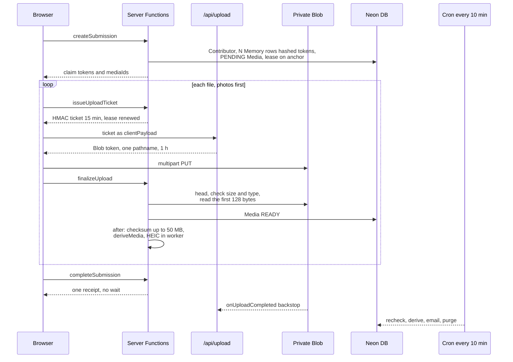

# Media uploads

How a photo, video or recording gets from a visitor's browser into private storage, how the server makes the web copy and thumbnail it shows (HEIC included), and how the private claim page lets the contributor add, remove and replace files.

**Status:** merged to `main`, which deploys to production: [PR #7](https://github.com/RobertdWray/jowray_com/pull/7) (2026-11-03: tickets, `/api/upload`, finalize, claim links, cron), [PR #22](https://github.com/RobertdWray/jowray_com/pull/22) (2026-11-03: remove, replace, cancel), [PR #25](https://github.com/RobertdWray/jowray_com/pull/25) (2026-11-03: derived images, HEIC worker), [PR #27](https://github.com/RobertdWray/jowray_com/pull/27) (2026-11-04: many files per memory), [PR #28](https://github.com/RobertdWray/jowray_com/pull/28) (2026-11-04: `createSubmission`, `issueUploadTicket`, `completeSubmission`, lease), [PR #48](https://github.com/RobertdWray/jowray_com/pull/48) (2026-11-05: byte check before `READY`, egress allowance, bounded image pipeline; issue #45) and [PR #50](https://github.com/RobertdWray/jowray_com/pull/50) (2026-11-05: serialised budgets, reservation windows, per-send cap, storage ceiling, revision cap; issue #44). The production check of the HEIC pipeline is not recorded (see gaps). Photo GPS saved per photo comes from [PR #66](https://github.com/RobertdWray/jowray_com/pull/66) (plan [2026-11-06-photo-gps-places](../plans/2026-11-06-photo-gps-places.md), Refs #58; not merged yet).

## What we built

1. On Send, `createSubmission` creates the contributor, up to 10 memories and their `PENDING` `Media` rows in one transaction. File bytes never reach the app server.
2. For each file, photos first, the browser asks `issueUploadTicket` for an HMAC-signed ticket naming one row, its Blob pathname, MIME type and size ceiling. Tickets last 15 minutes.
3. The browser trades the ticket at `/api/upload` for a Blob client token scoped to that pathname, type and size (1 hour), then uploads straight to the private Vercel Blob store, multipart, with progress.
4. The browser calls `finalizeUpload`. The server runs `head()` on the ticketed pathname, checks size and type, then reads the first 128 bytes and marks the row `READY` (relabelled if the bytes are another allowed type of the same kind). Over the ticketed size or a type other than the ticket's makes it `FAILED` and deletes the blob; bytes it does not recognise make it `FAILED` as `unrecognized_bytes`, never served, with the bytes kept. After the response it hashes files of 50 MB or less and starts the derived copies.
5. Every photo gets a `WEB_IMAGE` (long edge 2048 px, metadata and GPS stripped) and a `THUMBNAIL` (1000 px JPEG, at most 350 KB, transparency flattened onto the paper colour). HEIC is decoded by libheif in WebAssembly inside a worker thread; other formats go through sharp. Pages show only a derived copy; the claim page says "Preparing your photo…" until it exists. The original stays downloadable.
6. When every file is done the browser calls `completeSubmission` once. It sends one receipt with every private link straight away; receipts carry no pictures since issue #46, so nothing waits for thumbnails (see [Email and cron](./email-and-cron.md)).
7. On `/m/<token>` the contributor can add files (10 live files per memory), remove one (two-step, soft delete), replace one (the old file stays until the new one is `READY`), edit per-file words, and use "Try again" or "Cancel" on a file that never arrived.
8. Two backstops cover a closed tab: Blob's signed `onUploadCompleted` callback, and the reconcile cron every 10 minutes.
9. Every photo's GPS is read from its stored original, in a step of its own, and saved on that photo (`Media.latitude`, `longitude`). It is shown nowhere on the site, admin page included; only Rob's MCP tools read it ([Photo GPS](#photo-gps)).

## Why we built it

The phase 1 plan explains why finalize is the main path and the Blob callback only a backstop: in production the SDK's callback URL resolves to the redirecting apex domain, previews sit behind Deployment Protection, and local dev gets no callback ([phase 1 plan §2](../plans/2026-11-02-phase1-database-infrastructure-memory-collection.md)).

The derived copies fix a real defect. Photos plan Context: "A production memory at www.jowray.com shows `Download IMG_8487.HEIC (this browser cannot display image/heic)` instead of the photo. The code is correct; the browser cannot decode HEVC and no renderable copy exists. iPhones shoot HEIC by default." Issue #17 found that sharp's prebuilt libvips has no HEVC decoder (`libde265` missing) while `heic-decode` (libheif in WASM) decoded the same photo in about 0.7 s. Rob's request, verbatim there: "We should be converting these images so they can be rendered… The user should be able to delete the image, replace the image, or add an image."

The lease exists because "a single 45-minute upload today already races" the cron step that emails and rotates the claim token ([photos plan §1, P11](../plans/2026-11-03-photos-derived-media.md)).

## Key decisions (Rob)

| Decision | Source |
|---|---|
| Checksum: `READY` after `head()` verifies size and type (and, since issue #45, the first bytes); SHA-256 inline in `after()` only up to 50 MB, otherwise by the cron. | [ledger, decisions](../plans/phase1-ledger.md) |
| Sharing `/share` publicly "Blocked until the Vercel WAF rate-limit rule and Spend Management are on". WAF rule set 2026-11-04 at 1200 requests per IP per 600 s (Rob: "each file costs about 3 requests"); Spend Management still open. | [ledger, one-off actions](../plans/phase1-ledger.md) |
| Every photo gets a derived copy, EXIF and GPS stripped; "Placeholder until sanitized; originals downloadable." | [photos plan §2](../plans/2026-11-03-photos-derived-media.md) |
| Photo GPS (2026-11-06): D1 stored per photo, never on the memory; D2 the server reads it from the stored original, independent of the derived copies, and never stores a point the browser sends; D3 the outcome is durable, with at most 3 attempts and a cron step that retries and backfills; D14 shown nowhere on the site, redacted from logs, kept in Sentry. | [photo-GPS plan, Decisions](../plans/2026-11-06-photo-gps-places.md) |
| One Memory, many Media of mixed kinds; one claim link, one email. | [photos plan §2](../plans/2026-11-03-photos-derived-media.md) |
| R5: HEIC originals "Kept at full quality; the server converts for previews only." R3: video posters deferred; `POSTER` reserved. | [ledger R3, R5](../plans/phase1-ledger.md) |
| HEIC decodes in a `worker_threads` Worker with a heap cap and `terminate()` at the deadline. | [photos plan §2](../plans/2026-11-03-photos-derived-media.md) |
| "Every device… No desktop/phone fork" was superseded by D9: cards on computers, one memory on phones, up to 10 mixed files per card. Requester's amendment, flagged for Rob. | [share redesign D9](../plans/2026-11-03-share-redesign.md) |
| D10: no per-file words on the share form; PR #27's columns stay editable on the claim page only. Agent's call, not yet acknowledged. D16 (completion waited up to 10 s for thumbnails, agent's call) is retired: receipts carry no uploaded pictures since issue #46 D1. | [share redesign D10, D16](../plans/2026-11-03-share-redesign.md), [ledger Task 15](../plans/phase1-ledger.md) |
| Inline views 302 to a 60-second presigned URL, so a 500 MB video never streams through a 60 s function. Agent ruling. | [ledger Task 5](../plans/phase1-ledger.md) |
| The raw token is never stored, so the cron path rotates it; the emailed link supersedes the on-screen one. Agent ruling. | [ledger Task 8](../plans/phase1-ledger.md) |
| Issues #44 and #45: Rob, 2026-11-05, each open decision takes the issue's suggested default: 4 GiB per send, 50 GiB total, 50 / 100 viewer-days per file before / after approval, 300 requests per viewer and copy a day, 50 GiB a day site-wide and 25 MiB proxy downloads (all env), 200 revisions per memory (a constant). A byte-check or decoder verdict never deletes an original (a deliberate departure from #45's acceptance item 2, under the merge-safety rule). | [PR #50](https://github.com/RobertdWray/jowray_com/pull/50), [PR #48](https://github.com/RobertdWray/jowray_com/pull/48) decisions tables |

## How it works

`deriveMedia` claims before it works: a `PENDING` `DerivedMedia` row with its candidate key is created per kind (`@@unique([mediaId, kind])` makes a racing worker lose at once), the original is decoded once, both copies are written, and each row is published under the memory row lock with a conditional update only that claim can satisfy. Failures are recorded as `too_many_pixels:<limit>`, `decode_failed`, `timeout`, `too_large` or `unsupported_type`; retryable ones get 3 attempts via cron step (g). The claim page calls `router.refresh()` every 3 s, ten times, while a copy is pending. Remove, cancel, replace and the swap on `READY` run inside `lockMemory` (`SELECT … FOR UPDATE`), recompute `Memory.type` and append a `MemoryRevision`. Limits: `MAX_BYTES` 25 MB photo, 100 MB voice, 500 MB video; `MAX_FILES_PER_MEMORY` 10; ticket 15 min; Blob token 1 h; lease 80 min; presign 60 s. Budgets (issue #44): every reservation carries `Media.reservedUntil` (creation or last ticket + 75 min, the ticket TTL plus the Blob token's life); the daily byte budget counts READY rows created today and every open reservation (cancelled ones included: a cancel cannot recall a Blob token already handed out), so a reservation that never receives bytes stops holding the budget when its window closes; `MAX_DECLARED_BYTES_PER_SUBMISSION` (default 4 GiB) bounds one send; `TOTAL_BYTE_CEILING` (default 50 GiB) bounds READY originals + derived copies + open reservations; and every budget check holds one transaction-scoped advisory lock (`lockBudget`, taken last in lock order, with a 5 s `lock_timeout` that turns a long wait into the ordinary "try again later") and reads one SQL statement, so concurrent writers cannot overshoot and no file can fall between two snapshots. Every "Try again" decides under that lock on a fresh read whether the window is still open (then it just extends it) or has closed (then it re-reserves); none is issued for a reservation older than a day. A claim-page save that changes nothing writes no row and no revision, and a memory keeps at most 200 revisions (the first plus the latest).

**Public-repo audit C (issue #45, 2026-11-05).** Three guards sit on top of the flow above. (1) Before a row becomes `READY`, `recordMedia` reads the blob's first 128 bytes (`StorageService.readPrefix`, a `Range` request; empty files are refused without one) and asks `detectMediaType` in `lib/media-types.ts` what they are: the declared type when the bytes agree; another allowed type of the same kind when they do not (a JPEG saved as `.heic`, a WebP named `.jpg`, a Voice Memo named `.mp3` are relabelled, never deleted); bytes of another kind or of no allowed type make the row `FAILED` as `unrecognized_bytes`, never `READY` and never served, but the bytes are **kept** (`blobUrl` records them) because a 128-byte verdict must not destroy a family's file; only the checks main already had (over the ticketed size, declared type not the ticket's) delete. QuickTime/MP4 need only a valid leading top-level atom (`ftyp` is optional in QTFF); MP3 may start with zero padding, an ID3v2 or APEv2 tag, or a frame; WAV may be RIFF, RF64 or BW64. Rows already `READY` are never re-read; `deriveMedia` applies the same relabelling to legacy rows from the buffer it already holds, and a decoder verdict never deletes an original. (2) `serveMedia` charges the **first request a viewer (client address) makes for a copy of a file on a day** with that copy's size against two daily counters in `EgressCounter` (`features/media/egress.ts`, one conditional statement each): the file's own (`MEDIA_FILE_DAILY_MULTIPLE` viewer-days × size once the memory is `APPROVED`, `MEDIA_FILE_DAILY_MULTIPLE_UNAPPROVED` before) and the site's (`MEDIA_DAILY_EGRESS_BYTES`); the viewer's later requests that day (probes, ranges, seeks, reloads) are free up to `MEDIA_VIEWER_DAILY_REQUESTS`. So a family watching a video all day costs viewers × size, and a published link is bounded by viewer-days × size per file and bytes per day site-wide. A claim-link holder over any of the three gets `429` + `Retry-After`; the admin route is counted, never refused; a counter error fails open (served, reported). Downloads up to `MEDIA_PROXY_DOWNLOAD_MAX_BYTES` (25 MiB, as on main) stream through with the sanitized filename; larger ones redirect with the blob host's `download=1` switch. (3) `deriveMedia` takes the one decode slot *before* it downloads the original; a full waiting line (`MAX_WAITING_DERIVATIONS`) or a slot that arrives after the deadline answers `deferred` with nothing claimed, so cron step (g) comes back to it, and one deadline from entry covers the wait, the download (aborted if it stalls) and the decode. An animated GIF over `maxFrames` (300) or whose whole frame strip is over `maxPixels` is derived as a still of its first frame (the download keeps the animation).

### Photo GPS

`features/media/extract-photo-gps.ts` reads a photo's GPS from the original and records the outcome on the row. It never goes through the derived copies, which are stripped, and cron step (g) never revisits a photo that has them, so GPS has its own state and its own retries.

1. **When it runs.** After `finalizeUpload` answers, as its own deferred task (`finalize.photo_gps`, apart from the checksum and the copies). The upload callback's backstop runs it too, before the derived copies, for a closed tab. Cron step (h) is the retry and the backfill for photos stored before the feature.
2. **Eligible.** `READY`, `image/*`, not removed, memory not deleted, not decided yet (`gpsCheckedAt` null), under 3 attempts (`gpsAttempts`), stored by this environment (`storagePrefix()`). Anything else is `skipped` at once.
3. **Claim.** A conditional update moves `gpsAttempts` from the count just read; of two workers that read the same row, exactly one wins and reads the bytes, the other is `skipped`.
4. **Read.** A JPEG's first 128 KiB (`StorageService.readPrefix`, a `Range` read) first; the whole original only when the prefix found nothing and its metadata continues past it. Any other image (HEIC, PNG, WebP…) is read whole. One 15 s deadline covers both reads: its `AbortSignal` goes to `readPrefix` and `get`, so a stalled read or download, body included, is aborted. ExifReader (`lib/photo-gps.ts`) parses the bytes; zero coordinates, a missing or wrong N/S/E/W reference, out-of-range values or no GPS count as absent.
5. **Outcomes.** `found` writes the pair and `gpsCheckedAt` in one update; `absent` only the stamp; both only while the row is still undecided, so another worker's decision stands. `failed` (unreadable bytes, a missing original, the deadline, any throw) leaves the row undecided for a later attempt and goes to Sentry with `step: photo_gps`. `skipped` writes nothing. Database CHECKs keep the pair together, in range, and only with the stamp. The log line carries the outcome and the attempt, never a coordinate; the logger also redacts `latitude` and `longitude` at the top level and up to three levels down (any depth in Sentry extras).
6. **Cron step (h).** Undecided photos of this environment with attempts left, oldest first, at most 10 per run. A photo starts only when its whole 15 s deadline still fits in the run's 50 s budget, so running out of run time never costs a photo an attempt; the rest wait 10 minutes. Each runs in its own Sentry isolation scope; the run's counts are `gpsFound`, `gpsAbsent`, `gpsFailed` and `gpsSkipped`, and a failed read is not a run error.

The browser also reads GPS, only to suggest place names on `/share` ([Share form](./share-form.md#place-suggestions-from-photos)); that point is never sent to be stored.

## Key files

| Path | Role |
|---|---|
| **app** | |
| `app/share/actions.ts` | Thin Server Functions for the four steps |
| `app/api/upload/route.ts` | Token exchange in `onBeforeGenerateToken`; `onUploadCompleted` backstop writes a `WebhookEvent` |
| `app/api/media/[id]/route.ts` | Token-gated file route; `v=web|thumb|original`, `download=1` |
| `app/m/[claimToken]/page.tsx`, `claim-form.tsx`, `media-list-client.tsx`, `actions.ts` | Claim page, edit form, per-file cards and their Server Functions |
| `app/api/cron/reconcile-uploads/route.ts` | Steps (a0) late-arrival sweep, (a) stale PENDING, (c) event replay, (d) email retries, (e) (e2) (e3) confirmations, (b) checksums, (f) purge, (f2) cancelled reservations, (g) derive, (h) photo GPS |
| **features** | |
| `features/memories/create-submission.ts`, `issue-upload-ticket.ts`, `ingest-upload.ts`, `complete-submission.ts` | Create, ticket, `recordMedia`/`finalizeUpload`/checksum/swap, complete (2-minute lease grace) |
| `features/memories/create-memory.ts`, `claim.ts` | `withinBudget` and claim-page tickets (add, replace); view, edit, remove, cancel, per-file words |
| `features/memories/derive-media.ts`, `lock.ts`, `media-state.ts`, `upload-lease.ts` | Claim-decode-publish; row lock and `lockBudget`; type recompute, revisions and the 200 cap; lease |
| `features/media/extract-photo-gps.ts` | The photo GPS step: claim, read from the original, record `found` / `absent`; `MAX_GPS_ATTEMPTS`, `GPS_READ_DEADLINE_MS` |
| `features/media/serve-media.ts`, `features/media/egress.ts` | Shared body of the media routes (`READY` only; 404 for any staging key); the `EgressCounter` statements |
| **services and integrations** | |
| `services/storage/index.ts`, `types.ts`, `integrations/vercel-blob/index.ts` | put, head, get, `readPrefix` (a `Range` read), del, presignGet |
| `services/images/index.ts`, `types.ts`, `integrations/images/sharp-heic.ts` | `DERIVE_DEFAULTS` (`maxFrames` 300), `MAX_WAITING_DERIVATIONS`; one decode, two encodes, the slot taken with `acquire` |
| **lib** | |
| `lib/upload-ticket.ts`, `lib/upload-client.ts`, `lib/submission-pipeline.ts` | Ticket mint and verify with TTLs; `uploadWithTicket`; browser sequencing with one retry |
| `lib/heic-worker.ts`, `lib/derived-keys.ts`, `lib/image-derive-error.ts`, `lib/site-url.ts` | Worker decode; key scheme; error codes; storage prefixes |
| `lib/photo-gps.ts` | ExifReader 4.51.0 (pinned): `readGpsFromBytes` (server), `readGpsFromFile` (browser), `jpegMetadataComplete` |
| `lib/media-types.ts`, `lib/claim-token.ts`, `lib/validations/media.ts` | MIME allowlist, limits and byte signatures (`detectMediaType`); hashed tokens; claim-page schemas |
| `server/config/env.ts` | `getUploadEnv` (budgets, per-send cap, ceiling), `getMediaServingEnv` (allowances, proxy download size) |
| **tests** | |
| `__tests__/lib/upload-ticket.test.ts`, `upload-client.test.ts`, `claim-token.test.ts`, `derived-keys.test.ts`, `heic-worker.test.ts`, `media-types.test.ts`, `submission-pipeline.test.ts`, `validations-media.test.ts` | Pure logic |
| `__tests__/features/create-submission.test.ts`, `issue-upload-ticket.test.ts`, `ingest-upload.test.ts`, `complete-submission.test.ts`, `claim.test.ts`, `derive-media.test.ts`, `lock.test.ts`, `media-state.test.ts`, `create-memory.test.ts` | Features with mocked db and storage |
| `__tests__/api/upload.test.ts`, `media.test.ts`, `admin-media.test.ts`, `reconcile.test.ts`, `__tests__/integrations/images.test.ts`, `vercel-blob.test.ts`, `__tests__/server/media-serving-env.test.ts`, `__tests__/fixtures/tiny.heic`, `rotated.heic`, `signatures.ts`, `anim-400.gif`, `anim-400x10.gif` | Routes and viewing sequences against the allowance; real sharp and libheif against fixtures; bounded prefix reads |
| `__tests__/lib/photo-gps.test.ts`, `__tests__/features/extract-photo-gps.test.ts`, `__tests__/integration/extract-photo-gps.test.ts`, `__tests__/integration/media-coordinates.test.ts` | GPS parsing against generated fixtures; the step's claim, reads, outcomes and deadline; the CHECKs and the conditional writes on real Postgres |
| `__tests__/integration/budget-concurrency.test.ts` | Real Postgres (`TEST_DATABASE_URL`, a Postgres 18 container in `ci`): concurrent sends, adds, replacements and re-tickets at the budget's last slot, the lock timeout |
| **Prisma** | |
| `prisma/schema.prisma` | `Media` (`storageKey`, `status`, `maxBytes`, `deletedAt`, `purgedAt`, `reservedUntil`, `replacesMediaId`, `sortOrder`, per-file words), `DerivedMedia` (`WEB_IMAGE`, `THUMBNAIL`, reserved `POSTER`), `EgressCounter`, `WebhookEvent`; `Media.latitude`, `longitude`, `gpsCheckedAt`, `gpsAttempts` |
| `prisma/migrations/20261105140000_media_reserved_until`, `prisma/migrations/20261105140000_egress_counters` | `reservedUntil` with its backfill and index; the counter table |
| `prisma/migrations/20261106200000_photo_gps_places` | The photo GPS columns and CHECKs (pair, ranges, coordinates only with the stamp), `PlaceLookup` and `PlaceLookupThrottle`; no new index (step (h)'s query measured on 5,010 rows: about 0.3 ms (B3)) |

## Tests and evidence

`npm run test:run` covers the files above; the images test runs the real decoders. Evidence:

- `docs/plans/evidence/2026-11-issue17/` ([README](../plans/evidence/2026-11-issue17/README.md)): a 48×64 HEIC fixture uploaded on the PR #25 preview renders upright in desktop Chrome; inline, `v=thumb` and `v=original` behaved as designed.
- `docs/plans/evidence/2026-11-share-redesign/` ([README](../plans/evidence/2026-11-share-redesign/README.md)): scripted Chromium checks, a phone send with a clip and two photos reaching `READY`, a real-database run of cron step (e3) honouring and then passing a lease.

Not run or not recorded: the iPhone and Android pass (HEIC, `.mov`, recording, five mixed files), a real 24 MP HEIC on Vercel, the issue #17 production acceptance A1, real receipt emails, a 100 MB video, seeking past the 60 s presigned URL, the Spend Management pause, photos plan V4 to V8 and V10 to V13.

## Known gaps and follow-ups

- M-H-03, M-H-10 (issue #38 §1.2): real-phone pass and issue #17 production checks never run.
- M-B-02 (§1.2): measure a 24 MP HEIC on Vercel; lower `maxPixels` or raise memory if it fails.
- M-B-05 (§1.2): iOS video seeking against the 60 s presigned URL unverified.
- M-H-01 (§1.3): Spend Management pause still open; `/share` formally blocked until then.
- M-B-01 (§3.4): video posters reserved, not built.
- M-B-04, M-B-06 (§3.4): shared raw decode on the sharp path; purge misses PENDING blobs on deleted memories.
- M-B-13 (§3.4): no "send me my link again"; rotation happens only on the cron path.
- M-B-12 (§4.4): accepted lease-renewal race.
- M-C-09, M-B-16 (§3.6): per-file words on the share form await Rob; a replacement cannot clear inherited words.
- M-C-20: the claim page shows the web copy, never `v=thumb`.
- Issue #45: the allowance numbers are first guesses (Rob to adjust by env); `EgressCounter` rows are never pruned (one per file, copy, viewer and day; a cron prune step is B's file); `FAILED` rows with `unrecognized_bytes` keep their blob until the file is cleared or the memory deleted (a cron sweep is B's file); the device matrix for the byte check has not been run on a preview; whether the private blob host honours `download=1` on a presigned URL is unverified.
- Photo GPS: the device pass (iPhone Photos with Location on, Android Chrome) and the production backfill check are not run yet (plan steps B9 and B12). A photo whose three attempts all failed stays undecided and is never read again.
- Issue #44: the 4 GiB per-send cap and 50 GiB ceiling are first guesses (Rob to confirm against real sends); D5, expiring never-approved memories, is not built.

## Related

- [Share form](./share-form.md), [Audio recording](./audio-recording.md), [Email and cron](./email-and-cron.md), [Admin panel](./admin-panel.md), [Draft on behalf](./draft-on-behalf.md), [Sentry telemetry](./sentry-telemetry.md)
- [Photos plan](../plans/2026-11-03-photos-derived-media.md), [Phase 1 plan](../plans/2026-11-02-phase1-database-infrastructure-memory-collection.md), [Phase 1 ledger](../plans/phase1-ledger.md), [Share redesign](../plans/2026-11-03-share-redesign.md), [Debt catalog](../2026-11-04-debt-catalog.md)
- [issue #17](https://github.com/RobertdWray/jowray_com/issues/17), [issue #38](https://github.com/RobertdWray/jowray_com/issues/38)
- [Code layout](../code-layout.md), [Environment](../environment.md) ("Image conversion"), [Admin](../admin.md)
