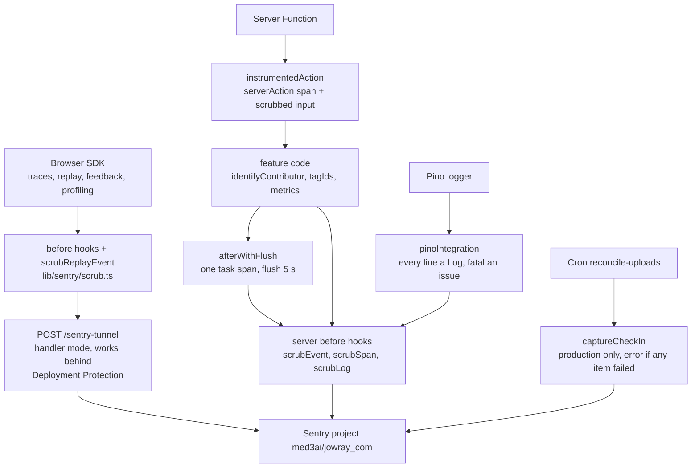

# Sentry telemetry

Error tracking and full telemetry for jowray.com: both Sentry inits, a handler-mode tunnel, the alpha "collect everything" data policy, and the scrubber that keeps bearer secrets out regardless.

**Status:** merged. Phase 1 install: [PR #5](https://github.com/RobertdWray/jowray_com/pull/5), [PR #8](https://github.com/RobertdWray/jowray_com/pull/8), [PR #13](https://github.com/RobertdWray/jowray_com/pull/13) (2026-11-03). Alpha telemetry: [PR #32](https://github.com/RobertdWray/jowray_com/pull/32), [PR #33](https://github.com/RobertdWray/jowray_com/pull/33), [PR #34](https://github.com/RobertdWray/jowray_com/pull/34) (2026-11-04). All six are on `main`, the production branch. The production smoke check (plan §11.4) is not recorded.

## What we built

1. A family member opens any page. The browser SDK starts a 100 % trace, an unmasked Session Replay and, in Chromium, a browser profile (every response carries `Document-Policy: js-profiling`).
2. Typing a name and email on `/share`, or opening a claim page, calls `identifyContributor`, so `user.email` rides on every later event, replay and log.
3. Every Server Function is wrapped by `instrumentedAction`: it shows in the trace as `serverAction/<name>`, linked to the browser trace, with its scrubbed input as the `server_action_input` context. Deferred work (emails, hashing, derived images) runs under `afterWithFlush`: one `task` span, flushed before the function freezes.
4. Errors the UI swallows on purpose still go through `reportClientError` with `surface` and `step` tags. A root-layout crash renders `app/global-error.tsx` ("Your memory was not lost") and the crash-report dialog, pre-filled from the identified contributor.
5. A floating "Report a problem" button opens the feedback form; email optional, screenshots on, success text "Thank you. Rob will take a look."
6. Browser events leave through `POST /sentry-tunnel`, so ad blockers and Vercel Deployment Protection do not drop them.
7. On the server every Pino line becomes a Sentry Log and `fatal` lines become issues. Counters `memory.created`, `upload.finalized{status}`, `confirmation.sent{outcome}` and the distribution `reconcile.run` record volume. The reconcile cron reports explicit check-ins to the `reconcile-uploads` monitor, production only, each item in its own isolation scope.
8. Before anything leaves either runtime, `lib/sentry/scrub.ts` removes claim tokens, upload tickets and protected header values from events, spans, logs, breadcrumbs, contexts and replay custom events.

## Why we built it

Phase 1 installed Sentry 11 "privacy first". The 2026-11-02 plan's Task 4 asked for a restrictive `dataCollection` (at minimum `userInfo`, `cookies`, `urlQueryParams`, `databaseQueryData` off), URL scrubbing and "Session Replay off; `tracesSampleRate` low"; review item S7 pinned "Replay off".

The 2026-11-04 plan's Context: "Rob asked whether Sentry is fully turned on and, since the users are family alpha testers who approved full tracking, to enable every Sentry feature (100 % Session Replay, the 'report a bug' widget, user identification by email) so vibe-coded bugs can be diagnosed from Sentry alone." Its audit found Sentry "installed and healthy; about half of its features are off, and the data policy strips the context Rob now wants", plus one defect: the rewrite-mode `/monitoring` tunnel dropped browser events on protected previews on SDK 11.9+.

So the policy flipped, deliberately. Rob, 2026-11-04 (plan §2a, quoted verbatim in `lib/sentry/data-collection.ts`, `instrumentation-client.ts`, `docs/code-layout.md` and every PR):

> I have deliberately authorized and pushed for 100 % tracking and error data collection. The family has approved these aggressive tracking measures since it is an alpha, vibe-coded website and only family will be using it. Intensive logging to rapidly fix errors is more important than security and privacy.

Still forbidden everywhere (§3 ruling 2): claim tokens in any form (`/m/<token>`, `?t=`, `claimToken`, `claimTokens`, `claimLink`), upload tickets (`ticket`, `clientPayload`, `sig`) and the values of `cookie`, `authorization`, `x-vercel-protection-bypass`, `x-vercel-signature`. Two accepted residuals (Rob, 2026-11-04): the `/m/<token>` page URL inside replay DOM recordings (rrweb's meta event, which no hook can scrub) and user-taken feedback screenshots.

## Key decisions (Rob)

| Decision | Source |
|---|---|
| Phase 1: restrictive `dataCollection`, URL scrubbing, Replay off, traces low; manual install, no wizard, no edge config | [Phase 1 plan Task 4](../plans/2026-11-02-phase1-database-infrastructure-memory-collection.md), item S7 |
| Rob created the Sentry organization token; Vercel only; source maps upload on Vercel builds | [phase1-ledger Task 4](../plans/phase1-ledger.md), [PR #13](https://github.com/RobertdWray/jowray_com/pull/13) |
| 100 % tracking for the alpha, the §2a authorization quoted in code and every PR; supersedes S7 | [plan §2, §2a](../plans/2026-11-04-sentry-full-telemetry.md) |
| Unmask everything in replays; Sentry's floating feedback button; screenshots on; replays recorded on `/m/<token>` pages with the rrweb residual accepted; no `data-sentry-block` | [plan §2, §14](../plans/2026-11-04-sentry-full-telemetry.md) |
| Skip Node profiling: no prebuilt binary for Node 26, Vercel not pinned to 24 | [plan §2, §14](../plans/2026-11-04-sentry-full-telemetry.md) |
| Collect request bodies, headers, query strings and DB query data, with scrubbing | [plan §2](../plans/2026-11-04-sentry-full-telemetry.md) |
| "Bearer secrets never reach Sentry" kept from Phase 1; the plan marks it "Assumed from house rule; Rob has not contradicted it" | [plan §2, §3](../plans/2026-11-04-sentry-full-telemetry.md) |
| Cron check-in semantics, the identity contract and "Rob ends the alpha" are the plan's proposals, still marked Proposed, implemented as written | [plan §2](../plans/2026-11-04-sentry-full-telemetry.md), M-F-11 |
| Handler-mode tunnel; stable check-in API, not the experimental Vercel cron flag; identity only where the contributor row is already loaded | [plan §3 rulings 4 to 6](../plans/2026-11-04-sentry-full-telemetry.md) |
| Agent rulings Rob accepted: `normalizeDepth: 6` (R4), identity set in `confirmSubmission` (R6), `key` as an exact-match secret for `enterAdmin` (R8), no render tests for the browser init (R9) | [plan §16](../plans/2026-11-04-sentry-full-telemetry.md), [PR #33](https://github.com/RobertdWray/jowray_com/pull/33) |

## How it works

Both inits share one `DATA_COLLECTION` object and the same `before*` hooks. The browser also registers `scrubReplayEvent` as an event processor, because `beforeSend` never sees replay or feedback events, and `scrubRecordingEvent` on replay network bodies (same-origin requests only, never the Blob uploads). The scrubber rewrites `/m/<token>` to `/m/[claimToken]`, strips `t=` and `key=`, filters secret keys in objects, JSON text (including double-encoded bodies) and React Flight text, and fails closed on truncation. The header deny list also drops `next-router-state-tree`, which encodes the `[claimToken]` segment on Server Function POSTs.

## Key files

| Path | Role |
|---|---|
| **app** | |
| `instrumentation.ts` | Server init inside `register()`, Node only: 100 % traces, `prismaIntegration`, `pinoIntegration`, `onRequestError` |
| `instrumentation-client.ts` | Browser init: unmasked replay, feedback widget, browser profiling, third-party filter in tag mode, console logs, the §2a quote |
| `app/sentry-tunnel/route.ts` | One line re-exporting the SDK's `POST` |
| `app/global-error.tsx` | Root error boundary with its own `<html>`, `captureException` and `showReportDialog` |
| `app/globals.css` | `#sentry-feedback` variables (site red, body font) |
| `app/share/actions.ts`, `app/m/[claimToken]/actions.ts` | The twelve wrapped Server Functions |
| `app/api/cron/reconcile-uploads/route.ts` | Explicit check-ins, per-item `withIsolationScope`, `reconcile.run` metric |
| `app/share/share-form.tsx`, `app/m/[claimToken]/claim-form.tsx`, `app/share/recorder.ts`, `app/share/use-share-draft.ts` | Browser identity and `reportClientError` call sites |
| `next.config.ts` | `withSentryConfig` (tunnel, `widenClientFileUpload`, `reactComponentAnnotation`, `applicationKey`) and the `Document-Policy` header |
| **features** | |
| `features/memories/create-submission.ts`, `complete-submission.ts`, `claim.ts`, `ingest-upload.ts`, `issue-upload-ticket.ts` | Server identity, tags and metrics where the contributor row is already loaded |
| `app/api/upload/route.ts` | Blob callback: tags and `afterWithFlush("upload.callback")` |
| **lib + server** | |
| `lib/sentry/data-collection.ts` | The one `DATA_COLLECTION` policy, with Rob's authorization |
| `lib/sentry/secrets.ts` | Secret field keys, key fragments (`token`, `ticket`), denied headers |
| `lib/sentry/scrub.ts` | Scrubber v2: `scrubUrl`, `scrubSecrets`, `scrubEvent`, `scrubSpan`, `scrubLog`, `scrubBreadcrumb`, `scrubReplayEvent`, `scrubRecordingEvent` |
| `lib/sentry/user.ts`, `server-action.ts`, `report.ts`, `metrics.ts`, `after-flush.ts` | `identifyContributor` / `tagIds`, `instrumentedAction`, `reportClientError`, the four metrics, `afterWithFlush` |
| `lib/logger/logger.ts` | Pino with redaction; imports the header deny list from `secrets.ts` |
| **tests** | |
| `__tests__/lib/sentry-envelope.test.ts` | The gate (below) |
| `__tests__/lib/sentry-scrub.test.ts`, `sentry-user`, `sentry-report`, `sentry-metrics`, `sentry-after-flush` | Unit contracts |
| `__tests__/next-config.test.ts`, `__tests__/api/reconcile.test.ts` | `Document-Policy` header; cron check-in status mapping |
| **Prisma** | none; Sentry adds no tables |

## Tests and evidence

- `__tests__/lib/sentry-envelope.test.ts` runs the real server SDK with the production `DATA_COLLECTION` and `before*` hooks over a capturing transport. It sets a user, a `server_action_input` context holding tokens, a request with a bypass header, a cookie and the router-state header, throws from a function holding token locals, emits a log and streams spans. No envelope may contain a `SENTRYTEST_` value; the error and log envelopes must carry the test email. It also proves the tunnel handler rejects a foreign DSN.
- `sentry-scrub.test.ts` pins the scrubber, including frame locals (R3: the envelope test cannot reach them offline). `reconcile.test.ts` pins `ok` and `error` check-ins and that previews never check in.
- There is no `docs/plans/evidence/` directory for this feature. The evidence is the plan's §16 ledger: on PR #34's preview the tunnel answered 200 behind Deployment Protection, a forced `/api/upload` error arrived scrubbed (JOWRAY_COM-5), a browser error arrived with replay, profile and React contexts (JOWRAY_COM-4), the header was on `/share`, the feedback button was injected. Recorded test counts: 925, 978 and 979 on the three PR tips.
- Not run: the §11.2 submission and identity checks, the feedback-form submission, the `/m/*` replay, the §10 sentry.io checklist and the §11.4 production smoke. Phase 1's Task 4 step 6 checks (an event with no query string or cookies) are superseded by the policy flip.

## Known gaps and follow-ups

- M-F-01, M-H-11: sentry.io checklist (GitHub + Seer, "User Feedback received" and "Replay with error" notifications) and production smoke never run; issue #38 §2.3.
- M-F-02: `app/admin/actions.ts` Server Functions are not wrapped; #38 §3.3.
- M-F-03: recorder and draft-storage catches emit noise at 100 % sampling; #38 §2.9.
- M-F-04: `clearContributor()` is called nowhere, so identity can go stale across two relatives on one phone; #38 §3.2.
- M-F-05: `key` as a secret field also filters replay keyboard breadcrumbs (nitpick).
- M-F-06, M-F-13: token-free claim URLs (F1) and presigned Blob URLs in breadcrumbs (F6) are accepted residuals; Vercel request logs also hold `/m/<token>`; #38 §4.4, §2.7.
- M-F-07: no automated browser envelope test (F2) or render test for `global-error.tsx`; needs the Playwright harness (M-I-01); #38 §3.7.
- M-F-08: Node profiling when a Node 26 binary ships (F3); #38 §3.7.
- M-F-09: per-segment `error.tsx` for `/share` and `/m` (F4); #38 §2.4.
- M-F-10: an `error` check-in needs two consecutive failures; decide `failureIssueThreshold: 1` or a metric alert (F5); #38 §2.3.
- M-F-11, ending the alpha (plan §13): one commit restores the Phase 1 `DATA_COLLECTION` values, sets `replaysSessionSampleRate: 0.1` and `replaysOnErrorSampleRate: 1.0`, removes the three unmasking options and sets `tracesSampleRate: 0.2`; scrubbers and identity stay. Instant stop without a deploy: disable the DSN in Sentry. The §2a comments stay with an "Ended on <date>" line. Four §2 rows still read Proposed; #38 §3.6.
- If a Content-Security-Policy is ever added, Replay needs `worker-src 'self' blob:` and the tunnel `connect-src 'self'` (plan §14).

## Related

- Sibling feature docs: [Share form](./share-form.md), [Media uploads](./media-uploads.md), [Audio recording](./audio-recording.md), [Admin panel](./admin-panel.md), [Draft on behalf](./draft-on-behalf.md), [Email and cron](./email-and-cron.md)
- Plans: [2026-11-04 Sentry full telemetry](../plans/2026-11-04-sentry-full-telemetry.md), [Phase 1 plan](../plans/2026-11-02-phase1-database-infrastructure-memory-collection.md), [Phase 1 ledger](../plans/phase1-ledger.md), [bootstrap report](../plans/2026-11-02-bootstrap-report.md)
- [Debt catalog section F](../2026-11-04-debt-catalog.md), [code layout](../code-layout.md), [environment](../environment.md), [admin](../admin.md)
