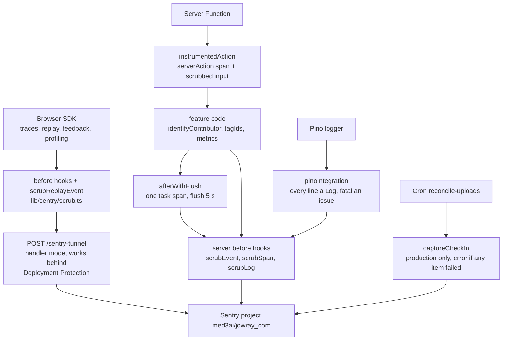

# Sentry telemetry

Error tracking and full telemetry for jowray.com: both Sentry inits, a handler-mode tunnel, the alpha "collect everything" data policy, and the scrubber that keeps bearer secrets out regardless.

**Status:** merged. Phase 1 install: [PR #5](https://github.com/RobertdWray/jowray_com/pull/5), [PR #8](https://github.com/RobertdWray/jowray_com/pull/8), [PR #13](https://github.com/RobertdWray/jowray_com/pull/13) (2026-11-03). Alpha telemetry: [PR #32](https://github.com/RobertdWray/jowray_com/pull/32), [PR #33](https://github.com/RobertdWray/jowray_com/pull/33), [PR #34](https://github.com/RobertdWray/jowray_com/pull/34) (2026-11-04). Public-repo audit D: [PR #47](https://github.com/RobertdWray/jowray_com/pull/47) (2026-11-05: linear-time scrubber, bounded input, `/api/upload` 400; refs issue #43). All seven are on `main`, the production branch. The production smoke check (plan §11.4) is not recorded.

Invite-token scrubbing, replay attribute unmasking and Pino R13 are implemented on this branch for [notify plan §8](../plans/2026-11-07-notify-correspondents.md); their deployment/live proof and S1 are not recorded as complete.

## What we built

1. A family member opens any page. The browser SDK starts a 100 % trace, an unmasked Session Replay and, in Chromium, a browser profile (every response carries `Document-Policy: js-profiling`).
2. The share form identifies the submitted contributor on Send (and a remembered contributor on mount when its source is not `invite`); opening a claim page also identifies its contributor, so `user.email` rides on every later event, replay and log.
3. Every Server Function is wrapped by `instrumentedAction`: it shows in the trace as `serverAction/<name>`, linked to the browser trace, with its scrubbed input as the `server_action_input` context. Deferred work (emails, hashing, derived images) runs under `afterWithFlush`: one `task` span, flushed before the function freezes.
4. Errors the UI swallows on purpose still go through `reportClientError` with `surface` and `step` tags. A root-layout crash renders `app/global-error.tsx` ("Your memory was not lost") and the crash-report dialog, pre-filled from the identified contributor.
5. A floating "Report a problem" button opens the feedback form; email optional, screenshots on, success text "Thank you. Rob will take a look."
6. Browser events leave through `POST /sentry-tunnel`, so ad blockers and Vercel Deployment Protection do not drop them.
7. On the server every Pino line becomes a Sentry Log and `fatal` lines become issues. Counters `memory.created`, `upload.finalized{status}`, `confirmation.sent{outcome}` and the distribution `reconcile.run` record volume. The reconcile cron reports explicit check-ins to the `reconcile-uploads` monitor, production only, each item in its own isolation scope.
8. `lib/sentry/scrub.ts` removes claim/invite tokens, share URLs, upload tickets and protected header values from the covered event fields, spans, logs, breadcrumbs, contexts and replay custom events (remaining gaps are listed below). Since issue #43 (2026-11-05) its text scanner runs in linear time and any string over 256 KiB is replaced whole, because `instrumentedAction` scrubs the raw input of every public Server Function before validation.
9. A malformed body on `POST /api/upload` answers `400 invalid_json` instead of an unhandled error reported once per request; the log line carries the error's name, never its message (which quotes the body).

## Why we built it

Phase 1 installed Sentry 11 "privacy first". The 2026-11-02 plan's Task 4 asked for a restrictive `dataCollection` (at minimum `userInfo`, `cookies`, `urlQueryParams`, `databaseQueryData` off), URL scrubbing and "Session Replay off; `tracesSampleRate` low"; review item S7 pinned "Replay off".

The 2026-11-04 plan's Context: "Rob asked whether Sentry is fully turned on and, since the users are family alpha testers who approved full tracking, to enable every Sentry feature (100 % Session Replay, the 'report a bug' widget, user identification by email) so vibe-coded bugs can be diagnosed from Sentry alone." Its audit found Sentry "installed and healthy; about half of its features are off, and the data policy strips the context Rob now wants", plus one defect: the rewrite-mode `/monitoring` tunnel dropped browser events on protected previews on SDK 11.9+.

So the policy flipped, deliberately. Rob, 2026-11-04 (plan §2a, quoted verbatim in `lib/sentry/data-collection.ts`, `instrumentation-client.ts`, `docs/code-layout.md` and every PR):

> I have deliberately authorized and pushed for 100 % tracking and error data collection. The family has approved these aggressive tracking measures since it is an alpha, vibe-coded website and only family will be using it. Intensive logging to rapidly fix errors is more important than security and privacy.

Still forbidden everywhere (§3 ruling 2): claim tokens in any form (`/m/<token>`, `?t=`, `claimToken`, `claimTokens`, `claimLink`), invite tokens and share URLs in any form (`/s/<token>`, `inviteToken`, `shareUrl`; R10, 2026-11-07), upload tickets (`ticket`, `clientPayload`, `sig`) and the values of `cookie`, `authorization`, `x-vercel-protection-bypass`, `x-vercel-signature`. Accepted residuals: the `/m/<token>` page URL inside replay DOM recordings (rrweb's meta event, which no hook can scrub) and user-taken feedback screenshots (Rob, 2026-11-04); `/s/<token>` in the replay DOM URL (R5) and Vercel request logs (R11, like `/m/`; Rob, 2026-11-07). Invitee names and emails are allowed under the 100% policy (R10); opening an invite alone does not identify its recipient.

## Key decisions (Rob)

| Decision | Source |
|---|---|
| Phase 1: restrictive `dataCollection`, URL scrubbing, Replay off, traces low; manual install, no wizard, no edge config | [Phase 1 plan Task 4](../plans/2026-11-02-phase1-database-infrastructure-memory-collection.md), item S7 |
| Rob created the Sentry organization token; Vercel only; source maps upload on Vercel builds | [phase1-ledger Task 4](../plans/phase1-ledger.md), [PR #13](https://github.com/RobertdWray/jowray_com/pull/13) |
| 100 % tracking for the alpha, the §2a authorization quoted in code and every PR; supersedes S7 | [plan §2, §2a](../plans/2026-11-04-sentry-full-telemetry.md) |
| Unmask everything in replays; Sentry's floating feedback button; screenshots on; replays recorded on `/m/<token>` pages with the rrweb residual accepted; no `data-sentry-block` | [plan §2, §14](../plans/2026-11-04-sentry-full-telemetry.md) |
| Skip Node profiling: no prebuilt binary for Node 26, Vercel not pinned to 24 | [plan §2, §14](../plans/2026-11-04-sentry-full-telemetry.md) |
| Collect request bodies, headers, query strings and DB query data, with scrubbing | [plan §2](../plans/2026-11-04-sentry-full-telemetry.md) |
| "Bearer secrets never reach Sentry" kept from Phase 1; the plan marks it "Assumed from house rule; Rob has not contradicted it" | [plan §2, §3](../plans/2026-11-04-sentry-full-telemetry.md) |
| Cron check-in semantics, the identity contract and "Rob ends the alpha" are the plan's proposals, still marked Proposed, implemented as written | [plan §2](../plans/2026-11-04-sentry-full-telemetry.md), M-F-11 |
| Handler-mode tunnel; stable check-in API, not the experimental Vercel cron flag; identity only where the contributor row is already loaded | [plan §3 rulings 4 to 6](../plans/2026-11-04-sentry-full-telemetry.md) |
| Agent rulings Rob accepted: `normalizeDepth: 6` (R4), identity set in `confirmSubmission` (R6), `key` as an exact-match secret for `enterAdmin` (R8), no render tests for the browser init (R9) | [plan §16](../plans/2026-11-04-sentry-full-telemetry.md), [PR #33](https://github.com/RobertdWray/jowray_com/pull/33) |
| Rob, 2026-11-05: sampling and Session Replay stay at 100 % "so I can check this alpha code"; existing keys are kept, no rotation or re-scoping | [phase1-ledger decisions](../plans/phase1-ledger.md), [PR #47](https://github.com/RobertdWray/jowray_com/pull/47) |
| Issue #43 §7.1 defaults, taken in PR #47: bound input inside `scrubText` so every caller is covered; 256 KiB cap; marker `[Filtered: oversized]`; `serverActions.bodySizeLimit` left at 1 MB; no app-side ceiling on the tunnel | [PR #47](https://github.com/RobertdWray/jowray_com/pull/47) decisions table |
| Rob, 2026-11-06: visitors are told in his words. A small "Privacy" button in the footer of every page opens a note: the site records the screen, the logs and what people click and type, and it is family-only, so there is no legal click-through. When the alpha settings end, update `app/_components/privacy-note-client.tsx` together with the "One honest note" bullet on `/how-it-was-built` | [plan](../plans/2026-11-06-privacy-note-and-diagram-viewer.md), [Privacy note](./privacy.md) |
| “Invitee names and emails fall under the 100% Sentry policy”; “Invite tokens and share URLs stay forbidden” (Rob, 2026-11-07, R10); replay DOM and Vercel request-log URL residuals accepted (R5/R11). | [notify plan §2](../plans/2026-11-07-notify-correspondents.md) |
| R12 amended: the replay issue is SDK attribute masking (D20); the server scrubber switch is a separate event-data change, pending deployment, token checks and Rob's re-confirmation at S1. R13 removes contributor-field Pino redaction everywhere and retains bearer redaction (Rob, 2026-11-07). | [notify plan §2, §8.10](../plans/2026-11-07-notify-correspondents.md) |

## How it works

Both inits share one `DATA_COLLECTION` object and the same `before*` hooks. The browser also registers `scrubReplayEvent` as an event processor, because `beforeSend` never sees replay or feedback events, and `scrubRecordingEvent` on replay network bodies (same-origin requests only, never the Blob uploads). The scrubber rewrites lower-case `/m/` paths with 16+ token characters to `/m/[claimToken]` and case-insensitive `/s/` paths with 12+ token characters to `/s/[inviteToken]` (including full URLs). Both patterns accept base64url characters and `%` to cover percent-encoded token characters. It strips `t=` and `key=`, filters secret keys in objects, JSON text (including double-encoded bodies) and React Flight text, and fails closed on truncation. Text that is not JSON goes through a hand-written scanner, one left-to-right pass with sticky regexes for the key run and the `:` separator, so each character is read a bounded number of times; it replaced a backtracking regex that went quadratic on adversarial text (1,908 ms at 160,001 characters, measured 2026-11-05). Its matching rules, escaped-quote handling, fail-closed truncation and idempotence are the old scanner's. Any string longer than `MAX_SCRUB_TEXT_LENGTH` (256 KiB) becomes `[Filtered: oversized]` before it is parsed or scanned; the cap sits above a full 10 × 10,000-character submission and Replay's 150,000-character body cap. The header deny list also drops `next-router-state-tree`, which encodes the `[claimToken]` or `[inviteToken]` segment on Server Function POSTs.

### Replay attributes and route-token transport

D20 centralizes `REPLAY_OPTIONS` in `lib/sentry/replay-options.ts`: `maskAllText: false`, `maskAllInputs: false`, `blockAllMedia: false`, `maskAttributes: []` and `networkCaptureBodies: true`. `instrumentation-client.ts` spreads this tested object beside the same-origin network allowlist and `scrubRecordingEvent`. The installed SDK defaults `maskAttributes` to `placeholder`, `title` and `aria-label`, and stars those attributes even with `maskAllText: false`; an empty array fixes that cause. Password inputs remain masked by the SDK. Server-side Data Scrubber settings do not control this DOM masking.

D21 handles two distinct Next.js wire shapes for **both** `inviteToken` and `claimToken`: request router-state tuples such as `["inviteToken","<token>","d"]` and RSC response segments such as `{"n":"inviteToken","t":"d","k":"<token>","s":[]}`. The protected `next-router-state-tree` request header is dropped whole. Tuple values and response-segment `k` values become `[Filtered]` in parsed objects and in plain/escaped Flight text, including Replay network response bodies; surrounding ordinary names/emails remain. This extends the plan's original tuple-only rule to the response shape actually emitted by the installed Next.js version.

### Pino under R13

Contributor fields (email, recipient email, name, phone, words, relationship, place, approximate date, filename and coordinates) now pass through Pino and its Sentry extra helper `redactPii`. Structured bearer fields remain `[Redacted]`: `SECRET_FIELD_KEYS` except `key`, plus `token` — `claimToken`, `claimTokens`, `claimLink`, `ticket`, `clientPayload`, `sig`, `presignedUrl`, `shareUrl`, `inviteToken`, `token`. Pino covers the top level and three levels down, plus the configured protected-header paths. `key` remains available for non-secret setting names in Pino; Sentry still filters that exact field. The header list is `cookie`, `authorization`, `x-vercel-protection-bypass`, `x-vercel-signature`, `next-router-state-tree`. Do not put bearer values in free-text log messages; Pino is field redaction, not a URL text scrubber. Log ids, never Prisma rows or people. Sentry Logs still run through `scrubLog`, and carry `user.email` once identified.

### S1 is pending: server-side event filtering

R12 amended requires the project's **Data Scrubber and Default Scrubbers to stay on until PR-2 is live and its token checks pass**. The orchestrator then re-confirms the event-data change with Rob, saves the before settings, switches both project flags off, reads back the result, waits at least six minutes for Relay's configuration cache, and proves an ordinary story containing “author” survives while token checks still pass. The **SDK scrubber stays enabled as the token control**. This fixes `[Filtered]` ordinary event data, not starred replay attributes; D20 fixes those separately. No completed switch or live setting readback is claimed here. [Plan §8.10](../plans/2026-11-07-notify-correspondents.md) owns the procedure and private evidence; rollback sets both project flags back to `true`.

## Key files

| Path | Role |
|---|---|
| **app** | |
| `instrumentation.ts` | Server init inside `register()`, Node only: 100 % traces, `prismaIntegration`, `pinoIntegration`, `onRequestError` |
| `instrumentation-client.ts` | Browser init: unmasked replay, feedback widget, browser profiling, third-party filter in tag mode, console logs, the §2a quote |
| `app/sentry-tunnel/route.ts` | One line re-exporting the SDK's `POST` |
| `app/global-error.tsx` | Root error boundary with its own `<html>`, `captureException` and `showReportDialog` |
| `app/globals.css` | `#sentry-feedback` variables (site red, body font) |
| `app/share/actions.ts`, `app/m/[claimToken]/actions.ts` | The twelve wrapped Server Functions |
| `app/api/cron/reconcile-uploads/route.ts` | Explicit check-ins, per-item `withIsolationScope`, `reconcile.run` metric |
| `app/share/share-form.tsx`, `app/m/[claimToken]/claim-form.tsx`, `app/share/recorder.ts`, `app/share/use-share-draft.ts` | Browser identity and `reportClientError` call sites |
| `next.config.ts` | `withSentryConfig` (tunnel, `widenClientFileUpload`, `reactComponentAnnotation`, `applicationKey`) and the `Document-Policy` header |
| **features** | |
| `features/memories/create-submission.ts`, `complete-submission.ts`, `claim.ts`, `ingest-upload.ts`, `issue-upload-ticket.ts` | Server identity, tags and metrics where the contributor row is already loaded |
| `app/api/upload/route.ts` | Blob callback: tags and `afterWithFlush("upload.callback")`; `400 invalid_json` on a malformed body |
| **lib + server** | |
| `lib/sentry/replay-options.ts` | Tested unmasking options, including `maskAttributes: []` |
| `lib/sentry/data-collection.ts` | The one `DATA_COLLECTION` policy, with Rob's authorization |
| `lib/sentry/secrets.ts` | Secret field keys, key fragments (`token`, `ticket`), denied headers |
| `lib/sentry/scrub.ts` | Scrubber v2: `scrubUrl`, `scrubSecrets`, `scrubEvent`, `scrubSpan`, `scrubLog`, `scrubBreadcrumb`, `scrubReplayEvent`, `scrubRecordingEvent`; the linear member scanner and `MAX_SCRUB_TEXT_LENGTH` |
| `lib/sentry/user.ts`, `server-action.ts`, `report.ts`, `metrics.ts`, `after-flush.ts` | `identifyContributor` / `tagIds`, `instrumentedAction`, `reportClientError`, the four metrics, `afterWithFlush` |
| `lib/logger/logger.ts` | Pino bearer/header redaction, contributor fields allowed under R13; shares the secret inventory |
| **tests** | |
| `__tests__/lib/sentry-envelope.test.ts` | The gate (below) |
| `__tests__/lib/sentry-scrub.test.ts`, `sentry-user`, `sentry-report`, `sentry-metrics`, `sentry-after-flush` | Unit contracts |
| `__tests__/lib/sentry-scrub-differential.test.ts`, `__tests__/fixtures/scrub-regex-main-73609cf.ts` | The old regex scanner kept as a fixture; byte-for-byte equality over a seeded corpus |
| `__tests__/lib/sentry-scrub-timing.test.ts`, `__tests__/api/upload.test.ts` | Linear-time budget and the oversized cap; `invalid_json` |
| `__tests__/next-config.test.ts`, `__tests__/api/reconcile.test.ts` | `Document-Policy` header; cron check-in status mapping |
| **Prisma** | none; Sentry adds no tables |

## Tests and evidence

- `__tests__/lib/sentry-envelope.test.ts` runs the real server SDK with the production `DATA_COLLECTION` and `before*` hooks over a capturing transport. It sets a user, a `server_action_input` context holding tokens, a request with a bypass header, a cookie and the router-state header, throws from a function holding token locals, emits a log and streams spans. No envelope may contain a `SENTRYTEST_` value; the error and log envelopes must carry the test email. It also proves the tunnel handler rejects a foreign DSN.
- D21 positive controls in `__tests__/lib/sentry-envelope.test.ts` inspect transported action input and the real SDK-recorded `server_action_result`, incoming invite bodies, and both route-token tuple bodies with the protected router header removed. They assert ordinary synthetic names/emails survive while tokens do not. The Replay case generates the installed Next.js transport segment (`segmentToTransportSegment`, `n`/`k`) for each token name, proves it contains the fixture before scrubbing, then checks `scrubRecordingEvent` retains the email/name but removes the token and URL. A real Pino-to-Sentry Log case proves the same R13 policy in both outputs. The Replay case tests the recording hook, not a captured browser envelope; route-handler response bodies are not covered because this SDK records outgoing bodies only for Server Functions.
- `__tests__/lib/replay-options.test.ts` pins the complete options object and its use by the browser init; `__tests__/lib/logger.test.ts`, `__tests__/next-config.test.ts` and `__tests__/app/analytics-client.test.ts` pin bearer-only redaction, invite headers and the analytics guard.
- `sentry-scrub.test.ts` pins the scrubber, including frame locals (R3: the envelope test cannot reach them offline) and the mixed-quoting cases from PR #47's reviews.
- `sentry-scrub-differential.test.ts` keeps `main`'s regex scanner (commit `73609cf`) as a test fixture and asserts that the linear scanner's output is byte-for-byte equal over a seeded 1,400-case corpus (consistent, escaped and mixed quoting, attacker text beside real secrets, Flight prefixes, truncation), that it never leaves a secret the old one filtered, and that it is idempotent.
- `sentry-scrub-timing.test.ts` runs seven 200,000-character adversarial shapes with their exact expected output against a 200 ms budget (fastest of three runs; the old regex took 3,162 ms and 5,257 ms on the two worst, the new scanner 0 to 9 ms), plus the oversized marker at any depth, no secret through oversized text, and the largest legitimate payload left alone.
- `reconcile.test.ts` pins `ok` and `error` check-ins and that previews never check in.
- There is no `docs/plans/evidence/` directory for this feature. The evidence is the plan's §16 ledger: on PR #34's preview the tunnel answered 200 behind Deployment Protection, a forced `/api/upload` error arrived scrubbed (JOWRAY_COM-5), a browser error arrived with replay, profile and React contexts (JOWRAY_COM-4), the header was on `/share`, the feedback button was injected. Recorded test counts: 925, 978 and 979 on the three PR tips.
- Not run: D20 live replay comparison, PR-2 production token checks and S1; current local checks are recorded in [Invite links](./invite-links.md#tests-and-evidence). Also unrecorded: the §11.2 submission and identity checks, the feedback-form submission, the `/m/*` replay, the §10 sentry.io checklist and the §11.4 production smoke. Phase 1's Task 4 step 6 checks (an event with no query string or cookies) are superseded by the policy flip.

## Known gaps and follow-ups

- PR #62 follow-up F1 (Low): `CLAIM_PATH` in `lib/sentry/scrub.ts` is case-sensitive and needs at least 16 characters, so an upper-case `/M/<token>` URL reaches Sentry unscrubbed and a short segment keeps its value; see [Vercel Web Analytics](./analytics.md#known-gaps-and-follow-ups).
- [MCP plan follow-up 8.8](../plans/2026-11-06-mcp-endpoint.md) (Medium, open): `scrubEvent` in `lib/sentry/scrub.ts` scrubs exception stack-frame locals, but not `event.exception.values[].value`, `event.message` or `logentry`, so secrets in those message fields can leave unscrubbed.
- M-F-01, M-H-11: sentry.io checklist (GitHub + Seer, "User Feedback received" and "Replay with error" notifications) and production smoke never run; issue #38 §2.3.
- M-F-02: `app/admin/actions.ts` Server Functions are not wrapped; #38 §3.3.
- M-F-03: recorder and draft-storage catches emit noise at 100 % sampling; #38 §2.9.
- M-F-04: `clearContributor()` is called nowhere, so identity can go stale across two relatives on one phone; #38 §3.2.
- M-F-05: `key` as a secret field also filters replay keyboard breadcrumbs (nitpick).
- M-F-06, M-F-13 and notify R5/R11: token-free claim/invite URLs (F1) and presigned Blob URLs in breadcrumbs (F6) are accepted residuals; Vercel request logs also hold `/m/<token>` and `/s/<token>`; #38 §4.4, §2.7.
- M-F-07: no automated browser envelope test (F2) or render test for `global-error.tsx`; needs the Playwright harness (M-I-01); #38 §3.7.
- M-F-08: Node profiling when a Node 26 binary ships (F3); #38 §3.7.
- M-F-09: per-segment `error.tsx` for `/share` and `/m` (F4); #38 §2.4.
- M-F-10: an `error` check-in needs two consecutive failures; decide `failureIssueThreshold: 1` or a metric alert (F5); #38 §2.3.
- M-F-11, ending the alpha (plan §13): one commit restores the Phase 1 `DATA_COLLECTION` values, sets `replaysSessionSampleRate: 0.1` and `replaysOnErrorSampleRate: 1.0`, restores the text/input/media masking options and removes the `maskAttributes: []` override, and sets `tracesSampleRate: 0.2`; scrubbers and identity stay. Instant stop without a deploy: disable the DSN in Sentry. The §2a comments stay with an "Ended on <date>" line. Four §2 rows still read Proposed; #38 §3.6.
- Issue #43 (open, closes last): Rob's dashboard items, namely Sentry Spike Protection with a notification, the on-demand budget and a per-key rate limit if the plan allows, further Vercel firewall rules and the spend circuit breaker; then the pre-flip checklist. Sampling stays at 100 % by ruling, so these are the quota guards.
- If a Content-Security-Policy is ever added, Replay needs `worker-src 'self' blob:` and the tunnel `connect-src 'self'` (plan §14).

## Related

- Sibling feature docs: [Share form](./share-form.md), [Media uploads](./media-uploads.md), [Audio recording](./audio-recording.md), [Admin panel](./admin-panel.md), [Draft on behalf](./draft-on-behalf.md), [Email and cron](./email-and-cron.md), [Vercel Web Analytics](./analytics.md), [Privacy note](./privacy.md)
- Plans: [2026-11-04 Sentry full telemetry](../plans/2026-11-04-sentry-full-telemetry.md), [Phase 1 plan](../plans/2026-11-02-phase1-database-infrastructure-memory-collection.md), [Phase 1 ledger](../plans/phase1-ledger.md), [bootstrap report](../plans/2026-11-02-bootstrap-report.md)
- [Debt catalog section F](../2026-11-04-debt-catalog.md), [code layout](../code-layout.md), [environment](../environment.md), [admin](../admin.md)
