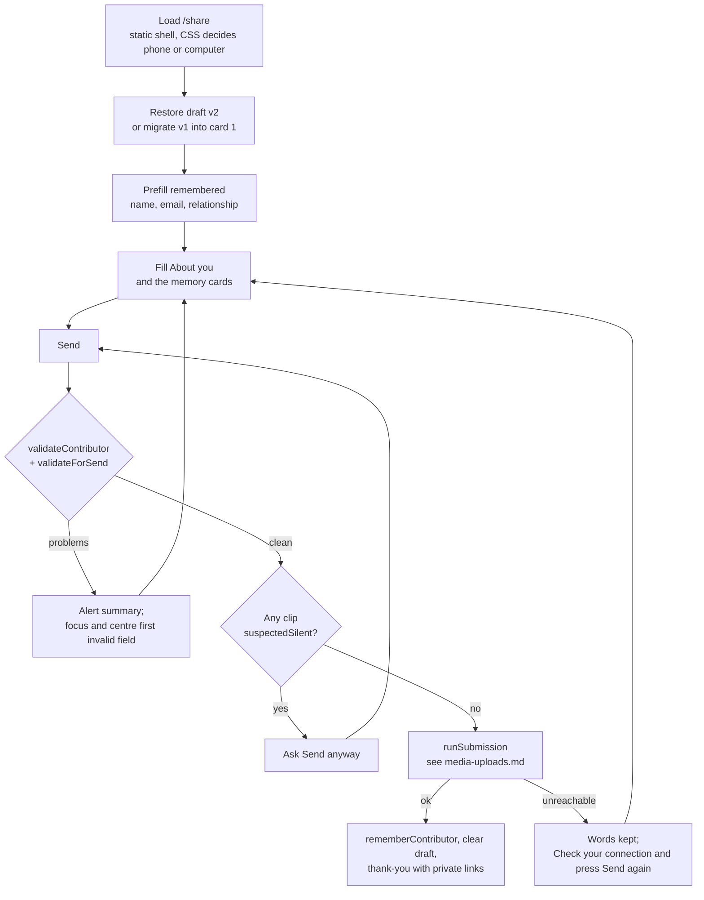

# Share form

The `/share` page of jowray.com, where a visitor writes or records a memory of Jo: who they are once, then one memory card on a phone or several on a computer, sent together with one receipt email.

**Status:** merged 2026-11-03 in [PR #7](https://github.com/RobertdWray/jowray_com/pull/7) (single-memory form), [PR #11](https://github.com/RobertdWray/jowray_com/pull/11) (no consent checkbox), [PR #16](https://github.com/RobertdWray/jowray_com/pull/16) (defaults, remembered contributor, preferences, consent v2) and [PR #21](https://github.com/RobertdWray/jowray_com/pull/21) (draft autosave); merged 2026-11-04 in [PR #28](https://github.com/RobertdWray/jowray_com/pull/28) and [PR #29](https://github.com/RobertdWray/jowray_com/pull/29) (memory cards), [PR #35](https://github.com/RobertdWray/jowray_com/pull/35) (required name and email, placeholders, two visibility options) and [PR #36](https://github.com/RobertdWray/jowray_com/pull/36) (desktop layout). Every merge to `main` deploys to production. The ledger still marks sharing the `/share` link publicly as blocked until the Task 10 gates are on: the WAF rule exists since 2026-11-04, Spend Management is not set.

## What we built

1. The page opens on "Write it down here." and an **About you** box: "Your name" and "Email" (both required), "How you knew Jo (optional)". A device that sent a memory before prefills all three from `localStorage`.
2. **Memory cards.** A phone shows one card, "Your memory". A computer (at least 48rem wide and 30rem tall) shows "Memory 1" in full, compact placeholders for Memory 2 and 3, and "+ Add another memory" up to ten.
3. Each card asks "When is this memory from? (roughly is fine)", "Where? (optional)", a media area and "Your memory of Jo". The media area holds "Record your voice" (see [Audio recording](./audio-recording.md)); phones add "Record a video" through their own camera and "Add photos or videos"; computers get "Upload photos, videos or recordings". Picked files are checked on arrival for type, size, duplicates and the ten-file cap.
4. **"Who can see this?"** is asked once per send: "Everyone" (default) or "Family".
5. Under Send: the Richard, Rob and Tracy line, three preference checkboxes (family may contact me, on; tell me when it is posted, on; weekly mailing list, off) and one consent sentence. There is no consent checkbox.
6. **Send** checks the form in the browser. A `role="alert"` summary lists each problem as a link and the first invalid field is focused and scrolled to the centre. A clip that sounds silent asks "Send anyway" first.
7. While sending, the button reads "Sending file 2 of 5 · 40% done" and a polite line says "Please keep this page open".
8. **Thank-you screen:** "Jo would have loved this.", one private link per memory labelled like "Memory 2 · Summer 1985 · Lake George", files that did not arrive named, and "We couldn't email you just now, so this page is the only copy" when no receipt went out. Phones also see a tip that a computer can send several at once.
9. The typed words are a **draft** on the device (`jowray.share.draft.v2`, 30 days), saved as the person types, when the tab is hidden and before a picker opens. Email is never stored. Reopening restores it with "We kept the words you typed last time."

## Why we built it

The share-redesign plan's Context: `/share` "is one long form for **one** memory with **at most one** file", and the requester wanted "Phones: one memory per send" and "Computers: contact details entered once, then several memory cards, with a '+' to add more." Two constraints shaped it: raw claim tokens are never stored, so "an email listing every private link must be sent while the browser still holds the tokens", and the old cap was 3 emails per address per day ([share redesign, Context](../plans/2026-11-03-share-redesign.md)).

The quick fixes answered Rob's review of 2026-11-04: email "should not be optional"; placeholders were bold and cropped (inputs inherited the label's weight through Tailwind Preflight); "Kay Bartholomew was her sister and that is confusing"; three visibility options were one too many; and on a wide desktop the usable column shrank as the window grew (604px at 2560) because the 5% padding sat on the 860px box ([quick fixes, Context](../plans/2026-11-04-share-form-quick-fixes.md)).

## Key decisions (Rob)

| Decision | Source |
|---|---|
| No consent checkbox: "friends and family". One implicit-consent sentence under Send; `consentVersion` still stored. | [ledger decisions table](../plans/phase1-ledger.md), [PR #11](https://github.com/RobertdWray/jowray_com/pull/11) |
| Contact checkbox on by default; sentence becomes `2026-11-v2`; "posted" on, mailing list off (Rob, 2026-11-03). | [consent v2](../consent/2026-11-v2.md), [PR #16](https://github.com/RobertdWray/jowray_com/pull/16) |
| Default visibility PUBLIC (Rob, 2026-11-03); the Prisma default stays FAMILY because validation always supplies a value. | commit `1f9dc2a`, [PR #16](https://github.com/RobertdWray/jowray_com/pull/16) |
| Name, email and relationship remembered in `localStorage`, never a cookie (Rob, 2026-11-03). | `lib/remembered-contributor.ts`, [PR #16](https://github.com/RobertdWray/jowray_com/pull/16) |
| D1 phone vs computer by CSS, never user agent; D5 visibility asked once; D8 no title field, `labelFor` instead; D11 compact placeholders; D12 phone tip on the thank-you screen only; D7 webcam is release 2. | [share redesign, Decisions](../plans/2026-11-03-share-redesign.md) |
| D9 a card holds up to 10 mixed files, "overrides Rob's 'no desktop/phone fork'"; D10 no per-file caption, date or place on `/share`, flagged to Rob. | same |
| Ruling 1: "Placeholder colour stays `wood`"; regular weight, one short example each. | [quick fixes, Rob's rulings](../plans/2026-11-04-share-form-quick-fixes.md) |
| Ruling 2: "Name is required too"; only "How you knew Jo" stays optional. | same |
| Ruling 3: plain "Everyone" and "Family" (amends D13), Everyone first and default; PRIVATE is admin-only. | same |
| Ruling 4: "Desktop: single column at 1040px with side-by-side rows. No right-hand rail." | same |
| R5 (agent, accepted): a failed Send focuses the first invalid field, not the summary. | [quick fixes, Rulings log](../plans/2026-11-04-share-form-quick-fixes.md) |

## How it works

`share-form.tsx` orchestrates; the logic lives in pure modules under `lib/`, tested in Node. `cardsReducer` owns the cards (deterministic ids so server and client render the same markup), the draft is read once and applied during render, and `runSubmission` creates the submission once, uploads photos first one file at a time, and completes exactly once in a `finally` (details in [Media uploads](./media-uploads.md)). A server refusal that names a field or card lands on it through `issuesFromSendFailure`; one that names nothing shows above the button.

## Key files

| Path | Role |
|---|---|
| **app** | |
| `app/share/page.tsx` | Static shell, `maxDuration = 120`, intro |
| `app/share/share-form.tsx` | Orchestrator: contributor fields, visibility, checkboxes, summary and reveal, silent-clip confirm, `beforeunload`, send |
| `app/share/memory-card-client.tsx`, `app/share/card-media-client.tsx` | One card and its placeholder; media rows, pickers, refusals |
| `app/share/use-memory-cards.ts`, `app/share/use-share-draft.ts`, `app/share/thank-you-client.tsx` | Cards hook; draft restore and save; done screen |
| `app/share/actions.ts` | Thin Server Functions |
| `app/_components/field-classes.ts`, `app/globals.css` | Field styling (`font-normal`, invalid ring); `wide`, `narrow`, `roomy` variants |
| **features** | |
| `features/memories/create-submission.ts`, `features/memories/complete-submission.ts` | Server side of a send |
| **lib** | |
| `lib/memory-cards.ts` | Reducer, `acceptFiles`, `labelFor`, `validateContributor`, `validateForSend`, `issuesFromSendFailure` |
| `lib/submission-pipeline.ts` | `runSubmission` |
| `lib/share-draft.ts`, `lib/remembered-contributor.ts` | Draft v2 with v1 migration; remembered fields |
| `lib/visibility.ts`, `lib/consent.ts`, `lib/reveal-scroll.ts` | Two contributor options; the four sentences; scroll arithmetic |
| `lib/validations/memory.ts` | Shared name and email schemas, `submissionIssueLocation` |
| **tests** | |
| `__tests__/lib/memory-cards.test.ts`, `__tests__/lib/submission-pipeline.test.ts`, `__tests__/lib/share-draft.test.ts`, `__tests__/lib/remembered-contributor.test.ts`, `__tests__/lib/validations-memory.test.ts`, `__tests__/lib/visibility.test.ts`, `__tests__/lib/reveal-scroll.test.ts`, `__tests__/features/create-submission.test.ts` | Pure modules and the server side |
| **Prisma** | |
| `prisma/schema.prisma` | `Contributor.contactOptIn`, `mailingListOptIn`; `Memory.visibility`, `notifyWhenPosted`, `consentVersion`, `consentedAt`, `submissionId`, `submissionIndex` |

## Tests and evidence

Unit tests cover the reducer, file acceptance, labels, both validators, the refusal mapping, the pipeline's ordering and retry rules, draft TTL and migration, remembered fields, the two visibility options and the reveal arithmetic. `create-submission.test.ts` pins the required-field messages and the stored trimmed name and lower-cased email. Last recorded suite counts: 1000/1000 (PR #35), 1004/1004 after the review fixes.

Evidence: [share redesign README](../plans/evidence/2026-11-share-redesign/README.md) (51 scripted Chromium checks at 390, 852×393 and 1280; a two-memory send; draft v2 and v1 migration; no hydration warnings) and [quick fixes README](../plans/evidence/2026-11-share-quick-fixes/README.md) (blank Send focuses Name centred, then Email; typing clears inline state only; offline Send keeps the words; contrast numbers; the layout table at six window sizes; `scrollHeight` 2190px at every `roomy` width, down from 2837px).

**Not run:** real devices (iPhone, Android) and the VoiceOver, TalkBack and reduced-motion pass; real receipt emails (outbound was disabled in every check). The share-redesign premortem and four-bucket sort (D17) are not recorded as run.

## Known gaps and follow-ups

- Rob to confirm `CONSENT_VERSION=2026-11-v2` in Vercel; v1 not marked superseded (M-A-03, M-C-15; issue #38 §1.1).
- The "November 10th" promise on the thank-you screen cannot be kept as written (M-J-03; §1.4).
- Device and assistive-technology pass (M-H-03, M-H-05; §1.2).
- No "Not you? Clear these" control for remembered fields on a shared device (M-C-13; §3.2).
- Desktop leftovers: `resize-y` inert at `roomy`, About-you two-up via `sm:` not `wide:`, lone placeholder (M-C-07).
- D10 per-file fields and the right-hand rail after 2560 evidence await Rob (M-C-09, M-C-21; §3.6).
- Drafts never hold media; iOS has no `beforeunload` (M-C-19, deliberately not doing). Webcam recording on computers is release 2, not built (M-C-11).
- Sentry noise from `use-share-draft.ts` storage probes (M-F-03; §2.9).

## Related

- [Audio recording](./audio-recording.md), [Media uploads](./media-uploads.md), [Admin panel](./admin-panel.md), [Draft on behalf](./draft-on-behalf.md), [Email and cron](./email-and-cron.md), [Sentry telemetry](./sentry-telemetry.md)
- [share redesign plan](../plans/2026-11-03-share-redesign.md), [share form quick fixes](../plans/2026-11-04-share-form-quick-fixes.md), [consent 2026-11-v2](../consent/2026-11-v2.md), [phase 1 ledger](../plans/phase1-ledger.md), [brand implementation](../plans/2026-11-03-brand-implementation.md), [debt catalog](../2026-11-04-debt-catalog.md)
- [code layout](../code-layout.md), [environment](../environment.md)
