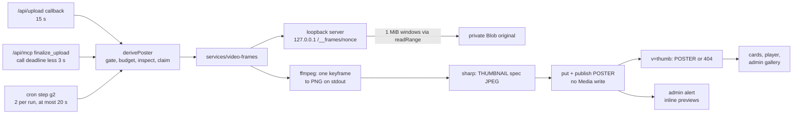

# Video posters

Every READY video gets one server-made JPEG frame, stored as a `POSTER` derived copy, so a video memory shows a picture instead of an empty dashed box: on the See memories cards, in the memory page player, in the admin gallery and in the family alert email. ffmpeg takes the frame inside three server functions only (the upload callback, the MCP endpoint and the reconcile cron), and every media route serves it as a video's `?v=thumb`.

**Status:** implemented and tested on branch `feat/video-posters`, [PR #99](https://github.com/RobertdWray/jowray_com/pull/99) (opened as a draft on 2026-11-08). Not merged, not deployed. Plan, rulings and ledger: [`docs/plans/2026-11-08-video-posters.md`](../plans/2026-11-08-video-posters.md). `ci` and the Vercel preview build last ran on `456b5df` (Tasks 1–5) and passed; Tasks 6–14 and these docs were committed after that push and have no CI run yet (2026-11-08). There is nothing to configure: no env key and no flag. After merge and deploy, cron step (g2) makes posters for the six live videos, two per run. Still Rob's: the PR review flow (one Team Code Review round, the regression check, approval and merge) and the preview and production checks V2–V8 listed under Tests and evidence.

## What we built

1. A video becomes READY. For a browser upload (share form, invite link, claim page), Blob's upload-completed callback at `/api/upload` schedules its own `upload.callback.poster` task, which runs `derivePoster` with 15 s. For an MCP `finalize_upload`, `features/admin/attach-media.ts` schedules `mcp.finalize.poster` with what is left of the call's 25 s, less 3 s. Cron step (g2) is the backstop and the backfill: two videos per run.
2. `derivePoster` (`features/memories/derive-poster.ts`) checks the row, reads the original's first bytes and movie box, claims a `POSTER` row and has ffmpeg take one keyframe at or before 1 s (or at 0 s when 1 s gives none). HLG and PQ videos are tone-mapped to SDR first. sharp re-encodes the frame at the THUMBNAIL spec: long edge at most 1000 px, mozjpeg q72 (q60 as a fallback), at most 350,000 bytes, flattened on `#fffdf8`, metadata stripped. The JPEG is published like every derived copy.
3. `/api/public-media/<id>?v=thumb`, the claim-link route `/api/media/<id>?v=thumb` and `/admin/media/<id>?v=thumb` answer a video with a 302 to its READY POSTER, or 404. Never the video itself.
4. A video memory's card on Explore, Map, Timeline and Tags (`MemoryCard`) shows the first video's poster under the red play badge and the duration pill (`VideoSlot` in `app/memories/_components/memory-card.tsx`). With no poster, or if the image fails to load, the dashed slot looks as it did before. The compact cards ("Close to this one" and the phone map's short list) keep their kind badge and show no picture, as for photos.
5. The memory page player gets `poster` when the copy is READY. It keeps `preload="none"`, so the small poster JPEG is the only request before play.
6. The admin gallery's player gets the same poster. The admin view (and MCP `get_memory`) reports `posterReady` for each file.
7. The family alert (`ADMIN_NEW_MEMORY`) now carries up to four inline pictures: each photo's THUMBNAIL and each video's POSTER. Contributor receipts still carry no uploaded picture (issue #46).

## Why we built it

The [plan's Context](../plans/2026-11-08-video-posters.md#context): "On https://www.jowray.com/memories/timeline, video memories show a dashed wood box with a red play badge and no picture." The root cause was not a regression: "No code path ever makes a picture for a video." `POSTER` had been reserved since PR #25 for a browser-captured frame (ruling R3), but all six live videos are iPhone HEVC `.MOV` files attached through MCP, where no browser exists. The plan also found a latent hazard: a video's `?v=thumb` answered 302 to the original video, so an `` pointed at it would have downloaded the whole file. A JPEG frame also shows in browsers that cannot play HEVC.

## Key decisions (Rob)

| Decision | Source |
|---|---|
| R-P1: posters are made server-side with ffmpeg (`ffmpeg-static`), superseding R3 ("Video posters are captured in the browser at upload time"). Rob, 2026-11-08, chose "Server ffmpeg (Recommended)". | [plan, Rulings](../plans/2026-11-08-video-posters.md#rulings); [phase 1 ledger R3](../plans/phase1-ledger.md) |
| R-P2: cards plus "Memory page player", "Admin media gallery" and "Emails" (Rob's multi-select, 2026-11-08). "Emails" means the admin alert only: receipts stay picture-free. | [plan, Rulings](../plans/2026-11-08-video-posters.md#rulings) |
| R-P3: claim-page posters are out of scope (not offered, not chosen); follow-up FU-1. | [plan, Rulings](../plans/2026-11-08-video-posters.md#rulings) |
| One PR: "Let's keep this in one pr please." (Rob, 2026-11-08). The plan's PR-1/PR-2/PR-3 stack became task groups of PR #99. | [plan, Execution setup](../plans/2026-11-08-video-posters.md#execution-setup) |
| D1–D10, agent's calls proposed in the plan; Rob let execution go ahead without overruling any, and the PR review is the final acceptance. D1 the binary is traced into `/api/upload`, `/api/mcp` and `/api/cron/reconcile-uploads` only; D2 ffmpeg reads through a loopback server, never a Blob URL; D3 the keyframe at or before 1 s; D4 the THUMBNAIL spec with no baked play badge; D5 tone-map HLG and PQ only; D6 a poster never writes the `Media` row; D7 a video's `?v=thumb` is its poster or 404; D8 the alert carries photo thumbnails too; D9 `ffmpeg-static` pinned at `5.3.0` with a pinned `allowScripts` entry; D10 the GPLv3 position in [`docs/dependencies.md`](../dependencies.md#ffmpeg-static-video-posters). | [plan, Rulings](../plans/2026-11-08-video-posters.md#rulings) |
| Execution rulings (agent's calls, 2026-11-08), the ones that shape behaviour: R2 the MCP poster task lives in `attach-media.ts`, because `scheduleReadyFollowUps` is page-reachable; R6/R10 a malformed box or a store error reading the original is a retryable `decode_failed` (at most 3 attempts); R7 ffmpeg gets `-max_pixels 33177600`; R8 a deferral after a reclaim resets the row's attempts; R9 the budget floor is checked before the slot and the loopback URL is redacted from stderr; R11 (g2) runs last, after (h), on at most 20 s of leftover run time; R12 the MCP task keeps 3 s back; R13 (g2) selects only allowed video types; R18 one preview read budget per send; R19 cron alerts read pictures within the run deadline, the advisory EmailLog read fails open, and the wait and the loader share one slot rule. | [plan, Execution rulings](../plans/2026-11-08-video-posters.md#execution-rulings) (verbatim) |

## How it works

### `derivePoster`: steps and verdicts

1. **Gate.** READY, an allowed `video/*` type, not removed, its memory not deleted, stored under this environment's prefix, and its POSTER row eligible under `isEligible(row, now, MAX_VIDEO_PIXELS)`. Anything else returns at once, reading nothing. A stale claim that used its 3 attempts is retired as `abandoned` without the binary, the slot or a byte.
2. **Preflight, before any claim.** At least 7 s left (`POSTER_MIN_BUDGET_MS` 6 s for ffmpeg and sharp, plus `CLAIM_MARGIN_MS` 1 s), the binary available (`fs.access(path, X_OK)`), then the one image slot, waited for only while those 7 s would remain. The slot is held through ffmpeg and sharp, since a 4K frame costs ffmpeg about 280 MB.
3. **Inspect.** `storage.head`, then the first 128 bytes: QuickTime/ISO BMFF → `mov`, EBML → `matroska`, anything else `unsupported_type`. For `mov`, `readVideoTrackInfo` (`lib/video-track.ts`, over the shared box walk in `lib/mp4-boxes.ts`) reads the first video track's size and its `colr` transfer (18 HLG, 16 PQ). A declared track over 33,177,600 pixels (8K UHD) is refused. The reads are cut off while 7 s remain, so they either finish in time to claim or the run defers, spending nothing.
4. **Claim** a `POSTER` row with a fresh `.jpg` key through the shared protocol (`features/memories/derived-claims.ts`, which `deriveMedia` also uses). An inspection verdict is recorded on the claim.
5. **Extract** inside a Sentry `media.poster` span, with the remaining budget less 1 s for sharp. **Re-encode** with `slot.thumbnail`, then release the slot.
6. **Write and publish** under the memory lock with no `whileLocked` callback, so the `Media` row and its `updatedAt` (which feeds MCP's `reviewVersion`) never change (D6). A video removed meanwhile is not resurrected.

| Verdict | When | What happens next |
|---|---|---|
| `derived` | The JPEG is published | Done |
| `decode_failed`, `timeout` | ffmpeg failed or ran out of time; a malformed movie box; a store error reading the original | Retried by the next producer or (g2), at most 3 attempts in all |
| `no_video_stream`, `no_frame`, `source_limit`, `unsupported_type`, `too_many_pixels:33177600`, `too_large` | A fact about the file | Final; never retried |
| `deferred` | Under 7 s left, no binary, the slot busy, header reads cut off (`inspect_time`), ffmpeg could not spawn, the loopback server failed, the blob write or the publish failed | Nothing recorded and no attempt spent; a claim already taken is given back; the cron comes back |

### Why a loopback server, and what it reads (D2)

The Linux `ffmpeg-static` binary is statically linked and cannot resolve DNS ("A limitation of statically linking glibc is the loss of DNS resolution"), and Vercel functions run no nscd, so ffmpeg could never open a Blob URL. Instead, `integrations/video-frames/frame-server.ts` starts a one-shot HTTP server on `127.0.0.1` port 0 (a free port) with one random path, `/__frames/<uuid>`. A numeric loopback address needs no DNS, and no signed URL ever reaches ffmpeg's arguments or stderr.

- **One window per answer.** ffmpeg sends `Range: bytes=<offset>-`. Each answer is a 206 carrying at most one 1 MiB window, read on demand with one `storage.readRange` call; ffmpeg asks again on a new connection where the answer ended, because it runs with `-reconnect 1 -reconnect_delay_max 0`. So the server never reads ahead, whatever the kernel's socket buffers hold.
- **Bounded.** At most 64 MiB of the original per poster (`source_limit`). GET and HEAD on the nonce path only; other paths 404, other methods 405, every answer `Connection: close`.
- **The iPhone shape** (moov after mdat) costs exactly three answers: the header window at 0, the moov, then the keyframe window. The real-binary test pins `[1 MiB, moov, 1 MiB]` on a fixture padded to 48 MiB. `derivePoster`'s own inspection adds the 128-byte prefix and the track reader's box reads.

`integrations/video-frames/ffmpeg.ts` runs the binary with `execFile`: no shell, an empty environment, a SIGKILL timeout and a 16 MiB stdout cap. The arguments are `-threads 2 -max_pixels 33177600 -reconnect 1 -reconnect_delay_max 0 -protocol_whitelist http,tcp -f <mov|matroska> -seekable 1 -ss <1|0> -noaccurate_seek -i <loopback URL> -map 0:v:0 -an -sn -dn -frames:v 1 -vf <filters> -f image2pipe -c:v png pipe:1`. Forcing the demuxer from our own sniff means an upload is never probed as a playlist. Autorotation stays on, so portrait phone clips come out portrait. ffmpeg's stderr is kept for the log only after `redactFrameUrls` has replaced the loopback URL.

**HDR (D5).** The scale filter runs first (long edge at most 1000 px, never enlarged, even sides). Only for HLG or PQ does `zscale=t=linear:npl=203,format=gbrpf32le,zscale=p=bt709,tonemap=tonemap=mobius:param=0.7:desat=0,zscale=t=bt709:m=bt709:r=tv,format=yuv420p` follow. The choice was measured on the darwin 6.0 binary: mid-grey HLG comes out at luma 141, where BT.2408 predicts 143, and scaling before the chain cut a 4K HLG frame's peak memory from 596 MB to 280 MB. SDR is left untouched. A binary without `zscale` leaves the frame as decoded and logs `hdr_untonemapped`.

### Serving and showing (D7)

`features/media/serve-media.ts` answers a video with `v=thumb` (and no download) with its READY, non-staging POSTER: a 302 to a 60-second presigned URL, charged at the poster's size against the viewer, file and site counters. With no such copy it answers 404 and never presigns. `v=web`, no `v`, and `download=1` still serve the original. The public read model (`features/memories/public.ts`) adds `PublicMemory.poster` (the first video with a served POSTER, sized from that copy) and makes `hasThumb` kind-aware: a photo's THUMBNAIL, a video's POSTER, never for a recording.

### The family alert (D8)

`features/memories/admin-previews.ts` never makes a copy: the alert runs from contributor-page Server Functions, so by D1 it only reads what the producers published.

- **Which pictures.** The first four READY photos and videos keep their slots. Each shows its copy only when it is READY, on a non-staging key, a JPEG, at most 350 KiB and sized. Content ids are `preview-<mediaId>`; attachments are named `photo-N.jpg` and `video-N.jpg`.
- **How long it waits.** After finalize, the alert polls every second for up to 15 s until each slot's copy is READY or failed for good, re-reads the memory and its readiness, then reads with 5 s. A completion send shares one wait deadline and one read deadline across all its memories, so it spends at most about 20 s on pictures (R18). The cron never waits, and its reads stop at the earlier of 5 s and the run deadline less 5 s (R19).
- **When it skips.** When the advisory `EmailLog` read shows the alert SENT, being sent or terminally skipped, nothing waits or loads. A failed advisory read is reported and treated as open (R19). Any read failure leaves that file as a badge card; the alert always goes.

### Telemetry

Pino (category `upload`) logs `poster_derived`, `poster_failed`, `poster_deferred`, `poster_dropped` and `poster_abandoned` with `mediaId`, `memoryId`, container, transfer, codec, size, `inspectBytes`, `frameBytes`, `sourceBytesRead`, `toneMapped`, `seekSeconds` and `durationMs`, plus `code`, `detail` and `stderrTail` on failure; never a URL. Sentry gets the `media.poster` span, an error event every time the binary is missing (`PosterEnvironmentError`), and a warning when header reads stall through a whole inspection window of at least 10 s. The loopback requests create no spans (`lib/sentry/http-options.ts`). The cron reports `posters` in its counts. The alert logs `admin_alert_previews` or `admin_alert_previews_skipped`.

## Operations and rollback

- **Nothing to set.** No env key or switch. `FFMPEG_BIN` must never be set on Vercel ([dependencies](../dependencies.md#ffmpeg-static-video-posters)).
- **The build gate.** `npm run build` ends with `scripts/check-traces.ts`. It fails when one of the three routes lacks the binary, another function carries an `ffmpeg-static` file, or a function's traced files pass 220 MB. On Vercel (adapter mode) the server-runtime trace is absent and the sizes exclude it. A bump of `ffmpeg-static` is a new binary: re-review it and its `allowScripts` entry ([dependencies](../dependencies.md#ffmpeg-static-video-posters)).
- **After deploy.** Wait two or three cron runs, then check the six live videos with the plan's V5 `curl` (status and content type only), expecting `200 image/jpeg` ([plan, Verification](../plans/2026-11-08-video-posters.md#verification)).
- **Rollback.** A revert PR. POSTER rows and blobs left behind are harmless, and purge (f) deletes every derived kind. After a revert, a video's `?v=thumb` would again redirect to the original, but the reverted cards and players no longer ask for it.

## Key files

| Path | Role |
|---|---|
| **app** | |
| `app/api/upload/route.ts` | The browser-upload producer: the `upload.callback.poster` task, 15 s |
| `app/api/cron/reconcile-uploads/route.ts` | Step (g2), the backstop and backfill (2 per run, at most 20 s, last); the alert's bounded preview reads in (d) and (e2) |
| `app/memories/_components/memory-card.tsx`, `app/memories/_components/video-player.tsx` | `VideoSlot` with the poster under the badge; the player's `poster` |
| `app/admin/media-gallery.tsx` | The admin player's `poster` |
| **features** | |
| `features/memories/derive-poster.ts` | `derivePoster`; `POSTER_MIN_BUDGET_MS`, `CLAIM_MARGIN_MS`, `INSPECT_STALL_REPORT_MS` |
| `features/memories/derived-claims.ts` | The claim and publish protocol shared with `deriveMedia` (`isEligible`, `claimKind`, `failClaims`, `publishClaims`) |
| `features/admin/attach-media.ts` | The MCP producer: `mcp.finalize.poster` (ruling R2) |
| `features/media/serve-media.ts`, `features/memories/public.ts`, `features/admin/get-memory.ts` | `v=thumb` for videos (D7); `poster` and `hasThumb`; `posterReady` |
| `features/memories/admin-previews.ts`, `features/memories/notify-admins.ts`, `features/memories/media-summary.ts` | The alert's wait and loader; wiring; `preview` filled |
| **services and integrations** | |
| `services/video-frames/index.ts`, `types.ts`, `frame-service.ts` | `createVideoFrameService`, `available()`, `extractPoster` and its result codes |
| `integrations/video-frames/frame-server.ts`, `integrations/video-frames/ffmpeg.ts` | The loopback Range server; the ffmpeg runner, its arguments and the HDR chain |
| `services/images/types.ts`, `integrations/images/sharp-heic.ts` | `DeriveSlot.thumbnail`: the thumbnail-only encode |
| **lib, config and scripts** | |
| `lib/video-frames.ts`, `lib/video-track.ts`, `lib/mp4-boxes.ts` | Constants, codes and URL redaction; track size and HDR transfer; the box walk shared with `lib/video-gps.ts` |
| `lib/sentry/http-options.ts`, `instrumentation.ts` | The server Http integration's options |
| `next.config.ts`, `package.json`, `scripts/check-traces.ts` | `serverExternalPackages` and the three trace keys; the pin, `allowScripts` and `build`; the trace gate |
| **tests** | |
| `__tests__/features/derive-poster.test.ts`, `derived-claims.test.ts` | Gate, budget floors, every verdict, races, give-backs, no `Media` write, no URL in logs |
| `__tests__/integrations/video-frames.test.ts`, `frame-server.test.ts` | The real binary over the real loopback server; Ranges, windows, cap, aborts, errors |
| `__tests__/lib/video-track.test.ts`, `__tests__/lib/video-frames.test.ts`, `__tests__/lib/sentry-http-options.test.ts`, `__tests__/scripts/check-traces.test.ts` | Box parsing and transfer table; redaction; the Http options on the real SDK; the trace gate |
| `__tests__/api/upload.test.ts`, `reconcile.test.ts`, `media.test.ts`, `public-media.test.ts`, `admin-media.test.ts`, `__tests__/features/attach-media.test.ts` | Producers and (g2) selection; serving and charging |
| `__tests__/features/public-memories.test.ts`, `__tests__/app/memory-card.test.ts`, `memory-players.test.ts`, `media-gallery.test.ts`, `__tests__/features/admin-memories.test.ts` | Read model and UI |
| `__tests__/features/admin-previews.test.ts`, `notify-admins.test.ts`, `complete-submission.test.ts`, `ingest-upload.test.ts`, `__tests__/services/admin-template.test.ts`, `email.test.ts` | The alert's wait, loader, budgets and the D1 module-graph guard |
| `__tests__/fixtures/poster-*`, `track-*`, `audio-only.m4a` | Synthetic clips; recipes in `__tests__/fixtures/README.md` |
| **Prisma** | `prisma/schema.prisma`: the existing `POSTER` value, comment reworded; no migration |

## Tests and evidence

- **Per task.** Each task's tests failed first and then passed; the RED and GREEN runs and the mutation checks are summarised in the [plan's Execution ledger](../plans/2026-11-08-video-posters.md#execution-ledger).
- **CI (Linux, ffmpeg 7.0.2).** `ci` passed on `01377cf`: video-frames 32/32, frame-server 34/34, video-track 74/74 and check-traces 14/14, and 138 of 138 files including the real-Postgres suites. It passed again on `456b5df`, the PR head as pushed.
- **Vercel preview build** on `456b5df`: check-traces OK in adapter mode (server-runtime trace absent, noted). Sizes: `/api/mcp` 140.7 MB, `/api/cron/reconcile-uploads` 140.3 MB and `/api/upload` 140.3 MB (these three carry ffmpeg); `/share` 63.0 MB with no ffmpeg (from the `01377cf` build: `/s/[inviteToken]` 63.0 MB, `/m/[claimToken]` 62.6 MB).
- **Real-Postgres suites** on a local Postgres 18, at `d20831e` and `7225d7e`: 16 files, 255 tests, all passing.
- **Local, darwin (ffmpeg 6.0)**, at `567e5ac`: `npm run validate` clean; `npm run test:run` 133 files passed and 11 skipped, 3,632 tests passed and 68 skipped (the real-Postgres suites without `TEST_DATABASE_URL`); `npm run build:offline` exit 0 with check-traces OK (`/api/mcp` 86.9 MB, the cron and `/api/upload` 86.5 MB, `/share` 43.4 MB). The docs task re-ran all three; see the plan's ledger.
- **Visual.** A static render of two VIDEO cards (with and without a poster) on the built CSS showed the frame clipped to the slot, with the badge and pill above it. The screenshot was not committed.

**NOT RUN:** CI on the commits after `456b5df`; V1's `VERCEL_ANALYZE_BUILD_OUTPUT` reading; V2 preview uploads (an iPhone `.MOV`, an `.mp4` and a recorder WebM through the share form, a `.MOV` through the claim page; the `media.poster` span; no `/__frames` transactions); V3 a manual cron run; V4 `/share` cold TTFB; V5 the six live videos in production; V6 screenshots of the live cards, player and admin gallery; V7 a real admin alert with a photo and a video; V8 a real iPhone HDR clip; the hydrated `FallbackImage` error path in a browser.

## Known gaps and follow-ups

Severities are the documenting agent's assessment, not Rob's rulings.

- **FU-1, low:** claim-page posters (R-P3; debt M-C-20). The claim page still shows a video without a frame.
- **FU-2, low:** a ~400 px `CARD` derivative for cards ([See memories](./see-memories.md) F6). Cards use the 1000 px poster.
- **FU-3, low:** a play badge on email video previews (`PLAY_BADGE_COMPOSITE`), if Rob wants one. The card already says "Video".
- **FU-4, medium, Rob:** an HEVC → H.264 web copy for browsers that cannot play HEVC. ffmpeg is now on the server, but videos "play as recorded" by Rob's ruling, so this needs his call.
- **FU-5, Rob:** an LGPL ffmpeg build, if licensing review asks (D10).
- **FU-6, low:** remove the unused browser poster staging key (`posterStagingKeyFor`, still deleted by purge (f)) once nothing reserves it.
- **FU-7, medium, Rob:** approve or deny the five pre-existing unapproved install scripts (`prisma`, `@prisma/engines`, `esbuild`, `exifreader`, `fsevents`) before npm 12, which blocks unapproved scripts by default.
- **FU-8, low:** head-of-line blocking in cron (g2). It takes the two oldest eligible videos each run; one whose header reads stall in every run (`inspect_time`) would hold the backfill, with a Sentry warning each time. New uploads are unaffected. Cheapest fix: alternate the order by run.
- **FU-9, low:** the admin alert's preview alt text still says "Your video" / "Your photo", copy written for contributors.
- Deferred review minors from each task are listed in the [plan's Execution ledger](../plans/2026-11-08-video-posters.md#execution-ledger).

## Related

- [Media uploads](./media-uploads.md), [See memories](./see-memories.md), [Email and cron](./email-and-cron.md), [Admin panel](./admin-panel.md), [MCP connector](./mcp.md), [Sentry telemetry](./sentry-telemetry.md)
- [Plan, rulings and ledger](../plans/2026-11-08-video-posters.md), [debt catalog](../2026-11-04-debt-catalog.md) (M-B-01, M-D-01, M-C-20), [phase 1 ledger](../plans/phase1-ledger.md) (R3)
- [Dependencies: `ffmpeg-static`](../dependencies.md#ffmpeg-static-video-posters), [Code layout](../code-layout.md)
